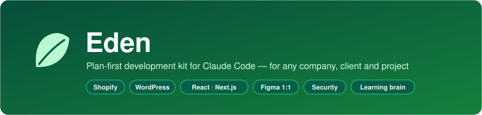
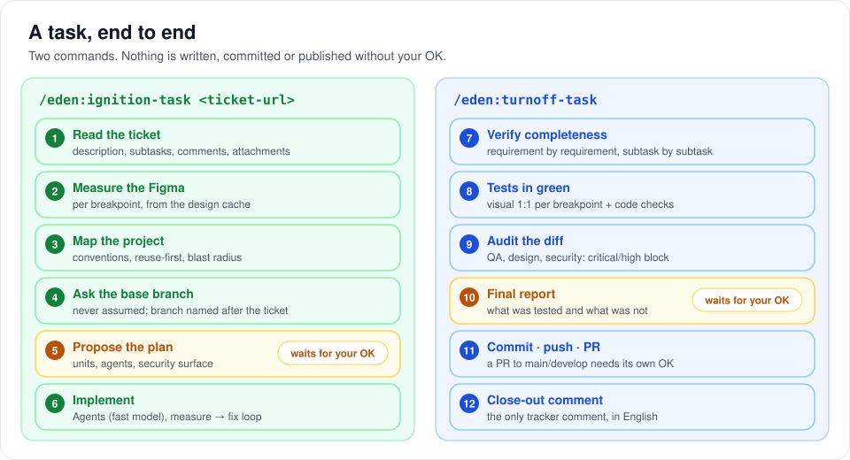
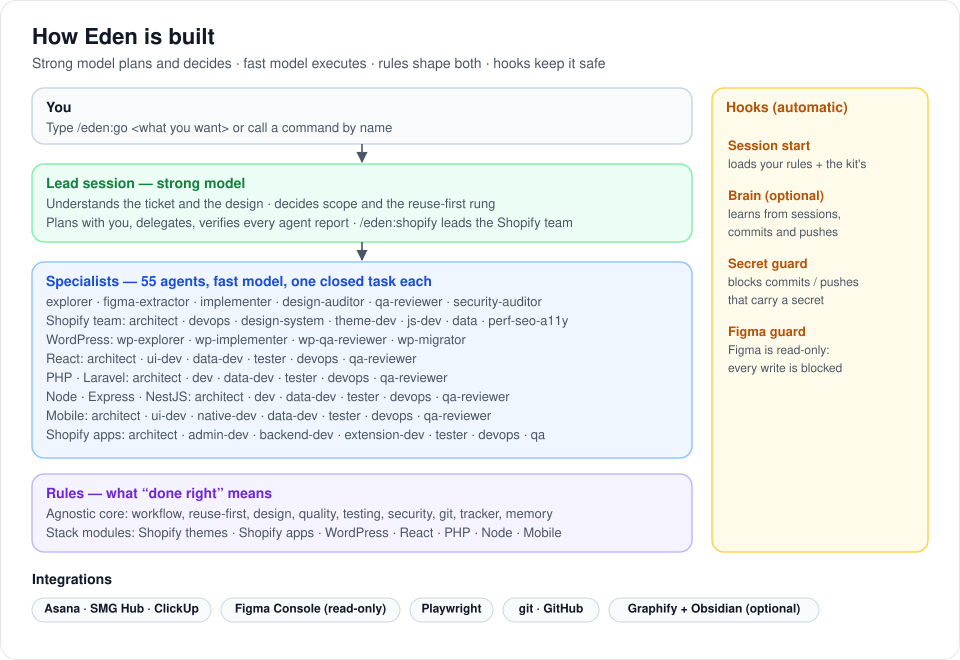
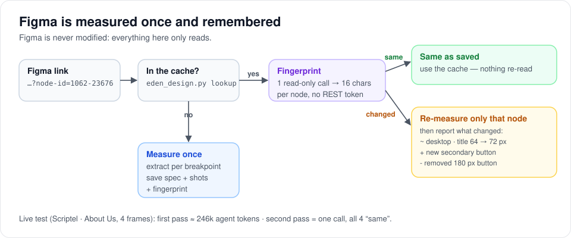
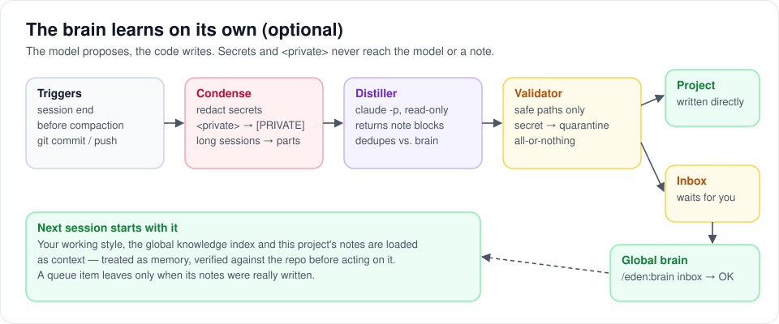

<p align="center">
  
</p>

<p align="center">
  <a href="README.md">🇬🇧 English version</a> ·
  <a href="docs/guide.es.md">📖 Guía completa</a> ·
  <a href="#inicio-rápido">⚡ Inicio rápido</a>
</p>

<p align="center">
  
  
  
  
  
</p>

**Eden** es un plugin de [Claude Code](https://claude.com/claude-code) que convierte un ticket en un pull
request terminado y revisado. Lee el ticket, **mide** el diseño de Figma, planea contigo y reparte el
trabajo entre agentes especialistas. Después lo prueba 1:1 contra el diseño, lo audita en seguridad y
cierra la tarea en tu tracker. Sirve para **cualquier empresa, cliente y proyecto**.

- 🧭 **Primero el plan.** Nada se escribe, commitea ni publica sin tu sí.
- ♻️ **Primero lo que ya existe.** El menor código que alcance el diseño, sin romper lo que ya está en producción.
- 🎯 **Se mide, no se estima.** Los valores salen de Figma, y Figma se mide una vez y se recuerda.
- 🛡️ **Seguro por defecto.** Unos hooks bloquean los commits con secretos, la lectura de `.env` y de llaves, y cualquier escritura en Figma.
- 🧠 **Aprende cómo trabajas** (opcional) de cada sesión, commit y push.

## Contenido

- [Requisitos](#requisitos)
- [Instalación paso a paso](#instalación-paso-a-paso)
- [Inicio rápido](#inicio-rápido)
- [Cómo funciona una tarea](#cómo-funciona-una-tarea)
- [Cómo está construido](#cómo-está-construido)
- [Los comandos de un vistazo](#los-comandos-de-un-vistazo)
- [Lo más destacado](#lo-más-destacado)
- [Configuración](#configuración)
- [Principios](#principios)
- [Documentación](#documentación)

---

## Requisitos

| Herramienta | ¿Hace falta? | Para qué | Cómo comprobarlo |
|---|---|---|---|
| **Git** | Sí | Ramas, commits y el guard de commits | `git --version` |
| **Python 3.9+**, que responda como **`python`** | Sí | Los hooks y scripts (solo biblioteca estándar, no hay nada que instalar con `pip`) | `python --version` |
| **Una herramienta de IA para programar** | Sí | [Claude Code](https://claude.com/claude-code) es la principal; también funcionan Qwen Code, Codex, OpenCode, Cursor, Gemini/Antigravity, Kimi Code y Grok Build | `claude --version` |
| **Node.js 20+** (LTS) | Recomendado | El MCP de Figma Console (`npx`), los tests visuales con Playwright, los stacks de JavaScript y el Shopify CLI | `node --version` |
| **Figma Desktop** + **MCP de Figma Console** | Para trabajo de diseño | Medir el diseño (solo lectura) | `/eden:setup status` |
| **MCP de Playwright** | Para tests visuales y `w2shopify` | Medir lo que renderiza el navegador (`test-visual`, `attention-detail`, `w2shopify`) | la lista de MCP de tu herramienta |
| **El MCP de tu tracker** (Asana, SMG Hub o ClickUp) | Para trabajar tickets | Leer el ticket, el comentario de cierre, el tiempo | `/eden:setup status` |
| `gitleaks`, `semgrep`, `osv-scanner` | Opcional | Escáneres de seguridad extra; sin ellos Eden dice qué no pudo revisar | `/eden:setup status` |
| **Obsidian** | Opcional | Navegar las notas del cerebro | — |
| **[UI/UX Pro Max](https://github.com/nextlevelbuilder/ui-ux-pro-max-skill)** | Opcional | Dirección visual (estilo, paleta, tipografía, reglas de UX) cuando una tarea no tiene Figma — Eden lo propone y solo lo corre con tu sí | `/eden:setup status` |
| **Las herramientas de tu stack** (Shopify CLI, PHP + Composer, WP-CLI, Xcode / Android SDK…) | Según el proyecto | El comando `*-setup` de cada stack las revisa y solo instala con tu sí | `/eden:shopify-setup`, `/eden:wp-setup`… |

> **macOS / Linux: tiene que existir `python`.** Los hooks llaman a `python`, y muchos sistemas solo
> traen `python3`. Si `python --version` falla: en Debian/Ubuntu instala `python-is-python3`; con
> Homebrew o pyenv, haz que `python` apunte a Python 3. Sin eso los hooks no hacen nada, en silencio y a
> propósito, para no romper nunca una sesión.

## Instalación paso a paso

### 1 · Instala los requisitos

Windows (PowerShell):

```powershell
winget install Git.Git Python.Python.3.12 OpenJS.NodeJS.LTS
```

macOS (Homebrew):

```bash
brew install git python node
```

Ubuntu / Debian:

```bash
sudo apt install git python3 python-is-python3 nodejs npm
```

Abre una terminal **nueva** después y comprueba `git --version`, `python --version` y `node --version`.

### 2 · Instala Claude Code e inicia sesión

Sigue [la instalación de Claude Code](https://docs.claude.com/en/docs/claude-code/setup), corre `claude`
una vez e inicia sesión.

### 3 · Instala Eden

Versión estable:

```bash
claude plugin marketplace add bandann/eden-dev-system
```

```bash
claude plugin install eden@eden-kit --scope user
```

### 4 · Comprueba la instalación

Abre un proyecto en Claude Code y corre:

```
/eden:setup status
```

Muestra la versión del plugin, las reglas, el cerebro opcional, el proveedor de IA, los hooks y los
escáneres que encontró. No cambia nada.

### 5 · Extras opcionales (cada uno muestra qué haría y espera tu sí)

| Comando | Qué agrega |
|---|---|
| `/eden:setup rules` | Las reglas completas del kit siempre activas (copiadas a `~/.claude/rules`) |
| `/eden:setup brain` | El cerebro que aprende (`~/.claude/eden-brain`) |
| `/eden:setup config` | `~/.claude/eden-config.json`: empresa, tracker, aprendizaje |
| `/eden:setup ai` | Detecta tus proveedores de IA y configura el que usa el cerebro |
| `/eden:setup githooks` | El guard de secretos y firma de la IA como hooks de git del repo actual |
| `/eden:setup hosts` | Eden en tus otras herramientas de IA (Codex, Cursor, Gemini, OpenCode, Kimi…) |

### Otras herramientas de IA

| Herramienta | Cómo |
|---|---|
| **Qwen Code** | `git clone https://github.com/bandann/eden-dev-system.git` y luego `qwen extensions install <carpeta>/plugins/eden`. Para actualizar, desinstala e instala de nuevo (`update` no ve los cambios locales) |
| **Codex** | `codex plugin marketplace add https://github.com/bandann/eden-dev-system.git` y luego `codex plugin add eden@eden-kit`. En Codex, confía en los hooks de Eden con `/hooks` (sin eso los guards no corren). Agentes: `/eden:setup hosts install codex` |
| **Grok Build** | Carga el plugin de Claude tal cual |
| **Cursor, Gemini / Antigravity, OpenCode, Kimi Code, cualquier herramienta con `AGENTS.md`** | Desde Claude Code: `/eden:setup hosts`. Sin Claude Code: clona el repo y corre `python -I <carpeta>/plugins/eden/scripts/eden_port.py install <herramienta>` (en seco) y luego lo mismo con `--apply` |

### Actualizar y desinstalar

- **Actualizar:** `/plugin marketplace update eden-kit` en Claude Code y luego `/reload-plugins`. Tras actualizar, `/eden:setup hosts sync` pone al día tus otras
  herramientas (`hosts doctor` dice si falta algo, si algo se modificó o si está viejo).
- **Desinstalar:** `claude plugin uninstall eden@eden-kit`. Tus datos (`~/.claude/eden-brain`,
  `eden-memory`, `eden-config.json`) se conservan. Otras herramientas: `/eden:setup hosts uninstall
  <herramienta> --apply`; hooks de git: `/eden:setup githooks --remove --apply`.

¿Vas a trabajar en el propio kit? Añade la carpeta local (`claude plugin marketplace add ~/Sites/eden-dev-system`):
tus cambios se aplican con `/reload-plugins`.

## Inicio rápido

**Empieza una tarea**

```
/eden:go arregla el mega menú en mobile, ticket https://app.asana.com/0/123/456
```

`/eden:go` es el enrutador. Con `--auto` orquesta la tarea completa (Fable planea, Opus y Sonnet construyen),
sigue adelante con las dudas que no bloquean y te las deja anotadas para que respondas después, y solo se
detiene ante lo bloqueante o irreversible. Entiende lo que pides, elige el comando adecuado, arma sus argumentos y **te
pregunta antes de ejecutarlo**. También puedes llamar a un comando directamente, por ejemplo
`/eden:ignition-task <url-del-ticket>`.

> **Eden nunca se activa solo.** Pegar el link de un ticket o mencionar Figma no arranca ningún flujo:
> los comandos corren solo cuando los escribes o apruebas lo que propone el enrutador.

---

## Cómo funciona una tarea

<p align="center">
  
</p>

| | `/eden:ignition-task <ticket>` | `/eden:turnoff-task` |
|---|---|---|
| **Hace** | Entiende la tarea, mide el diseño, prepara la rama e **implementa** | Verifica, prueba, audita y, con tu sí, **commitea, pushea y abre el PR** |
| **Tracker** | Solo lee; pasa el ticket a *in progress* y arranca el cronómetro | Publica el **único** comentario de la tarea, en inglés |
| **Te espera en** | La rama base y el plan | El reporte final y cualquier PR a `main` o `develop` |

Los trabajos más chicos tienen comandos propios que no hacen el ciclo completo: `create-new-section`,
`section-mod`, `figma-expert`, `attention-detail` y `qa-pixel-perfect`. Ninguno commitea: el trabajo
queda en la rama para `turnoff-task`.

---

## Cómo está construido

<p align="center">
  
</p>

- **El modelo principal planea, el rápido ejecuta.** Tu sesión (Opus en Claude Code, o el modelo más
  capaz de la herramienta que uses) sostiene el requerimiento, el plan y cada decisión. Las lecturas
  grandes, como un escaneo del tema, un árbol de Figma o un diff largo, las hacen agentes del nivel rápido
  (Sonnet en Claude Code) que devuelven conclusiones, así tu contexto queda limpio. Cada reporte de un agente se verifica
  antes de darlo por bueno.
- **Roles, no nombres.** Los skills piden un rol (`explorer`, `implementer`, `reviewer`…) y el roster del
  stack dice qué agente lo cumple. Shopify tiene un equipo completo que lidera `/eden:shopify`, React
  (SPA y Next.js) otro que lidera `/eden:react`, PHP (sin framework y Laravel) un tercero que lidera
  `/eden:php`, el back-end en Node (Express, NestJS) un cuarto que lidera `/eden:node`, las apps móviles
  (React Native, Ionic) un quinto que lidera `/eden:mobile`, las apps de Shopify un sexto que lidera
  `/eden:shopify-app`, y WordPress tiene sus propios especialistas.
- **Núcleo agnóstico y módulos por stack.** Las reglas del núcleo (flujo, reuse-first, diseño, calidad,
  tests, seguridad, git y tracker) valen en todas partes. Shopify y WordPress solo añaden lo que les es
  propio.
- **Tus reglas mandan.** Al iniciar la sesión, Eden detecta tus reglas globales en `~/.claude/rules`. Si
  una choca con el kit, gana la tuya.

---

## Los comandos de un vistazo

Todos los comandos se escriben `/eden:<nombre>`. La descripción completa de cada uno está en la
[guía](docs/guide.es.md).

| Área | Comandos |
|---|---|
| **Arranque** | `go` (el enrutador) · `shopify` (el líder del equipo Shopify) · `setup` (instalación, reglas, cerebro y config) |
| **Ciclo de tarea** | `ignition-task` · `turnoff-task` · `estimate-time` · `time-report` · `mydaily` |
| **Base del proyecto** | `shopify-setup` · `create-fundaments` (design system desde Figma) · `create-sitemap` (páginas ↔ nodos de Figma) |
| **Construir** | `create-new-section` · `section-mod` · `figma-expert` · `download-figma-img` · `uiux-pro` (dirección visual sin Figma, consultando antes) · `w2shopify` (el diseño de un sitio en vivo → tema Shopify) |
| **QA y tests** | `attention-detail` · `qa-pixel-perfect` · `test-visual` · `test-code` · `pastel-sync` |
| **Seguridad y calidad** | `security-check` · `antislop` · `launch-check` |
| **Conocimiento** | `brain` · `memory` · `context` |
| **WordPress** | `wp-setup` · `wp-local` · `wp-import` · `wp-feature` |
| **React · Next.js** | `react` (el líder del equipo) · `react-setup` · `react-component` · `next-route` · `react-data` |
| **PHP · Laravel** | `php` (el líder del equipo) · `php-setup` · `laravel-feature` · `laravel-api` |
| **Node · Express · NestJS** | `node` (el líder del equipo) · `node-setup` · `node-api` · `node-data` |
| **Móvil · React Native · Ionic** | `mobile` (el líder del equipo) · `mobile-setup` · `mobile-screen` · `mobile-native` · `mobile-release` |
| **Apps de Shopify** | `shopify-app` (el líder del equipo) · `shopify-app-setup` · `shopify-app-admin` · `shopify-app-extension` · `shopify-app-webhook` · `shopify-app-deploy` |

---

## Lo más destacado

### 🎯 Figma se mide una vez, y nunca se modifica

<p align="center">
  
</p>

La primera vez que se mide una sección, su Design Spec se guarda en la memoria del proyecto. Las
siguientes veces basta **una llamada de solo lectura** que saca la huella de los nodos:

- **Si nada cambió**, se usa el spec guardado.
- **Si algo cambió**, se vuelve a medir solo ese nodo y recibes la lista exacta de cambios.

En una prueba real, la segunda pasada sobre una página de 4 frames costó una sola llamada en vez de
toda la extracción.

Figma es **de solo lectura**: un hook bloquea toda herramienta de Figma que pueda escribir, y también
cualquier script cuyo código escriba.

### 🛡️ La seguridad es requisito de construcción

Todo plan declara su superficie de ataque. `turnoff-task` audita el diff, y los hallazgos **críticos y
altos bloquean** la entrega. Un hook detiene cualquier `git commit` o `git push` que lleve un secreto o la firma de una IA — en Claude Code, Qwen, Codex, Gemini, Cursor, Kimi o Grok —, y `/eden:setup githooks` añade el mismo guard como hooks de git, así protege cada commit con cualquier herramienta de IA, o sin ella.
Si están instalados, se usan `gitleaks`, `semgrep` y `osv-scanner`, y el reporte dice qué no se pudo
verificar.

### 🧠 Un cerebro que aprende cómo trabajas (opcional)

<p align="center">
  
</p>

Con `~/.claude/eden-brain/` activado, cada sesión, commit y push pasa por cuatro pasos:

1. Se condensa, con los secretos y los bloques `<private>` redactados.
2. Un destilador la procesa en segundo plano.
3. Se valida antes de escribir nada.
4. Las notas del proyecto se guardan directo, y lo general espera tu aprobación en una bandeja
   (`/eden:brain inbox`).

La sesión siguiente arranca con todo eso. Sin cerebro, Eden funciona exactamente igual.

**Las sesiones largas siguen frescas.** Un vigilante mide el contexto real: al 60 % guarda la sesión en el
cerebro y refresca el checkpoint de la tarea; al 80 % te avisa cuándo es seguro hacer `/clear`. La sesión
nueva arranca limpia, con el checkpoint y lo aprendido reinyectados.

### 🔌 Cualquier tracker, cualquier stack

Los skills piden **operaciones** (`task.read`, `task.move`, `task.comment`, `time.add`…) y un adaptador
las traduce a **Asana** (por defecto), **SMG Hub** o **ClickUp**. Con los modelos pasa igual: las llamadas
headless del propio Eden (el destilador del cerebro) usan el proveedor de IA que configuren —
`ai.provider` en `eden-config.json`: un CLI (`claude` por defecto, `codex`, `gemini`, `qwen`) o
cualquier API con formato Anthropic u OpenAI (OpenAI, Gemini, Kimi, GLM, MiniMax, DeepSeek, Qwen, Grok,
OpenRouter, Ollama o la suya). `/eden:setup ai` detecta lo que hay en la máquina y lo deja configurado;
`ai set` es el camino manual. **Otras herramientas de IA:** Claude Code, Qwen Code, Grok Build y Codex cargan el
plugin tal cual; `/eden:setup hosts` agrega los agentes de Codex e instala Eden en Cursor, Gemini/Antigravity, OpenCode, Kimi Code
o cualquier herramienta que lea `AGENTS.md`.
Los stacks soportados son **Shopify**
(Horizon y otros), **WordPress** en sus cuatro sabores (block theme, clásico, page builder y headless),
**React** (SPA con Vite, o Next.js), **PHP** (sin framework o Laravel), el back-end en **Node** (sin framework,
Express o NestJS), las apps **móviles** (React Native con Expo o bare, Ionic con Capacitor) y las **apps de
Shopify** (admin embebido, extensiones y Functions) como stack propio, separado de los temas. Un stack sin módulo sigue funcionando con las reglas del
núcleo, y `scripts/eden_stack.py detect` dice qué stack es un repo.

---

## Configuración

Eden funciona **sin configurar nada**. Todo lo de abajo es opcional, y `/eden:setup` siempre muestra
antes qué haría y espera tu sí.

| Comando | Qué hace |
|---|---|
| `/eden:setup rules` | Copia las reglas completas del kit a `~/.claude/rules` para que estén siempre activas |
| `/eden:setup brain` | Crea el cerebro que aprende solo (necesita `claude auth login` en una terminal) |
| `/eden:setup config` | Crea `~/.claude/eden-config.json` con tu empresa y tu tracker por defecto |
| `/eden:setup migrate` | Retira una instalación antigua por copia de archivos (≤ 2.1.0), con respaldo |

**Por proyecto:**

1. Copia `plugins/eden/team/project-config.example.json` a `.claude/project-config.json`.
2. Rellena al menos la URL de Figma, `project.prefix` (el prefijo del código del cliente) y el tracker.
3. Ejecuta `/eden:create-fundaments` y, si es un sitio entero, `/eden:create-sitemap`.

Si te saltas el paso 3, la primera `ignition-task` te lo propone.

**Precedencia** (gana lo de la izquierda): lo que dices en el momento → las convenciones reales del
proyecto → `CLAUDE.md` / `project-config.json` → perfil de operación → `~/.claude/eden-config.json` →
módulo del stack → default del núcleo.

Tus datos viven **fuera del plugin** y sobreviven a una desinstalación: `~/.claude/eden-brain/`,
`~/.claude/eden-memory/`, `~/.claude/eden-config.json` y las reglas que hayas sincronizado. Para
actualizar, `claude plugin update eden@eden-kit`. Para desactivarlo sin desinstalar,
`claude plugin disable eden`.

---

## Principios

- **Se mide, no se estima.** Si falta un dato, se pregunta.
- **La rama base siempre se pregunta.** Ningún PR a `main` o `develop` sin autorización explícita en el momento.
- **El menor código posible.** Lo nuevo es el último escalón, y todo setting nuevo arranca con el comportamiento actual.
- **Reportes honestos.** Lo que falló, lo que se saltó y lo que quedó a medias se dice tal cual.
- **Español para hablarle al dev, inglés para todo lo escrito:** código, commits, PR, docs y tracker.

---

## Documentación

| | |
|---|---|
| 📖 [Guía completa](docs/guide.es.md) · [Full guide](docs/guide.md) | Cada comando, el cerebro, la caché de diseño, la seguridad, los equipos, el tracker, la configuración y la migración |
| 📜 [`plugins/eden/rules/`](plugins/eden/rules) | Las reglas que sigue el kit: núcleo, Shopify y WordPress |
| 👥 [`plugins/eden/teams/`](plugins/eden/teams) | Rosters: qué agente cumple cada rol en cada stack |
| 🧾 [Historial de versiones](docs/guide.es.md#historial-de-versiones) | Qué cambió en cada versión |

La capa anti-slop está adaptada de [anti-slop](https://github.com/miqdadbadjuber/anti-slop) (MIT); los
detalles están en [`THIRD_PARTY_NOTICES.md`](plugins/eden/THIRD_PARTY_NOTICES.md). Eden se publica con la
[licencia MIT](LICENSE).
