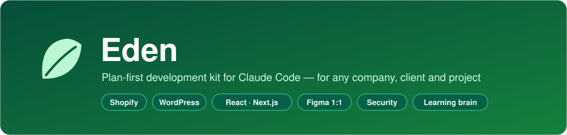
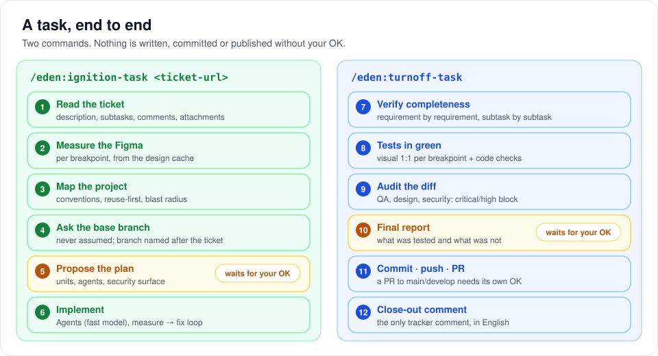
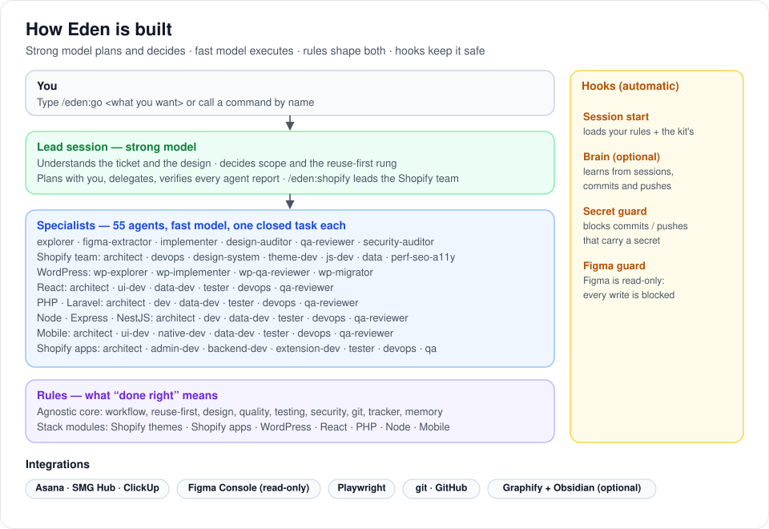
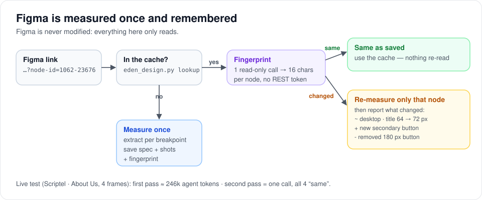
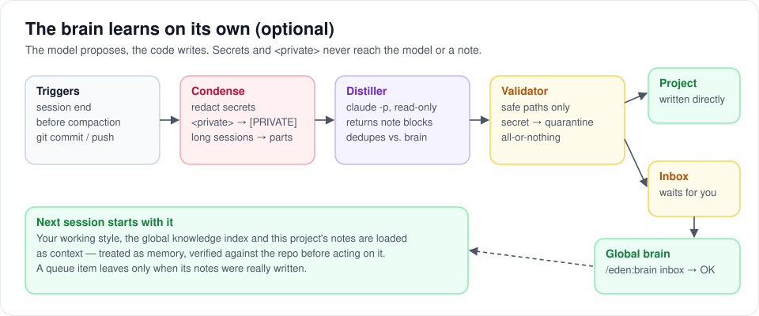

<p align="center">
  
</p>

<p align="center">
  <a href="README.es.md">🇪🇸 Versión en español</a> ·
  <a href="docs/guide.md">📖 Full guide</a> ·
  <a href="#quick-start">⚡ Quick start</a>
</p>

<p align="center">
  
  
  
  
  
</p>

**Eden** is a [Claude Code](https://claude.com/claude-code) plugin that turns a ticket into a finished,
reviewed pull request: it reads the ticket, **measures** the Figma design, plans with you, delegates the
work to specialist agents, tests it 1:1 against the design, audits it for security, and closes the task
in your tracker. It works for **any company, client and project**.

- 🧭 **Plan-first.** Nothing is written, committed or published without your OK.
- ♻️ **Reuse-first.** The least code that reaches the design, without breaking what is already live.
- 🎯 **Measured, not guessed.** Design values come from Figma; Figma is measured once and remembered.
- 🛡️ **Safe by default.** Hooks block commits that carry secrets, reading `.env` and key files, and any write to Figma.
- 🧠 **Learns how you work** (optional), from every session, commit and push.

## Contents

- [Requirements](#requirements)
- [Installation](#installation)
- [Quick start](#quick-start)
- [How a task works](#how-a-task-works)
- [How Eden is built](#how-eden-is-built)
- [Commands at a glance](#commands-at-a-glance)
- [Highlights](#highlights)
- [Configuration](#configuration)
- [Principles](#principles)
- [Documentation](#documentation)

---

## Requirements

| Tool | Needed? | What for | Check it |
|---|---|---|---|
| **Git** | Yes | Branches, commits and the commit guard | `git --version` |
| **Python 3.9+**, callable as **`python`** | Yes | The hooks and scripts (standard library only, nothing to `pip install`) | `python --version` |
| **An AI coding tool** | Yes | [Claude Code](https://claude.com/claude-code) is the main host; Qwen Code, Codex, OpenCode, Cursor, Gemini/Antigravity, Kimi Code and Grok Build also work | `claude --version` |
| **Node.js 20+** (LTS) | Recommended | The Figma Console MCP (`npx`), Playwright visual tests, the JavaScript stacks and the Shopify CLI | `node --version` |
| **Figma Desktop** + **Figma Console MCP** | For design work | Measuring the design (read-only) | `/eden:setup status` |
| **Playwright MCP** | For visual tests and `w2shopify` | Measuring what the browser renders (`test-visual`, `attention-detail`, `w2shopify`) | the tool's MCP list |
| **Your tracker's MCP** (Asana, SMG Hub or ClickUp) | For ticket work | Reading tickets, the closing comment, time | `/eden:setup status` |
| `gitleaks`, `semgrep`, `osv-scanner` | Optional | Extra security scanners; Eden says what it could not check without them | `/eden:setup status` |
| **Obsidian** | Optional | Browsing the brain's notes | — |
| **[UI/UX Pro Max](https://github.com/nextlevelbuilder/ui-ux-pro-max-skill)** | Optional | Design direction (style, palette, type, UX rules) when a task has no Figma — Eden proposes it and runs it only with your yes | `/eden:setup status` |
| **Your stack's tools** (Shopify CLI, PHP + Composer, WP-CLI, Xcode / Android SDK…) | Per project | Each stack's `*-setup` command checks them and installs only with your yes | `/eden:shopify-setup`, `/eden:wp-setup`… |

> **macOS / Linux: `python` must exist.** The hooks call `python`, and many systems only ship `python3`.
> If `python --version` fails: on Debian/Ubuntu install `python-is-python3`; with Homebrew or pyenv, make
> `python` point to Python 3. Without it the hooks do nothing — silently, by design, so they never break
> a session.

## Installation

### 1 · Install the requirements

Windows (PowerShell):

```powershell
winget install Git.Git Python.Python.3.12 OpenJS.NodeJS.LTS
```

macOS (Homebrew):

```bash
brew install git python node
```

Ubuntu / Debian:

```bash
sudo apt install git python3 python-is-python3 nodejs npm
```

Open a **new** terminal afterwards and check `git --version`, `python --version` and `node --version`.

### 2 · Install Claude Code and sign in

Follow [the Claude Code setup](https://docs.claude.com/en/docs/claude-code/setup), then run `claude` once
and sign in.

### 3 · Install Eden

Stable version:

```bash
claude plugin marketplace add bandann/eden-dev-system
```

```bash
claude plugin install eden@eden-kit --scope user
```

### 4 · Check the installation

Open a project in Claude Code and run:

```
/eden:setup status
```

It reports the plugin version, the rules, the optional brain, the AI provider, the hooks and the
scanners it found. It changes nothing.

### 5 · Optional extras (each one shows what it would do and waits for your yes)

| Command | What it adds |
|---|---|
| `/eden:setup rules` | The full kit rules always on (copied to `~/.claude/rules`) |
| `/eden:setup brain` | The self-learning brain (`~/.claude/eden-brain`) |
| `/eden:setup config` | `~/.claude/eden-config.json`: company, tracker, learning |
| `/eden:setup ai` | Detects your AI providers and configures the one the brain uses |
| `/eden:setup githooks` | The secret / AI-signature guard as git hooks of the current repo |
| `/eden:setup hosts` | Eden in your other AI tools (Codex, Cursor, Gemini, OpenCode, Kimi…) |

### Other AI tools

| Tool | How |
|---|---|
| **Qwen Code** | `git clone https://github.com/bandann/eden-dev-system.git`, then `qwen extensions install <folder>/plugins/eden`. To update, uninstall and install again (`update` does not see local changes) |
| **Codex** | `codex plugin marketplace add https://github.com/bandann/eden-dev-system.git`, then `codex plugin add eden@eden-kit`. In Codex, trust Eden's hooks with `/hooks` (without it the guards do not run). Agents: `/eden:setup hosts install codex` |
| **Grok Build** | Loads the Claude plugin as it is |
| **Cursor, Gemini / Antigravity, OpenCode, Kimi Code, any `AGENTS.md` tool** | From Claude Code: `/eden:setup hosts`. Without Claude Code: clone the repo and run `python -I <folder>/plugins/eden/scripts/eden_port.py install <tool>` (dry run), then the same with `--apply` |

### Update and uninstall

- **Update:** `/plugin marketplace update eden-kit` in Claude Code, then `/reload-plugins`. After an update, `/eden:setup hosts sync` updates your other tools
  (`hosts doctor` says if anything is missing, edited or out of date).
- **Uninstall:** `claude plugin uninstall eden@eden-kit`. Your data (`~/.claude/eden-brain`,
  `eden-memory`, `eden-config.json`) is kept. Other tools: `/eden:setup hosts uninstall <tool> --apply`;
  git hooks: `/eden:setup githooks --remove --apply`.

Working on the kit itself? Add the local folder (`claude plugin marketplace add ~/Sites/eden-dev-system`):
your edits apply with `/reload-plugins`.

## Quick start

**Start a task**

```
/eden:go fix the mega menu on mobile, ticket https://app.asana.com/0/123/456
```

`/eden:go` is the router: it reads what you want, picks the right command, fills its arguments and
**asks you before running it**. With `--auto` it orchestrates the whole task (Fable plans, Opus and Sonnet
build), keeps going on non-blocking questions and logs them for you to answer later, and stops only for what is
blocking or irreversible. Or call a command directly, for example `/eden:ignition-task <ticket-url>`.

> **Eden never activates on its own.** Pasting a ticket link or mentioning Figma does not start a flow:
> commands run only when you type them (or approve the router's proposal).

---

## How a task works

<p align="center">
  
</p>

| | `/eden:ignition-task <ticket>` | `/eden:turnoff-task` |
|---|---|---|
| **Does** | Understands the task, measures the design, prepares the branch and **implements** | Verifies, tests, audits and, after your OK, **commits, pushes and opens the PR** |
| **Tracker** | Reads only; moves the ticket to *in progress* and starts the timer | Posts the **only** comment of the task (in English) |
| **Stops for you** | The base branch and the plan | The final report, and any PR to `main`/`develop` |

Smaller jobs have their own commands that skip the full cycle: `create-new-section`, `section-mod`,
`figma-expert`, `attention-detail`, `qa-pixel-perfect`. None of them commits — the work stays on the
branch for `turnoff-task`.

---

## How Eden is built

<p align="center">
  
</p>

- **The strong model plans, the fast one executes.** Your session (Opus in Claude Code, or the most
  capable model of whatever tool you use) holds the requirement, the plan and every decision. Large
  reads — a theme scan, a Figma tree, a long diff — go to agents on the fast tier (Sonnet in Claude Code)
  that return conclusions, so your context stays clean. Every agent report is verified before it counts.
- **Roles, not names.** Skills ask for a role (`explorer`, `implementer`, `reviewer`…); the stack's
  roster says which agent fills it. Shopify has a full team led by `/eden:shopify`, React (SPA and
  Next.js) another led by `/eden:react`, PHP (plain and Laravel) a third led by `/eden:php`, Node
  back-ends (Express, NestJS) a fourth led by `/eden:node`, mobile apps (React Native, Ionic) a fifth
  led by `/eden:mobile`, Shopify apps a sixth led by `/eden:shopify-app`, and WordPress has its own
  specialists.
- **Agnostic core + stack modules.** The core rules (workflow, reuse-first, design, quality, testing,
  security, git, tracker) apply everywhere; Shopify and WordPress add only what is specific to them.
- **Your rules win.** At session start Eden detects your global rules in `~/.claude/rules`; where one
  conflicts with the kit, yours takes priority.

---

## Commands at a glance

All commands are `/eden:<name>`. The full description of each one is in the [guide](docs/guide.md).

| Area | Commands |
|---|---|
| **Start** | `go` — the router · `shopify` — Shopify team lead · `setup` — install status, rules, brain, config |
| **Task cycle** | `ignition-task` · `turnoff-task` · `estimate-time` · `time-report` · `mydaily` |
| **Project base** | `shopify-setup` · `create-fundaments` (design system from Figma) · `create-sitemap` (pages ↔ Figma nodes) |
| **Build** | `create-new-section` · `section-mod` · `figma-expert` · `download-figma-img` · `uiux-pro` (design direction without Figma, asked first) · `w2shopify` (a live site's design → Shopify theme) |
| **QA & tests** | `attention-detail` · `qa-pixel-perfect` · `test-visual` · `test-code` · `pastel-sync` |
| **Security & quality** | `security-check` · `antislop` · `launch-check` |
| **Knowledge** | `brain` · `memory` · `context` |
| **WordPress** | `wp-setup` · `wp-local` · `wp-import` · `wp-feature` |
| **React · Next.js** | `react` — team lead · `react-setup` · `react-component` · `next-route` · `react-data` |
| **PHP · Laravel** | `php` — team lead · `php-setup` · `laravel-feature` · `laravel-api` |
| **Node · Express · NestJS** | `node` — team lead · `node-setup` · `node-api` · `node-data` |
| **Mobile · React Native · Ionic** | `mobile` — team lead · `mobile-setup` · `mobile-screen` · `mobile-native` · `mobile-release` |
| **Shopify apps** | `shopify-app` — team lead · `shopify-app-setup` · `shopify-app-admin` · `shopify-app-extension` · `shopify-app-webhook` · `shopify-app-deploy` |

---

## Highlights

### 🎯 Figma is measured once — and never modified

<p align="center">
  
</p>

The first extraction of a section is saved as a Design Spec in the project's memory. Next time, **one
read-only call** fingerprints the nodes: if nothing changed the saved spec is used; if something did,
only that node is measured again and you get the exact list of changes. In a live test, a second pass
over a 4-frame page cost a single call instead of a full extraction.

Figma is **read-only**: a hook blocks every Figma tool that could write, and any script whose code would.

### 🛡️ Security is a build requirement

Every plan declares its attack surface; `turnoff-task` audits the diff and **critical and high findings
block** the delivery. A hook stops any `git commit` or `git push` that carries a secret or an AI signature — on Claude Code, Qwen, Codex, Gemini, Cursor, Kimi or Grok — and `/eden:setup githooks` adds the same guard as git hooks, so it protects every commit with any AI tool, or none. `gitleaks`,
`semgrep` and `osv-scanner` are used when installed, and the report says what could not be checked.

### 🧠 A brain that learns how you work (optional)

<p align="center">
  
</p>

With `~/.claude/eden-brain/` enabled, every session, commit and push is condensed (secrets and
`<private>` blocks redacted), distilled in the background and validated before anything is written.
Project notes are saved directly; anything general waits in an inbox for your approval
(`/eden:brain inbox`). The next session starts with it. Without the brain, Eden works exactly the same.

**Long sessions stay fresh.** A context watcher measures the real context window: at 60 % it saves the
session into the brain and refreshes the task checkpoint; at 80 % it tells you when it is safe to `/clear`.
The new session starts clean, with the checkpoint and what was learned injected back.

### 🔌 Any tracker, any stack

Skills ask for **operations** (`task.read`, `task.move`, `task.comment`, `time.add`…) and an adapter maps
them to **Asana** (default), **SMG Hub** or **ClickUp**. The same goes for models: Eden's own headless
calls (the brain distiller) run whichever AI provider you configure — `ai.provider` in `eden-config.json`:
a CLI (`claude` by default, `codex`, `gemini`, `qwen`) or any Anthropic- or OpenAI-format API
(OpenAI, Gemini, Kimi, GLM, MiniMax, DeepSeek, Qwen, Grok, OpenRouter, Ollama or your own).
`/eden:setup ai` detects what your machine has and sets it up for you; `ai set` is the manual route. **Other AI tools:** Claude Code, Qwen Code, Grok Build and Codex load the
plugin as it is; `/eden:setup hosts` adds Codex's agents and installs Eden in Cursor, Gemini/Antigravity, OpenCode, Kimi Code or any
tool that reads `AGENTS.md`. Stacks: **Shopify** (Horizon and others),
**WordPress** in its four flavours (block theme, classic, page builder, headless), **React** (SPA with
Vite, or Next.js), **PHP** (plain PHP or Laravel), **Node** back-ends (plain, Express, NestJS) and **mobile**
apps (React Native with Expo or bare, Ionic with Capacitor), plus **Shopify apps** (embedded admin,
extensions and Functions) as their own stack, separate from themes. A stack without a module still works with the core rules, and `scripts/eden_stack.py
detect` tells which stack a repo is.

---

## Configuration

Eden works with **no configuration**. Everything below is optional, and `/eden:setup` always shows what
it would do and waits for your yes.

| Command | What it does |
|---|---|
| `/eden:setup rules` | Copies the full kit rules to `~/.claude/rules` so they are always active |
| `/eden:setup brain` | Creates the self-learning brain (needs `claude auth login` in a terminal) |
| `/eden:setup config` | Creates `~/.claude/eden-config.json`: your company and default tracker |
| `/eden:setup migrate` | Removes an old file-copy install (≤ 2.1.0), with a backup |

**Per project** — copy `plugins/eden/team/project-config.example.json` to `.claude/project-config.json`
and set at least the Figma URL, `project.prefix` (the client's code prefix) and the tracker. Then run
`/eden:create-fundaments` and, for a whole site, `/eden:create-sitemap`. If you skip them, the first
`ignition-task` offers them.

**Precedence:** what you say in the moment → the project's real conventions → `CLAUDE.md` /
`project-config.json` → operation profile → `~/.claude/eden-config.json` → stack module → core default.

Your data lives **outside the plugin** and survives an uninstall: `~/.claude/eden-brain/`,
`~/.claude/eden-memory/`, `~/.claude/eden-config.json` and any rules you synced. Update with
`claude plugin update eden@eden-kit`; turn it off with `claude plugin disable eden`.

---

## Principles

- **Measure, don't estimate.** If a value is missing, ask.
- **The base branch is always asked.** No PR to `main` or `develop` without explicit approval at the time.
- **The least code possible.** New code is the last rung; every new setting defaults to current behaviour.
- **Honest reports.** What failed, what was skipped and what is partial is said plainly.
- **Spanish to talk to the dev, English for everything written** — code, commits, PRs, docs, tracker.

---

## Documentation

| | |
|---|---|
| 📖 [Full guide](docs/guide.md) · [Guía completa](docs/guide.es.md) | Every command, the brain, the design cache, security, teams, tracker, configuration and migration |
| 📜 [`plugins/eden/rules/`](plugins/eden/rules) | The rules the kit follows — core, Shopify and WordPress |
| 👥 [`plugins/eden/teams/`](plugins/eden/teams) | Rosters: which agent fills each role per stack |
| 🧾 [Version history](docs/guide.md#version-history) | What changed in each release |

The anti-slop layer is adapted from [anti-slop](https://github.com/miqdadbadjuber/anti-slop) (MIT) — see
[`THIRD_PARTY_NOTICES.md`](plugins/eden/THIRD_PARTY_NOTICES.md). Eden itself is released under the [MIT License](LICENSE).
