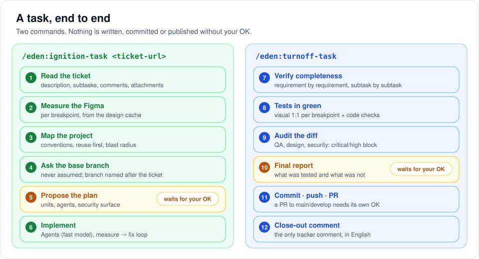
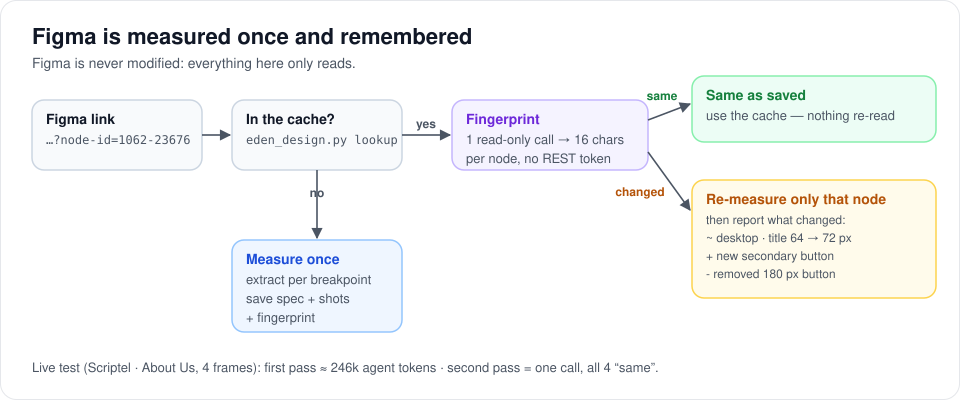
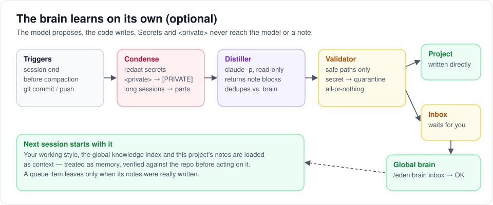

# Guía de Eden

> 🇬🇧 [English version](guide.md) · ⬅️ [Volver al README](../README.es.md)

La referencia completa: qué hace cada comando, cómo funciona cada pieza y cómo se configura. Para empezar rápido, el [README](../README.es.md).

## Índice

1. [El ciclo de una tarea y los comandos de diseño](#el-ciclo-de-una-tarea-y-los-comandos-de-diseño)
2. [Caché de diseño y Figma de solo lectura](#caché-de-diseño-y-figma-de-solo-lectura)
3. [QA y tests](#qa-y-tests)
4. [Seguridad y anti-slop](#seguridad-y-anti-slop)
5. [WordPress](#wordpress)
6. [Cerebro, memoria y contexto](#cerebro-memoria-y-contexto)
7. [Operación diaria: QA visual, reportes y tiempo](#operación-diaria-qa-visual-reportes-y-tiempo)
8. [Equipos, modelos, perfiles y tracker](#equipos-modelos-perfiles-y-tracker)
9. [Configuración y migración](#configuración-y-migración)
10. [React · Next.js](#react--nextjs)
11. [PHP · Laravel](#php--laravel)
12. [Node · Express · NestJS](#node--express--nestjs)
13. [Móvil · React Native · Ionic](#móvil--react-native--ionic)
14. [Apps de Shopify](#apps-de-shopify)
15. [Historial de versiones](#historial-de-versiones)

---

## El ciclo de una tarea y los comandos de diseño



> **Reparto:** `ignition-task` entiende, prepara la base e **implementa**. `turnoff-task` verifica,
> **commitea, pushea, abre el PR** y publica el **único** comentario de la tarea en el tracker.

### 🚀 `ignition-task`

1. **Lee la tarea completa** del tracker por MCP: descripción, requerimientos, campos personalizados,
   comentarios, adjuntos y **todas las subtareas**.
2. **Extrae el diseño de Figma** con Figma Console — nodo por nodo, en **mobile y desktop** (y tablet si
   el diseño lo especifica): layout, espaciados, tipografía, tokens, estados. Sale un **Design Spec**
   con números, no impresiones.
3. **Mapea el proyecto** para entender sus convenciones antes de proponer nada.
4. **Valida los artefactos del proyecto**: los fundamentos de diseño (si faltan, `create-fundaments`
   los levanta del Figma antes de planear) y el sitemap (si existe, ubica la tarea en él y cita el
   NODE-SECTION que toca; si falta, propone `create-sitemap`).
5. **Pregunta de dónde sale la rama** — siempre, nunca la asume — y la crea con el nombre correcto y la
   URL del ticket guardada.
6. **Orquesta**: clasifica el trabajo en unidades (S/M/L/XL) y decide qué se hace directo y qué se
   delega a subagentes.
7. **Propone el plan** y espera aprobación. Sin aprobación no se escribe código.
8. **Pone la tarea en marcha**: la mueve a "in progress" y arranca el registro de tiempo. **No publica
   comentarios.**
9. **Implementa** las unidades aprobadas, en paralelo cuando no se cruzan, con el loop
   implementar → auditar diseño → corregir. El trabajo queda en la rama **sin commitear**.

### 🔌 `turnoff-task`

1. **Verifica completitud** requerimiento por requerimiento y subtarea por subtarea.
2. **Audita todo el diff de la rama**: funcional, regresiones, bleed, reglas del equipo, limpieza,
   validación del stack, consola.
3. **Verifica el diseño 1:1 contra Figma** en cada breakpoint.
4. **Registra el QA** — qué se probó y qué no, explícitamente.
5. **Presenta el reporte y espera confirmación.** Nada se sube antes.
6. **Commitea, pushea y abre el PR.** Un PR contra `main` o `develop` pide **autorización aparte**.
7. **Cierra en el tracker**: el **único** comentario de la tarea, en inglés, que **describe qué se hizo**
   —con lo que quedó fuera, el PR y el preview a la página exacta del cambio. El detalle técnico va en
   el PR, no en el ticket. El estado y la asignación los decide el dev.

### 🧱 `create-fundaments`

Levanta los **fundamentos de diseño** del proyecto: entra al Figma, extrae el design system que ya
existe ahí (color, tipografía, espaciado, breakpoints, grid, radios, sombras, iconografía, estados) y lo
**integra al proyecto** en cuatro artefactos sincronizados:

| Artefacto | Para quién |
|---|---|
| Tokens en código (donde el proyecto ya los ponga) | El navegador — la verdad de ejecución |
| `docs/design-system.md` | El equipo — la verdad consultable |
| `.claude/project-config.json` | Los skills y `eden:design-auditor` |
| Bloque en `CLAUDE.md` | Claude, cada sesión |

Se ejecuta solo (`/eden:create-fundaments`) o automáticamente desde `ignition-task` cuando el proyecto
todavía no los tiene. Es **aditivo**: instalar los fundamentos no debe cambiar nada visualmente. Los
conflictos con tokens existentes y los huecos del Figma se reportan y los decide el dev — nunca se
pisan valores en silencio ni se inventa lo que el design system no define.

### 🗺️ `create-sitemap`

Determina la **arquitectura de la tienda** cruzando tres fuentes:

| Fuente | Qué aporta |
|---|---|
| **Figma** | Las páginas y sus secciones, cada una anclada a su `node-id` por breakpoint (**NODE-SECTION**), más las specs de anotaciones y comentarios |
| **El tema** | Qué plantillas y secciones existen ya, y en cuántas páginas se usa cada una (blast radius real) |
| **Tracker** | Qué tareas hay sobre cada sección y en qué estado |

El resultado es `docs/sitemap.md`: página por página, cada sección con su nodo de Figma, la sección del
tema que le corresponde, su **estado** (✅ built · 🔧 needs-work · ♻️ reusable · 🆕 to-build ·
👻 orphan · ❓ undefined), la decisión reuse-first y su ticket.

Los dos cabos que nadie suele revisar salen solos: las secciones del tema que **no** están en el diseño
(👻, se reportan, no se borran) y las secciones pedidas que el diseño **no** define (❓, huecos para el
diseñador).

Cuando existe, `ignition-task` ubica cada tarea en él — el plan cita el NODE-SECTION que toca — y
`turnoff-task` actualiza su estado al cerrar.

### 🧩 `create-new-section` · 🔧 `section-mod`

Para cuando **solo hace falta una sección** y no el ciclo completo de una tarea. Son autónomos: piden la
URL del ticket y la del Figma si existen, **más lo que el dev quiera aportar** —comportamiento esperado,
casos borde, restricciones, qué NO tocar—, y con eso planean, construyen y verifican.

| | `create-new-section` | `section-mod` |
|---|---|---|
| **Para** | Una sección que no existe | Una sección que ya existe y hay que cambiar |
| **Primero** | Recorre la escalera reuse-first — que se llame "create" no significa que haya que crear | Inventaría lo que hay y mide el **blast radius**: quién más la usa |
| **El riesgo** | Construir de más | Romper lo que ya funciona |
| **La regla** | Escalón más barato que resuelva | Default neutro: las instancias existentes se ven **igual que antes** |

Ninguno commitea ni pushea: al terminar, el trabajo queda en la rama para `turnoff-task`.

### 🎨 `figma-expert`

Traduce un diseño de Figma a código con el **protocolo pixel-perfect completo**, de punta a punta, y se
valida a sí mismo. Es el comando para cuando el criterio de la tarea **es la fidelidad**.

El ciclo es siempre el mismo y no se salta ningún paso: extraer el nodo con **Figma Console** (medidas,
tipografía, espaciados, colores, sombras, imágenes, estados y el comportamiento por breakpoint) →
congelar un **Design Spec** que se convierte en el contrato → bajar los assets reales → implementar con
los tokens y los patrones del proyecto, recorriendo antes la escalera reuse-first → **medir el render
con Playwright** (bounding boxes y estilos computados, no solo capturas) → clasificar cada diferencia,
buscar su causa raíz y corregir **una propiedad a la vez** → volver a medir.

Las tres reglas que lo separan de "quedó parecido":

- **Nada se estima.** Cada valor tiene su origen: el Figma o el navegador. Lo que no se pudo medir se
  reporta como no medido, nunca se rellena.
- **La tipografía se resuelve primero.** Una fuente mal cargada cambia anchos, saltos de línea y el
  ritmo vertical entero — ajustar espaciados encima de eso es perseguir un síntoma.
- **Cierra de dos formas, no de tres:** 1:1 en todos los breakpoints medidos, o una lista exacta de qué
  no coincide y por qué.

> Se reparte así con los demás: `figma-expert` **implementa y valida** un diseño, `attention-detail`
> **mide** una sección, `qa-pixel-perfect` mide **y corrige** una página entera, y `create-new-section`
> / `section-mod` construyen dentro del ciclo del kit. Tampoco commitea ni pushea.

### 🔎 `attention-detail`

QA de fidelidad **en profundidad** sobre una sección. Mide el render real en el navegador con
**Playwright** y el nodo en **Figma Console**, y compara elemento por elemento y breakpoint por
breakpoint: ancho, alto, tipografía, espaciados, padding, margins, colores, bordes e **imágenes**.

- Mide **lo computado**, no lo que dice el CSS — y espera a que carguen fuentes e imágenes, porque
  medir antes da números falsos.
- Reporta el **delta exacto** y el `archivo:línea` responsable. Diferencias bajo 1px se ignoran; el
  resto se reporta.
- Marca un caso que el ojo no ve: un color correcto **pero hardcodeado** en vez de venir del token.
- **Si a la sección le faltan imágenes del diseño, las exporta del Figma** y las deja en el proyecto. Las
  que no puede colocar solo —porque las sube el merchant desde el admin— las deja descargadas y dice
  exactamente dónde están y qué hacer con ellas.

Se usa en loop: medir → corregir → volver a medir. Nada se da por bueno sin haberlo medido; lo que no se
pudo medir se reporta como no medido.

> Requiere el **MCP de Playwright** conectado. Sin él, el skill se detiene en vez de sustituir la
> medición real por una lectura del código.

### 🖼️ `download-figma-img`

Baja **todos** los assets de un Figma —fotos, ilustraciones, logos e iconos— y los deja utilizables:

- **Nombres que dicen de dónde salieron**: `hero-banner--background@2x.jpg`,
  `value-props--icon-shipping.svg`. El prefijo es el NODE-SECTION, así que el nombre conecta diseño,
  código y asset. Si el nodo se llamaba `Rectangle 7`, propone un nombre y **registra el renombrado**.
- **Formato por tipo**: SVG para todo lo vectorial (escala, pesa poco, se recolorea por CSS), JPG para
  fotos, PNG solo con transparencia real. Densidad `@2x` cuando corresponde — verificando antes el
  ancho del frame, porque un diseño ya hecho a 2x exporta a 1x.
- **Carpeta organizada** (`design-assets/{page}/{section}/` por defecto, con `icons/` aparte) y un
  **`manifest.md`** que enlaza cada archivo con su node-id, tamaño y dónde se usa.
- **Cuenta antes de bajar**, deduplica lo repetido (el mismo icono en cinco secciones se baja una vez) y
  **nunca sobrescribe** sin avisar.

Complementa a `attention-detail`, que exporta imágenes puntuales durante el QA: este baja el lote
completo, antes de construir.

---

## Caché de diseño y Figma de solo lectura

### 🗂️ Caché de diseño — Figma se mide una vez y se recuerda



La primera vez que una tarea mide una sección de Figma, su **Design Spec** (JSON + `.md` legible) y sus
capturas se guardan en la memoria del proyecto. La próxima vez que aparece el mismo enlace:

1. `eden_design.py lookup "{url}"` dice si está guardado (un enlace a un contenedor —una SECTION con los
   frames de mobile y desktop— encuentra todos sus frames).
2. **Una sola llamada de solo lectura** (`figma-fingerprint.js` por `figma_execute`) devuelve una huella
   corta por nodo: recorre todo el subárbol dentro de Figma —tamaños, auto-layout, paddings, tipografía,
   fills, variables— y el árbol nunca llega al contexto. **No necesita token REST.**
3. Según el resultado:
   - **igual** → se usa la caché y no se vuelve a leer nada de Figma;
   - **cambió** → se vuelve a medir **solo ese nodo** y se reporta qué cambió, punto por punto
     (`desktop · título 64 → 72 px`, `nuevo: botón secundario`…). La caché se actualiza sola y el spec
     anterior queda en `.prev.json`.

| Si el proyecto… | La caché vive en |
|---|---|
| tiene cerebro (lo normal) | `~/.claude/eden-brain/projects/{proyecto}/design/` |
| no tiene ningún cerebro | `~/.claude/eden-cache/design/{proyecto}/` |

Nunca se crean archivos en el repo de un cliente sin vault. Se desactiva por proyecto con
`"design_cache": {"enabled": false}`. **Medido en vivo** (Scriptel · About Us, 4 frames): la primera
pasada costó ~246k tokens de agente; la segunda, una llamada que devolvió 4 × `same`.

Contrato completo: `plugins/eden/rules/on-demand/eden-design-cache-rules.md`.

### 🔒 Figma es de solo lectura

Se lee, se mide, se captura y se saca la huella; **nunca** se crea, edita, renombra, mueve ni borra nada
en un archivo de Figma. Lo garantiza un hook (`hooks/eden_figma_guard.py`):

- Solo pasan las herramientas **conocidas como de lectura**; cualquier otra se bloquea, incluidas las
  que traigan versiones futuras del servidor (falla cerrado).
- Todo `figma_execute` se revisa: si el código crea, borra, asigna propiedades (también `+=` o por
  índice `obj[k] = v`), llama métodos por nombre calculado, usa `Object.assign` / `eval` / `new Function`,
  carga fuentes o agrupa, se bloquea.
- Solo un proyecto puede levantarlo, a propósito: `"figma": {"allow_writes": true}` en su
  `project-config.json`.

---

## QA y tests

### 🧪 `test-visual` · `test-code` — nada se entrega sin test

**Test-first.** El criterio de aceptación se escribe antes que el código, y debe **fallar primero**: un
test que pasa antes de implementar no está midiendo nada.

**`test-visual`** deriva del Figma un **baseline versionado** y lo verifica contra el render real con
Playwright, nodo por nodo y breakpoint por breakpoint:

| | Qué asevera |
|---|---|
| 🎨 Color | Texto, fondo, bordes — **y que venga del token**. Un `#1a1a1a` correcto pero hardcodeado **falla**: se rompe cuando cambie el esquema |
| 🔤 Tipografía | Familia, tamaño, peso, line-height, letter-spacing, transform |
| 📐 Espaciado | Padding ×4, margin ×4, gap — midiendo la separación real, porque Figma no colapsa márgenes y el navegador sí |
| 📏 Dimensiones | Ancho, alto, contenedor, aspect-ratio |
| 🎬 Animación | Propiedad, duración, easing — **y que `prefers-reduced-motion` la desactive** |
| 📱 Responsive | Todo lo anterior en cada breakpoint, más el reflujo y cero scroll horizontal |

**`test-code`** escribe los tests de comportamiento primero (estados, eventos, casos borde, y la
limpieza en `disconnectedCallback` — la fuga que no se ve probando a mano), corre linter/type-check/
Theme Check, y verifica con **context7** que las APIs y librerías usadas son **las vigentes**, nunca de
memoria: una API deprecada pasa el linter y falla meses después.

`turnoff-task` tiene una **puerta bloqueante**: en rojo no se cierra. Y lo que no se pudo testear se
declara — nunca se marca como pasado.

> `test-visual` es el semáforo (repetible, rojo/verde); `attention-detail` es el microscopio (informe
> exhaustivo cuando algo no cuadra). No se sustituyen.

### 🎯 `qa-pixel-perfect`

El pase de **página completa** contra su Figma — y el **único comando del kit que corrige**, no solo
mide.

Recorre todas las secciones en todos los breakpoints y compara tipografía (familia, tamaño, **peso y
grosor**, line-height, letter-spacing), espaciados (padding, margin, gap), **dimensiones**,
**alineaciones**, colores de todo tipo y **animaciones**. Más lo que solo se ve a nivel página: el
**orden** de las secciones, el **espaciado entre** ellas, que todas alineen al mismo contenedor, header
y footer, la coherencia de tokens entre secciones, y que **no haya scroll horizontal** en ningún ancho.

**No hay punto medio:** o la página queda 1:1, o hay una lista exacta de qué falta y por qué.

Cada discrepancia se clasifica antes de tocar nada:

| | Qué es | Qué hace |
|---|---|---|
| 🟢 | El valor vive solo en esa sección | **Lo corrige** |
| 🟡 | Tocaría un token, un componente compartido o un default | **Para y pregunta**, con el blast radius medido y las opciones |
| 🔴 | No se puede igualar (fuente no disponible, la plataforma no lo permite) | **Lo declara** — no lo aproxima |

Y después de cada corrección **vuelve a medir**, incluidas las secciones de arriba y abajo y todos los
breakpoints: corregir un padding mueve lo que hay debajo, y corregir en desktop sin verificar 375 es
como se arregla una cosa y se rompen dos.

> Los cuatro no se pisan: `test-visual` es el **semáforo** repetible de una sección,
> `attention-detail` el **microscopio** de una sección, `qa-pixel-perfect` el pase de **página entera
> que corrige**, y `eden:design-auditor` el agente que mide para todos ellos.

---

## Seguridad y anti-slop

### 🛡️ Seguridad

La seguridad es un requisito de construcción, no una pasada final. Contrato completo en
`rules/eden-security-rules.md`.

| Comando | Qué hace |
|---|---|
| `/eden:security-check diff` · `section` · `project` · `secrets` · `deps` | Audita con el rol `security-auditor` (solo lectura) y reporta por severidad con `archivo:línea` |

- **Plan:** todo plan declara su `🛡️ Superficie` (entra · sale · quién · secretos · terceros).
- **Qué bloquea:** en `turnoff-task` y `launch-check`, los hallazgos **Críticos y Altos** bloquean el
  commit, el push, el PR y el lanzamiento. Los Medios y Bajos se reportan y quedan en el PR. Solo el dev
  puede aceptar una excepción, de forma explícita, y se escribe en la sección *Security exceptions* del PR.
- **Hook de commit:** `eden-commit-guard` (`eden_guard.py`) revisa lo que va a entrar en cada `git commit` de Claude (y los
  commits que van a salir en un `git push`) y lo bloquea si contiene un secreto o la firma de la IA
  (`Co-Authored-By: Claude …`, "Generated with Claude Code"). El autor es el dev; un co-autor humano sí pasa.
  La firma también se apaga en origen con `attribution` en `~/.claude/settings.json`.
- **Escáneres:** `gitleaks` (secretos), `semgrep` (análisis estático) y `osv-scanner` (dependencias). Se
  usan si están instalados; **el kit funciona sin ellos** (el revisor lee el código y el reporte declara
  qué no se pudo verificar).

### 🧹 Anti-slop

Que nada parezca hecho por una IA en piloto automático. Adaptación al flujo Eden de
[anti-slop](https://github.com/miqdadbadjuber/anti-slop) (MIT, © Miqdad Badjuber); el reglamento original
queda en `skills/antislop/references/upstream/` como material de consulta. Contrato en
`rules/on-demand/eden-antislop-rules.md`, que es **bajo demanda**: no se carga en cada sesión.

| Capa | Cuándo aplica | Qué hace |
|---|---|---|
| **Funcional** | Siempre que la tarea toque UI o textos al usuario | Nada inventado (cifras, testimonios), nada muerto (enlaces, botones), estados vacío/carga/error, teclado, contraste medido, móvil usable. **Lo duro bloquea `turnoff-task`** |
| **Estética y voz** | Solo sin diseño definido y con tu sí | Evita los defaults de IA (degradados azul-violeta, *bento grid*, "Get Started", em dash…) y cada decisión lleva su porqué. Solo se reporta |

- **Figma manda.** Si hay diseño, se implementa el diseño: la capa estética nunca se aplica sobre lo que
  el diseño define. Si el Figma choca con la capa funcional, se te reporta; no se resuelve en silencio.
- **Pregunta de fuente de diseño:** sin Figma, captura ni imagen, `ignition-task`, `create-new-section`
  y `section-mod` te preguntan si aplican la capa estética.
- **`antislop.mode`** (`.claude/project-config.json` o `~/.claude/eden-config.json`): `ask` (default),
  `on` u `off`. Son excepciones explícitas tuyas; la capa funcional no se desactiva.
- **Excepciones:** solo tú puedes aceptar un bloqueo, y queda escrito en la sección *Anti-slop exceptions* del PR.

| Comando | Qué hace |
|---|---|
| `/eden:antislop section <nombre>` · `page <ruta>` | Audita una sección o una página (render real) |
| `/eden:antislop copy <archivos>` · `code <archivos>` | Solo los textos al usuario / solo los comentarios de código |
| `/eden:antislop contrast <hex> <hex>` | Ratio WCAG de una pareja con `scripts/contrast_check.py` |

---

## WordPress

### 🟦 WordPress — `wp-setup` · `wp-local` · `wp-import` · `wp-feature`

WordPress **no es una plataforma: son cuatro formas de construir**, con reglas, tokens y "secciones" que
no se parecen entre sí. El kit las soporta todas y **no adivina cuál es**: se decide una vez, por
proyecto, y queda escrita donde el resto del kit la lee.

| Sabor | El sistema de tokens es | Una "sección" es |
|---|---|---|
| **Block theme (FSE)** | `theme.json` | Un pattern, un bloque o un template part |
| **Tema clásico** | Custom properties propias | Un template part PHP |
| **Page builder** | Los globales del builder (en la **DB**) | Un widget o una plantilla guardada |
| **Headless** | Los tokens del front | Un componente del framework |

- **`wp-setup`** es el **primer comando de todo proyecto WordPress**. Inventaría lo que hay, pregunta el
  sabor y el entorno local **con una recomendación razonada sobre este sitio** (no en abstracto),
  levanta lo que falte —child theme, mu-plugin, PHPCS, `.gitignore`, config del entorno— y escribe la
  decisión en `project-config.json`, en el `CLAUDE.md` (marcador `eden-wp`) y en `docs/`. Sin sabor
  declarado, los demás comandos preguntan en vez de escribir código.
- **`wp-local`** opera el entorno del día a día en LocalWP, DDEV, wp-env o Docker: levanta, deja el sitio
  en modo desarrollo (debug, Query Monitor, cachés fuera, **correos y pagos apagados**), ejecuta WP-CLI
  y **diagnostica leyendo el log antes de tocar nada**.
- **`wp-import`** mueve sitios en sus cuatro formas: producción→local, contenido demo/WXR, migración
  desde otra plataforma, y el camino de vuelta a staging. Backup antes de escribir, `--dry-run` antes de
  ejecutar, y `search-replace` **solo** con WP-CLI y `--precise --recurse-objects` — cualquier otra vía
  corrompe los datos serializados **sin dar ningún error**.
- **`wp-feature`** construye funcionalidad: CPTs, taxonomías, campos, endpoints REST, WooCommerce. En el
  **mu-plugin del sitio**, no en el tema, y con los nombres propuestos y consensuados antes de escribir
  — un slug no se cambia después sin migrar contenido.

Las secciones van por `create-new-section` / `section-mod`, ruteados al sabor del proyecto.

**Las tres cosas de WordPress que el kit trata como no negociables:**

1. **El blast radius incluye la base de datos.** Parte del sitio no está en el repo: renombrar un
   bloque, un shortcode o una clase que ya está en contenido publicado **rompe páginas que nadie va a
   revisar**. Se mide con `wp db search`, además del `grep`. Es *la* diferencia con Shopify.
2. **La funcionalidad va al mu-plugin, la presentación al child theme.** Si cambia el diseño y se
   cambia el tema, el cliente no puede perder sus datos.
3. **La seguridad es parte de construir**: escapar en la salida, sanitizar en la entrada, **nonce Y
   capability** en toda acción, `permission_callback` real en cada ruta REST. `eden:wp-qa-reviewer` lo
   trata como crítico, no como observación.

Y dos que nunca: no se edita el core, un plugin de terceros ni el tema padre; y **no se instala un
plugin sin preguntarle al dev**.

---

## Cerebro, memoria y contexto

### 🧠 `/eden:brain` — el cerebro del proyecto

La memoria de cuatro capas resolvió **qué recordamos**. El cerebro resuelve lo siguiente: **cómo se
consulta sin leerlo entero**, y cómo se conecta con el código real en vez de quedar como notas sueltas.

Son **tres capas que se responden entre sí**:

| Capa | Qué es | Quién la escribe | ¿Se versiona? |
|---|---|---|---|
| **Grafo de código** | `graphify-out/graph.json` — nodos y relaciones reales del repo | **Graphify, automático** | No — se regenera |
| **Vault semántico** | Obsidian: memoria de 4 capas, decisiones, diseño, episodios, con `[[wikilinks]]` | **Nosotros, a mano** | **Sí** |
| **Memoria de trabajo** | `.claude/checkpoint.md` y `.claude/context/` | El flujo, durante la tarea | No |

La de arriba dice **qué hay**; la del medio, **qué significa y por qué**; la de abajo, **qué estamos
haciendo ahora**. Un cerebro sin la del medio es un linter caro; uno sin la de arriba es un blog.

**Ámbitos** — espejan la memoria del kit: `~/.claude/eden-brain/` (global, todos los proyectos) y
`~/.claude/eden-brain/projects/{proyecto}/` (cada proyecto, fuera del repo del cliente). Los dos se escriben solos;
al global solo llega lo verificado, porque con 40+ tiendas un caso particular promovido a regla general se propaga a
todas. Nada del cerebro se escribe en el repo de un cliente. Un **cerebro de equipo** (`/eden:brain team`) es un repo
git privado que el equipo comparte: todos los que trabajan en el mismo proyecto leen su carpeta `projects/{owner-repo}/`.

**Aprende solo.** El plugin trae hooks de Claude Code que hacen que el cerebro crezca sin que lo
pidas:

| Cuándo | Qué pasa |
|---|---|
| **Al iniciar una sesión** | Se carga tu forma de trabajar, el índice del conocimiento global y el del proyecto, y cuántas propuestas esperan aprobación |
| **En cada mensaje que envías** | Se añaden, resumidas, las notas relacionadas (hasta 3, solo del proyecto y del conocimiento general, nunca de otro cliente; no en un «ok»; sin repetir en 20 mensajes). `/eden:brain recall search "…"` muestra qué saldría para un mensaje |
| **Antes de cada `git commit` / `git push`** que ejecuta Claude | Se destila lo trabajado hasta ese momento y se actualiza la nota de la rama (qué se hizo, decisiones, pendientes) |
| **Al cerrar la sesión o antes de compactar** | Se destila el resto de la sesión: correcciones, preferencias, decisiones, gotchas, procedimientos |

El destilador corre en segundo plano (`claude -p` con Sonnet en `--safe-mode` por defecto, o el proveedor que dejó `/eden:setup ai`) y nunca bloquea
nada. Lo del proyecto se escribe directo, y también lo general (tu forma de trabajar, hechos de una plataforma)
cuando la sesión lo verificó o tú lo dijiste: sin paso de aprobación. Con `learning.global_writes: "inbox"` en
`~/.claude/eden-config.json`, lo general vuelve a esperar tu sí en `/eden:brain inbox`. Estado y control:
`/eden:brain learn` (`on`, `off`, `now`, `model`). Requiere el CLI `claude` con sesión iniciada
(`claude auth login`). Detalle en `rules/eden-brain-rules.md` § Aprendizaje automático.



**Cómo escribe.** El destilador **solo lee**: devuelve cada nota en un bloque `=== EDEN NOTE ===` y el
script las valida (solo el cerebro del proyecto y `semantic/`, `procedural/` y `me/working-style.md` del global, sin `..` ni rutas absolutas), manda a
cuarentena la que lleve un secreto y escribe el resto. **Una sesión solo sale de la cola cuando sus notas
se escribieron de verdad.** Las sesiones largas se parten en tramos, y una sesión abierta en un worktree
aprende en el repo principal. Si se perdió algo, `eden_brain.py requeue {transcript}` la vuelve a encolar.

**Qué cambia en el día a día:**

- **Blast radius con una fuente más.** `graphify affected "X" --depth 2` encuentra relaciones reales
  —quién llama, quién importa, qué depende— que un grep no ve. **Se suma al grep, nunca lo sustituye**, y
  en WordPress sigue haciendo falta `wp db search`: **las tres, o el blast radius está incompleto**.
- **Preguntar antes de leer.** `graphify query "..." --budget 2000` responde acotado en tokens en vez de
  mandar a un agente a leer medio repo. Es exactamente lo que `eden-context-rules` persigue.
- **`docs/` y la memoria también pueden entrar al grafo**, para consultarlos en la misma pregunta que el
  código — pero eso requiere la pasada semántica (ver el aviso de abajo).

⚠️ **Lo que rinde de verdad, medido — no supuesto** (`graphifyy 0.8.30`, 2026-09-09):

| | `affected` | Por qué |
|---|---|---|
| **WordPress** | **Sí** | `.php` está soportado por el extractor AST |
| **Shopify** | **Limitado** | **`.liquid` NO está soportado**: solo se extraen su `.js`, `.json` y `.css`. Ahí **el grep sigue siendo la fuente principal** |
| **docs/ y memoria (`.md`)** | Solo con LLM | El `update` barato es AST puro; el markdown necesita la pasada semántica (`/graphify`, o `GEMINI_API_KEY`) |

En Shopify —la plataforma principal— **el cerebro aporta sobre todo en la capa de memoria y decisiones,
no tanto en el grafo de código.** Se dice así, porque prometer lo contrario haría que alguien confiara
en un blast radius que no vio lo que decía ver.

**Las dos reglas que lo mantienen vivo:**

1. **Generado y curado no se mezclan.** `brain/code/` y `graphify-out/` se regeneran con un comando y
   **no se editan a mano jamás** — la siguiente construcción se lleva ese trabajo por delante. Van al
   `.gitignore`. Lo curado sí se versiona y se revisa en el PR.
2. **Un grafo desactualizado no parece desactualizado.** Una nota vieja se nota vieja; un grafo viejo
   responde con seguridad sobre código que ya no existe. Por eso `status` compara la fecha del grafo con
   el último commit, y toda consulta declara su antigüedad. **Si grafo y realidad se contradicen, gana
   la realidad.**

> ⚠️ **Graphify trae su propio skill y su `description` se auto-activa** con cualquier pregunta sobre el
> código. El kit se la reescribe a invocación explícita — pero **`graphify install` la revierte** en cada
> reinstalación o upgrade del paquete. `/eden:brain doctor` lo comprueba y la reaplica.

**Requisitos:** `pip install graphifyy` y Obsidian (opcional — el vault son archivos markdown y Claude
los lee igual; la app es para que **tú** veas el grafo).

### 🧠 `/eden:memory` — memoria de cuatro capas

El kit recuerda entre sesiones **y entre proyectos**:

| Capa | Responde a | Vive en |
|---|---|---|
| **Trabajo** | ¿Qué estoy haciendo ahora? | `.claude/checkpoint.md` |
| **Episódica** | ¿Qué pasó y cómo terminó? | `memory/episodic/` |
| **Semántica** | ¿Qué es verdad? | `memory/semantic/` |
| **Procedural** | ¿Cómo se hace esto? | `memory/procedural/` |

En dos ámbitos: **global** (`~/.claude/eden-memory/`, vale para los 40+ clientes) y **local** (del
proyecto). Se consulta **al arrancar** una tarea y se consolida **al cerrarla** — el checkpoint se
destila en las otras tres capas antes de borrarse.

Tres decisiones de diseño que la mantienen útil:

- **Lo local se escribe solo; lo global espera tu aprobación.** Con 40+ tiendas, un caso particular
  promovido a regla general se propaga a todas — es el fallo que hace inservible una memoria automática.
- **No se memoriza lo que ya está en el código, en `docs/` o en git.** Eso se cita; duplicarlo lo
  desincroniza. Se memoriza lo que no es derivable: gotchas, decisiones no obvias y **las correcciones
  del dev**.
- **Es archivos, no una caja negra.** Se lee, se revisa en un PR y se corrige. Un hecho equivocado es
  peor que ninguno.

Y un objetivo explícito: lo procedural que se usa tres veces **deja de ser memoria y se convierte en
skill o regla**. La memoria es la antesala del kit, no un cajón paralelo.

### 📉 `/eden:context` — tareas largas sin comprimir

Una tarea de ocho horas no debería obligarte a compactar el contexto ni a abrir sesión nueva.

**Lo que el kit no puede hacer, dicho claro:** controlar la ventana de contexto. La compactación es del
harness de Claude Code, no del kit. **Lo que sí hace** es que el llenado deje de importar:

| Palanca | Cómo |
|---|---|
| **Que no entre basura** | Toda lectura grande —escaneo, árbol de Figma, diff largo, inventario— **se delega obligatoriamente** a un agente del nivel rápido, que devuelve conclusiones |
| **Punteros, no contenido** | Lo destilado se escribe en `.claude/context/`; en la sesión queda una línea |
| **Descarga por hitos** | Al cerrar cada unidad, tras extraer Figma, tras auditar — automático dentro del flujo |

Nunca se sueltan el requerimiento, el plan, las decisiones ni lo pendiente: eso es lo que da coherencia.
Todo lo demás es recuperable de disco, pieza por pieza, gracias a un `INDEX.md` que dice **cuándo**
recargar cada archivo — y que marca cuándo un artefacto quedó obsoleto porque el código cambió después.

**La regla de oro:** nada se suelta sin haberlo escrito. "Ya no lo necesito" solo vale si quedó en
disco.

---

## Operación diaria: QA visual, reportes y tiempo

### 🎨 `pastel-sync` · 📅 `mydaily` · 🚀 `launch-check`

Los tres se apoyan en el perfil activo del proyecto (`profiles/{nombre}/`) para sus formatos y umbrales.

- **`pastel-sync`** — trabaja los comentarios visuales de QA: los ordena por severidad, los arregla uno
  a uno verificando cada arreglo, y **no deja devolver la tarea mientras quede alguno en Open**. Los
  ambiguos no se adivinan: se redacta la pregunta para el reviewer.
- **`mydaily`** — el reporte diario, cruzando el tracker, git y el checkpoint. Entrega los cuatro bloques
  (*Accomplished Today · Carried Over to Tomorrow · Tomorrow's Priority · Unresolved Blockers*) **en
  español y en inglés**, listos para pegar. Los bloqueantes resueltos van **con el cómo** — es lo que
  convierte el daily en conocimiento del equipo y no en un trámite. "Ayer" es el último día laboral: el
  lunes mira al viernes. Lo publica el dev.
- **`launch-check`** — P9 y P10: pre-deploy, spot-check en producción, analytics verificado **en
  producción**, monitoreo 24–48h y la garantía de 30 días. Sin sign-off escrito del cliente, no sigue.

### ⏱️ `estimate-time`

Estima el tiempo de una tarea del tracker y carga los estimados — **descomponiendo por subtarea, y si es
una página, sección por sección**.

Lo que la hace distinta de estimar a ojo:

- **Se apoya en el tiempo real de tareas parecidas ya cerradas** (las entradas de tiempo del tracker y el tiempo
  en cada estado). Mirar cuánto estuvo algo rebotando entre Review e In Progress es lo que explica las
  desviaciones que nadie ve venir.
- **Descompone cada unidad en seis fases:** análisis · desarrollo · **pruebas del kit** (con el loop de
  corrección hasta verde) · **QA del dev** · cierre · **margen en su propia columna**. Así queda visible
  que el desarrollo es menos de la mitad del trabajo, y que el QA manual es tiempo del proyecto aunque no
  lo ejecute el kit.
- **Declara la confianza por unidad** — ALTA si hay histórico directo, BAJA si nunca hicimos algo así — y
  lo de confianza baja **se entrega como rango, no como número**.
- **Cada número lleva su base:** "4:50 porque CU-86ab tardó 4:15 en algo equivalente". Sin base, la
  confianza es baja por definición.
- **No escribe en el tracker sin tu aprobación**, y si una tarea ya tenía estimado no lo pisa en silencio.

Al cerrar la tarea se compara estimado contra real y la desviación **se guarda en memoria**. Sin ese
paso, el kit estimaría igual de mal dentro de un año.

### ⏱️ `time-report`

Registra en el tracker de tiempo el tiempo trabajado. Lo que lo hace fiable es **de dónde saca la duración** y lo que
hace antes de escribir:

- **Siempre pregunta antes de cargar.** Sin excepción, ni cuando la duración parece obvia. Muestra la
  tarea, la fecha, la duración, **de dónde salió** y cuánto hay ya registrado ese día — y espera el sí.
  El tiempo entra en la facturación del cliente y corrige mal.
- **Reconstruye con evidencia:** el cronómetro activo, la hora de inicio del checkpoint, los commits del
  día y el tiempo en estado del tracker. Los commits **acotan la ventana, no la miden** — entre el
  primero y el último hubo comidas y reuniones, y eso lo sabe el dev, no el kit.
- **Detecta los huecos**: un día con commits y cero horas registradas se reporta. Cada hueco se
  confirma **por separado** — cargar tres días de golpe con un solo "sí" es como se registra mal.
- Si el dev corrige la duración, **gana la suya sin discutir**: él estuvo ahí.

Se reparte con el resto así: `ignition-task` arranca el cronómetro, `turnoff-task` registra al cerrar
una tarea completa, `mydaily` **avisa** de lo que falta por registrar, y `time-report` es el que lo
**carga** — a mitad de tarea, en días olvidados, o repartiendo una jornada entre varios tickets.

---

## Equipos, modelos, perfiles y tracker

### Equipos por stack — un líder y sus especialistas

Cada stack trae su **equipo**. El **líder** es un skill en la sesión principal (`/eden:shopify`) porque
tiene que acordar el plan contigo; los **especialistas** son subagentes con una subtarea cerrada.

Los skills del kit **ya no nombran agentes**: piden un **rol** (`explorer`, `implementer`, `reviewer`,
`quality-auditor`…) y el roster del stack (`teams/{stack}/roster.md`) dice quién lo cumple. Un skill
escrito una vez sirve para Shopify, WordPress o cualquier stack que se agregue; sin roster, se usa el
equipo genérico.

| Stack | Líder | Especialistas |
|---|---|---|
| Shopify | `/eden:shopify` | architect · devops · design-system · theme-dev · js-dev · data · qa-reviewer · perf-seo-a11y |
| WordPress | — (los `wp-*` hacen de líder) | eden:wp-explorer · eden:wp-implementer · eden:wp-qa-reviewer · eden:wp-migrator |
| React, apps web y móviles | pendiente | — |

**Con la tienda, el equipo Shopify nunca hace `shopify theme push`** y no toca el tema publicado sin tu
autorización. `theme pull` y `theme dev` solo si los autorizas. Detalle en `rules/eden-team-rules.md` y
`teams/shopify/roster.md`.

### Modelos — el modelo principal planifica, el rápido ejecuta

El kit corre con dos **niveles de modelo**, y cada uno tiene un trabajo distinto. Se llaman `strong` y
`fast`, no por un proveedor: cada herramienta de IA los cumple con sus propios modelos (en Claude Code,
Opus y Sonnet).

| | **`strong`** — la sesión | **`fast`** — los agentes |
|---|---|---|
| **Es** | El orquestador: habla contigo y sostiene el hilo | Los ejecutores: reciben un encargo cerrado |
| **Hace** | Entender, decidir el alcance, planear, repartir, **verificar** | Escanear, medir, extraer, escribir, auditar |
| **Decide** | Todo lo que sea una decisión | Nada — si hay que decidir, se detiene y reporta |

**Por qué:** un escaneo del tema, un volcado de Figma o un diff largo son miles de tokens de datos
crudos. Si entran en la sesión principal desplazan lo que hay que recordar —el requerimiento, el plan,
lo decidido—. Delegándolos, la sesión recibe **la conclusión, no el volcado**. Y las decisiones de alcance y
riesgo se toman con el panorama completo, no dentro de una tarea aislada.

Los agentes declaran `model: sonnet` (= el nivel `fast`); eso viene en el kit, y para otras herramientas
se traduce a su propio campo (`fast` en Qwen Code, `inherit` en Cursor) o se omite para que el agente
herede el modelo de la sesión — `scripts/eden_ai.py` → `TIERS`, que se cambia en `ai.tiers` de
`eden-config.json`. **Poner la sesión en el nivel `strong` lo haces tú**: `/model opus` en Claude Code (o
`ANTHROPIC_MODEL` si apunta a otro proveedor), `/model` en Qwen Code, Codex o Gemini, el selector de
modelo en Cursor u OpenCode. Si un comando arranca y la sesión está claramente en un modelo pequeño o
rápido, te lo dice en una línea y sigue — no te bloquea.

Detalle en `rules/eden-model-strategy-rules.md`.

### Perfiles de operación

El kit tiene dos capas que no se mezclan:

| Capa | Qué es |
|---|---|
| **Núcleo** | Cómo trabajamos con cualquier cliente. Agnóstico. Cuando no sabe algo, **pregunta**. |
| **Perfil** | Las verdades de una operación concreta: estados reales, ramas, roles, umbrales, reglas de negocio |

Un perfil no cambia cómo piensa el kit: **le da los datos que si no tendría que preguntar**. Se activa
por proyecto con `<!-- eden-profile: acme-retail -->` en su `CLAUDE.md`.

**Precedencia:** el dev en el momento → el proyecto → el perfil → el default del núcleo.

**Y si algo se sale del perfil, no se bloquea**: se aplica el default y se declara en una línea. Si el
perfil contradice la realidad del repo, gana la realidad y se reporta. Un perfil desactualizado no es
una orden.

El kit trae `profiles/_template/`; cada empresa crea el suyo a partir de ahí (es interno, nunca se
publica). Un perfil declara tracker, estados, rama base sugerida, roles, anchos y umbrales de QA,
severidades con plazo, fases, garantía, formato de reportes diarios y, opcionalmente, un archivo de
reglas de negocio (`business_rules`).

### Tracker

El kit no es de un gestor de tareas. Los skills piden **operaciones** (`task.read`, `task.move`,
`task.comment`, `time.add`…) y el **adaptador** del tracker dice qué herramienta las cumple. Hoy hay
tres: **Asana** (el default), **SMG Hub** (también como tracker de tiempo con tickets en Asana) y
**ClickUp**; y `none` para trabajo sin ticket.

- **Tickets y tiempo son dos ejes:** `tracker.provider` y `tracker.time_provider` (vacío = el mismo).
- **Resolución:** el dev en el momento → la referencia (el link del ticket manda) → `project-config.json`
  → el perfil → `~/.claude/eden-config.json` → default `asana`.
- Si el servidor del tracker no está conectado, se te dice; nunca se cambia de tracker en silencio.

La tabla de adaptadores, el vocabulario de operaciones y los estados lógicos viven en
`rules/eden-tracker-rules.md`.

---

## Proveedor de IA (llamadas headless)

Las llamadas que Eden hace **por su cuenta** a un modelo — hoy, el destilador del cerebro en segundo
plano — pasan por `scripts/eden_ai.py`, que habla con **cualquier proveedor**: un CLI que tengas
instalado, o cualquier API con el formato de Anthropic Messages o de OpenAI Chat Completions (que ofrece
casi todo proveedor). Se elige **en automático** o **a mano**:

- **Automático** — `/eden:setup ai` detecta, sin escribir nada, los CLIs de IA en el PATH (y si `claude`
  tiene sesión), las claves de API en el entorno o en el bloque `env` de `~/.claude/settings.json`, si
  Claude Code ya apunta a un proveedor (`ANTHROPIC_BASE_URL` de Kimi, GLM, MiniMax, DeepSeek o Qwen, modelo
  incluido) y si hay un ollama local. Para las APIs con clave le pide la lista de modelos al proveedor y
  elige el más rápido. Los ordena y recomienda uno; `ai auto` lo escribe tras tu sí (`--pick N` para
  otro), y `ai test` hace una llamada real corta para confirmarlo. Nunca muestra una clave.
- **Manual** — `/eden:setup ai set <proveedor> [--model M] [--key-env VAR] [--base-url URL] [--api anthropic|openai]`,
  o edita tú el bloque `ai` de `~/.claude/eden-config.json`:

```json
"ai": {
  "provider": "deepseek",
  "model": "<el modelo rápido de tu proveedor>",
  "providers": {
    "mi-cli": { "cmd": ["mi-cli", "run", "--model", "{model}", "-"], "add_dir_flag": "--add-dir" },
    "mi-api": { "api": "openai", "base_url": "https://llm.example.com/v1", "api_key_env": "MI_API_KEY", "model": "mi-modelo" }
  }
}
```

| Tipo | Integrados | Cómo corre |
|---|---|---|
| **CLI** | `claude` (default), `codex`, `gemini`, `qwen` | Prompt por stdin, respuesta por stdout; `{model}` se sustituye. Solo lectura donde el CLI lo permite (`claude`: `--safe-mode` + `Read,Glob,Grep`; `codex`: `--sandbox read-only`) |
| **API (formato Anthropic)** | `anthropic`, `moonshot` (Kimi), `zai` (GLM), `minimax`, `deepseek`, `dashscope` (Qwen) | `POST {base_url}/v1/messages` |
| **API (formato OpenAI)** | `openai`, `openrouter`, `google` (Gemini), `xai` (Grok), `ollama` (local) | `POST {base_url}/chat/completions` |

Alias: `kimi`→`moonshot`, `glm`→`zai`, `grok`→`xai`, `chatgpt`→`openai`, `qwen-api`→`dashscope`.
Cualquier otro proveedor o un servidor propio (vLLM, LM Studio…) es una entrada en `providers` con
`api`, `base_url`, `api_key_env` y `model`.

- **Modelo:** `ai.model` › `providers[p].model` › el default del preset. `learning.model` (`sonnet`)
  solo aplica al CLI `claude`, así que un proveedor que no es Claude nunca recibe un nombre de modelo
  de Claude. Salvo `anthropic`, los presets de API **no** traen modelo — los proveedores los renombran
  demasiado seguido —, así que pon `ai.model`.
- **Claves:** se leen de la variable de entorno que dice `api_key_env` (p. ej. `DEEPSEEK_API_KEY`),
  **nunca** del archivo de configuración y nunca se registran. En Claude Code puedes definirla en el
  bloque `env` de `~/.claude/settings.json`. Solo se acepta `https`, salvo `http` a localhost.
- **Qué viaja:** una API no tiene herramientas, así que la sesión condensada (ya redactada) y las notas
  del proyecto van **dentro del prompt**, es decir, se envían a ese proveedor. Un CLI las lee él mismo.
- **Errores:** CLI ausente, clave ausente, configuración inválida o clave rechazada (401/403) dejan la
  sesión en la cola y se avisan al arrancar la siguiente sesión; `/eden:brain learn now` sigue
  destilando dentro de la sesión.
- `/eden:setup status` muestra el proveedor configurado, qué CLIs están en el PATH y qué claves de API
  están definidas (nunca su valor).

### Usar estos modelos en la propia sesión

Esa configuración cubre solo las llamadas headless de Eden. Para **trabajar** con Kimi, GLM, MiniMax,
DeepSeek o Qwen dentro de Claude Code, apunta Claude Code al endpoint compatible con Anthropic del
proveedor (`ANTHROPIC_BASE_URL`, `ANTHROPIC_AUTH_TOKEN`, `ANTHROPIC_MODEL`, como documenta cada uno);
Eden corre igual encima. Las demás herramientas (Codex, Gemini/Antigravity, OpenCode, Kimi Code, Cursor,
Grok Build) son las siguientes fases del trabajo multi-herramienta.

### Instalar Eden en otras herramientas de IA

Claude Code, Qwen Code, Grok Build y **Codex** cargan el plugin tal cual (Codex desde el marketplace
`eden-kit`: `codex plugin marketplace add https://github.com/bandann/eden-dev-system.git` y luego
`codex plugin add eden@eden-kit`). Para las demás, `/eden:setup hosts`
detecta qué herramientas tienes y `hosts install <herramienta…>` (o `--detected`) empaqueta Eden para
ellas: primero en seco, `--apply` tras tu sí.

| Capa | Dónde | Qué |
|---|---|---|
| Kit compartido | `~/.eden/kit/` | El plugin adaptado una vez: las rutas apuntan aquí, `/eden:x` pasa a `/eden-x`, `eden:agente` a `eden-agente`. Los hooks y scripts corren desde aquí |
| Skills compartidos | `~/.agents/skills/eden-*/` | La carpeta estándar de Agent Skills que leen Codex, Gemini/Antigravity, Cursor, Kimi Code y OpenCode: se escriben una vez, así ninguna los ve dos veces |
| Codex | `~/.codex/agents/eden-*.toml` | Solo los agentes: los plugins de Codex no pueden traerlos. Los skills y los hooks vienen del plugin nativo; **confía en sus hooks con `/hooks`** o nunca corren |
| Cursor | `~/.cursor/plugins/local/eden/` | Manifiesto, agentes (`readonly`, `model: inherit`), hooks (`beforeShellExecution`, `beforeMCPExecution`…) |
| Gemini / Antigravity | `~/.gemini/extensions/eden/` | Extensión con `EDEN.md` como contexto, agentes, comandos `/eden:x`, hooks (`BeforeTool`…). Antigravity: `agy plugin import gemini` |
| OpenCode | `~/.config/opencode/agents/`, `plugins/eden.js` | Agentes (`mode: subagent`) y un plugin v2 (`export default { id, setup }`): el resumen de reglas por el hook de sesión `context`, los dos guards por `tool.hook("execute.before")` |
| Kimi Code | `~/.eden/hosts/kimi/` | Se genera, no se instala: una carpeta de plugin y un `hooks.toml` para añadir a `~/.kimi-code/config.toml` |
| Cualquier otra (Crush…) | `~/.eden/EDEN.md` | El resumen de reglas y cómo llamar a los skills: enlázalo desde tu `AGENTS.md`; usa `githooks` para el guard |

Los agentes llevan el campo de modelo de cada herramienta según los niveles (`eden_ai.agent_model`). Cada
archivo queda registrado en `~/.eden/installed.json`; `hosts uninstall <herramienta…>` quita exactamente
eso (y el kit compartido cuando ya no lo usa ninguna). Tras actualizar el plugin, vuelve a correr
`install` para regenerar.

**Qué se verificó en la herramienta real** (Windows, noviembre de 2026):

| Herramienta | Versión | Verificado | Pendiente |
|---|---|---|---|
| Codex | 0.167 | Carga el plugin nativo desde el marketplace y lista sus skills; un `codex exec` real como proveedor de IA del cerebro (solo lectura); su CLI se encuentra dentro de la app de escritorio; `codex login status` detecta la sesión | Los hooks dentro de una sesión de Codex: necesitan tu confianza (`/hooks`). Codex recorta los hooks de `SessionEnd` a 3 s |
| OpenCode | 2.2.6 | Carga los 55 agentes y el plugin v2 sin errores; los hooks del plugin, con la forma de contexto v2 de OpenCode, inyectan las reglas, dejan pasar `ls` y las lecturas de Figma, y bloquean un commit con un secreto y una escritura en Figma | Una corrida con el modelo (requiere un agente con herramientas autoaprobadas) |
| Qwen Code | 0.26.5 | Carga el plugin (`qwen extensions`); se actualizó a 3.16 reinstalando desde la carpeta local (`update` no ve los cambios locales) | Los hooks posteriores a 3.13 en una sesión real. Qwen además lee `rules/` como sus propias reglas condicionales y muestra un aviso por cada regla sin `paths:` (inofensivo: Eden carga sus reglas por el hook) |
| Cursor, Gemini/Antigravity, Kimi, Grok, Crush | — | Paquetes generados y revisados por tests; los hooks generados corren desde el kit | No están instalados en la máquina de prueba |


### Los hooks de Eden

Cada hook tiene un nombre corto, que se ve mientras corre (`statusMessage`) y que usan estas guías:

| Nombre | Cuándo | Qué hace |
|---|---|---|
| `eden-load-rules` | Al iniciar la sesión | Inyecta el resumen de reglas del kit y apunta a las reglas completas |
| `eden-brain-recall` | Al iniciar la sesión | Carga lo que el cerebro sabe de ti y de este proyecto |
| `eden-context-resume` | Tras `/clear` o `/compact` | Devuelve el checkpoint y lo recién aprendido |
| `eden-context-watch` | En cada mensaje | Mide el contexto; guarda en `save_at` y avisa en `warn_at` |
| `eden-brain-learn-on-exit` | Al cerrar la sesión | Encola la sesión para que el cerebro la destile |
| `eden-brain-learn-before-compact` | Antes de compactar | Lo mismo, antes de que se comprima el contexto |
| `eden-brain-learn-on-commit` | En un `git commit` / `push` | Registra lo que se está entregando |
| `eden-commit-guard` | En un `git commit` / `push` | Lo bloquea si lleva un secreto o la firma de una IA, y un push cuyo contenido cambió después de que `turnoff-task` lo revisara (también como hooks de git: `/eden:setup githooks`) |
| `eden-secrets-readonly` | En una lectura de archivo o un comando de shell | Bloquea leer `.env`, llaves privadas, `~/.ssh` y archivos de credenciales (las plantillas y las llaves públicas pasan; `security.allow_read` para las excepciones del dev) |
| `eden-figma-readonly` | En cualquier llamada a Figma | Bloquea todo lo que escribiría en Figma |

### Funcionar en otras herramientas de IA (hooks)

Todos los hooks de Eden leen su entrada y escriben su respuesta por `hooks/eden_host.py`, el único lugar
que conoce el contrato de hooks de cada herramienta. Detecta quién llama (`--host`, `$EDEN_HOST` o la
forma del payload) y traduce: nombres de evento (`BeforeTool`, `preToolUse`, `beforeShellExecution`,
`PreCompress`… → los de Claude), nombres del tool de shell (`run_shell_command`, `Shell`, `bash`… →
`Bash`), payloads en camelCase o de Cursor, y la forma de bloquear una llamada (el `hookSpecificOutput`
de Claude, `{"decision": "deny"}`, `{"permission": "deny"}`, o el código de salida 2 para una
herramienta que no conoce). Claude Code, Qwen Code, Codex y Kimi Code reciben exactamente el JSON de
siempre. El cerebro también lee los transcripts de Codex y cualquier JSONL genérico `{role, content}`,
y el guard de Figma reconoce los nombres de herramientas MCP al estilo de cada una. Empaquetar Eden
para cada herramienta llega en una versión posterior.

**El guard como hooks de git.** Una herramienta sin hooks, o cuyos hooks no pueden bloquear, tampoco
puede commitear un secreto ni una firma de la IA: `/eden:setup githooks` instala el mismo guard como
hooks `pre-commit`, `commit-msg` y `pre-push` del repo, así que corre en cada commit y push, lo haga
quien lo haga. Un hook que ya existía se conserva y sigue corriendo primero; con `core.hooksPath`
(husky) te dice qué línea añadir; las actualizaciones del plugin no lo rompen; `githooks --remove`
restaura lo que había. La detección de firmas ahora cubre también Codex, Gemini, Qwen, Kimi, Grok y
otros asistentes, no solo Claude.

---

## Configuración y migración

### Configuración global y por proyecto

| Archivo | Qué fija | Quién lo escribe |
|---|---|---|
| `~/.claude/eden-config.json` | Tu empresa y tu tracker por defecto, para todos tus proyectos | El instalador lo siembra; tú lo ajustas |
| `.claude/project-config.json` | Empresa, `project.prefix` y `namespace`, stack, tracker, Figma, breakpoints | Tú, desde `team/project-config.example.json` |
| Perfil (`profiles/{nombre}/`) | Estados, ramas, roles y umbrales de una operación concreta | El kit, activado por proyecto |

**Precedencia:** el dev en el momento → `project-config.json` → perfil → `eden-config.json` → default del
núcleo.

**`project.prefix`** (corto, en minúsculas, del cliente) es el prefijo del código propio del proyecto:
tokens `--{prefix}-*`, snippet `{prefix}-design-tokens`, funciones PHP `{prefix}_*`, REST `{prefix}/v1`.
El nombre del kit **nunca** entra en el código de un cliente. Vacío = se pregunta antes de escribir
código con prefijo.

### Configurar un proyecto

1. Copia `CLAUDE.base.md` dentro del `CLAUDE.md` del proyecto.
2. Copia `team/project-config.example.json` a `.claude/project-config.json` y pon al menos la URL del
   Figma, el `project.prefix` y, si no es el default, el `tracker`.
3. Copia `docs/_TEMPLATE.md` a la carpeta `docs/` del proyecto.
4. Ejecuta `/eden:create-fundaments` — rellena el resto: tokens, breakpoints exactos, el doc del design
   system y el bloque de diseño del `CLAUDE.md`.
5. Ejecuta `/eden:create-sitemap` si el proyecto es una tienda entera o varias páginas — deja el mapa de
   páginas y secciones con sus NODE-SECTION.

(Si te saltas 4 y 5, la primera `ignition-task` te los propone.)

### Migrar desde una instalación anterior

**Desde Eden ≤ 2.1.0 (instalado por copia de archivos):** instala el plugin y ejecuta
`/eden:setup migrate`. Te enseña la lista exacta, y con tu sí respalda en
`~/.claude/backups/eden-file-install-{fecha}/` y retira las skills y agentes copiados, `~/.claude/eden/`
y los hooks de Eden en `settings.json`. Conserva tus reglas, el cerebro, la memoria y la config. Los
comandos pasan de `/ignition-task` a `/eden:ignition-task`, de `/eden` a `/eden:go`, y de `/eden-brain`,
`/eden-memory`, `/eden-context` y `/eden-shopify` a `/eden:brain`, `/eden:memory`, `/eden:context` y
`/eden:shopify`.

**Desde dev-system-FL (prefijo `fl-`):**

1. Respalda y retira a mano lo instalado con `fl-*` en `~/.claude` (comandos `/fl*`, agentes `fl-*`,
   reglas `fl-*-rules.md`). La versión 2.x de Eden lo hacía con su instalador.
2. **Cerebro y memoria:** mueve `~/.claude/fl-brain` a `eden-brain` y `fl-memory` a `eden-memory`.
3. **Los marcadores viejos siguen funcionando.** `<!-- fl-profile -->`, `<!-- fl-stack -->`,
   `fl-fundaments` y `fl-sitemap` en un proyecto existente se leen como sus equivalentes `eden-*`, y el
   kit te propone migrarlos. Un bloque `clickup` antiguo en `project-config.json` se lee como
   `tracker.provider: clickup`.
4. **Proyectos con código `--fl-*`** (tokens, snippet `fl-design-tokens`, funciones `fl_*`): declara
   `"prefix": "fl"` en su `.claude/project-config.json` y el código existente queda válido sin renombrar
   nada.
5. Reinicia la sesión de Claude Code. Los comandos pasan a ser `/eden:go`, `/eden:shopify`, `/eden:brain`,
   `/eden:memory` y `/eden:context`.

---

## React · Next.js

El equipo React cubre dos sabores: **SPA** (React con Vite y React Router) y **Next.js** (App Router,
Server Components, Server Actions, route handlers). Reglas en `plugins/eden/rules/react/` y su sabor;
equipo en `plugins/eden/teams/react/roster.md`.

| Comando | Qué hace |
|---|---|
| `/eden:react` | El líder: clasifica (nuevo, onboarding o tarea), planea con el equipo, reparte y verifica. Nunca despliega |
| `/eden:react-setup` | Levanta el entorno: scaffold oficial vigente (Vite o `create-next-app`), Node y gestor, TypeScript estricto, ESLint, Vitest + Testing Library, Playwright, `.env.example`; en un proyecto existente, solo lo que falta |
| `/eden:react-component` | Un componente, reuse-first: blast radius, Figma (caché primero), test primero, tokens, accesibilidad y todos sus estados |
| `/eden:next-route` | Una ruta de Next: página, layout, route handler o Server Action, con la frontera server/client, caché según la versión instalada, metadata y seguridad de servidor |
| `/eden:react-data` | La capa de datos: herramienta del proyecto, estado del servidor frente al de la UI, formularios con validación compartida, carga/vacío/error, invalidación |

**El equipo:** `react-architect` (explora y audita, solo lectura) · `react-ui-dev` (componentes y estilos)
· `react-data-dev` (estado, fetching, Server Actions, route handlers) · `react-tester` (tests primero:
Vitest/Jest + Testing Library, Playwright) · `react-devops` (entorno, scripts, config, CI) ·
`react-qa-reviewer` (diff, lint, type-check, tests, build, calidad).

**Lo que nunca hace:** desplegar, agregar o actualizar dependencias sin tu sí, poner secretos en
variables `NEXT_PUBLIC_`/`VITE_`, desactivar lint o tests, ni cambiar la versión mayor de React, Next,
Vite o React Router como parte de otra tarea.

**Next cambia rápido:** las APIs de caché (`'use cache'`, Cache Components), las de petición asíncronas
y `proxy.ts` (antes `middleware.ts`) se comprueban con context7 contra la versión instalada. Las Server
Actions y los route handlers son endpoints públicos: cada uno comprueba quién pide y si puede, valida la
entrada y devuelve un DTO.

**Detección de stack:** `python -I plugins/eden/scripts/eden_stack.py detect [ruta]` dice el stack y el
sabor de un repo con un orden fijo (una app de Shopify también es React; Laravel también es PHP) y marca
como ambiguo un monorepo con dos stacks.

---

## PHP · Laravel

El equipo PHP cubre dos sabores: **PHP sin framework** (librerías sueltas o un micro-framework) y
**Laravel**. WordPress es PHP, pero tiene su propio módulo y su propio equipo. Reglas en
`plugins/eden/rules/php/` y su sabor; equipo en `plugins/eden/teams/php/roster.md`.

| Comando | Qué hace |
|---|---|
| `/eden:php` | El líder: comprueba que PHP y Laravel tengan soporte, clasifica (nuevo, onboarding o tarea), planea con el equipo, reparte y verifica. Nunca despliega ni toca bases reales |
| `/eden:php-setup` | Levanta el entorno: PHP con soporte, Composer, Laravel con el instalador y el starter kit elegidos (o la base PSR-4 sin framework), entorno local (Herd, Sail, Docker), base de tests desechable, Pest o PHPUnit, Pint, PHPStan/Larastan, `composer audit`, `.env.example` |
| `/eden:laravel-feature` | Una funcionalidad de punta a punta: migración reversible con índices, modelo con mass assignment y casts, Form Request, Policy, rutas, controlador o acción, vistas, jobs y eventos, test primero |
| `/eden:laravel-api` | Endpoints con contrato estable: rutas versionadas, Sanctum, Policies, Form Requests, API Resources, paginación, errores consistentes, límite de frecuencia; un cambio de forma en un endpoint existente es un breaking change |

**El equipo:** `php-architect` (explora y audita, solo lectura) · `php-dev` (rutas, controladores,
validación, autorización y vistas) · `php-data-dev` (modelos, migraciones, colas, Resources,
integraciones) · `php-tester` (Pest o PHPUnit, con los casos de seguridad siempre) · `php-devops`
(entorno, Composer, config, Pint, PHPStan, CI) · `php-qa-reviewer` (diff, tests, Pint, PHPStan,
`composer audit`). Si el front es Inertia con React, esa parte la hace el equipo React.

**Lo que nunca hace:** desplegar; migrar, sembrar o borrar datos fuera de la base local o de tests;
ejecutar SQL de escritura en una base real; añadir o actualizar paquetes sin tu sí; dejar secretos en el
código o en `.env.example`; desactivar PHPStan, tests o el CSRF.

**Versiones con soporte:** PHP y Laravel publican una mayor al año y retiran el soporte con fechas
fijas. Un proyecto en una versión sin soporte de seguridad se reporta en el onboarding, y `composer
audit` corre en cada cierre (hay avisos recientes graves, como la RCE de Livewire 3 por debajo de 3.6.4).

---

## Node · Express · NestJS

El equipo Node cubre el **back-end en Node** en tres sabores: **Node sin framework** (servicios,
workers, CLIs), **Express** y **NestJS**. Next.js corre en Node pero es del equipo React, y una app de
Shopify, del stack `shopify-app`. Reglas en `plugins/eden/rules/node/` y su sabor; equipo en
`plugins/eden/teams/node/roster.md`.

| Comando | Qué hace |
|---|---|
| `/eden:node` | El líder: comprueba que Node, el framework y el ORM tengan soporte, clasifica (nuevo, onboarding o tarea), planea con el equipo, reparte y verifica. Nunca despliega ni toca bases reales |
| `/eden:node-setup` | Levanta el entorno: Node LTS, gestor de paquetes, ESM o CommonJS, el scaffold vigente (`nest new`, o la base de Express o sin framework con la app separada del `listen`), TypeScript estricto, ESLint, el ORM, el runner con supertest, una base local y otra de tests en Docker, `.env.example` |
| `/eden:node-api` | Endpoints con contrato estable: validación de toda la entrada (Zod o DTOs con `whitelist`), auth y autorización por recurso, salida con DTOs, errores sin pila, paginación y límite de frecuencia; un cambio de forma en un endpoint existente es un breaking change |
| `/eden:node-data` | La capa de datos: esquema y migración con el ORM del proyecto revisando el SQL generado, índices y restricciones, repositorios sin N+1, transacciones, jobs idempotentes |

**El equipo:** `node-architect` (explora y audita, solo lectura) · `node-dev` (rutas, controladores,
módulos, middleware, guards, validación) · `node-data-dev` (esquema, migraciones, repositorios, colas,
clientes externos) · `node-tester` (integración HTTP con supertest, siempre con los casos de seguridad) ·
`node-devops` (entorno, scripts, config, Docker, CI) · `node-qa-reviewer` (diff, lint, typecheck, tests,
build, `npm audit`).

**Lo que nunca hace:** desplegar; migrar, sembrar o resetear fuera de la base local o de tests; añadir o
actualizar dependencias sin tu sí; dejar secretos en el código, en `.env.example` o en logs; desactivar
lint, tipos o tests.

**Versiones y avisos:** Node 26 es LTS desde el 28-10-2026 y Node 24 está en mantenimiento; Express 5
cambió el enrutado y los errores asíncronos; NestJS 12 es ESM y usa Vitest por defecto en proyectos ESM;
Prisma 7 cambió su configuración. NestJS publicó varios avisos altos de bypass de middleware: la
protección de una ruta va en guards, y la versión se mantiene al día.

---

## Móvil · React Native · Ionic

El equipo móvil cubre dos sabores: **React Native** (con Expo, lo recomendado, o sin framework) e
**Ionic con Capacitor** (una app web en Angular, React o Vue dentro de un WebView). Reglas en
`plugins/eden/rules/mobile/` y su sabor; equipo en `plugins/eden/teams/mobile/roster.md`.

| Comando | Qué hace |
|---|---|
| `/eden:mobile` | El líder: comprueba versiones y requisitos de las tiendas, qué se puede verificar en este entorno (sin macOS no hay iOS local), clasifica, planea con el equipo, reparte y verifica. Nunca publica ni envía OTA a producción |
| `/eden:mobile-setup` | Levanta el entorno: el scaffold vigente (`create-expo-app`, o Ionic + Capacitor con su framework), navegación, theme, TypeScript, tests con Testing Library y e2e, perfiles de build y canales de OTA separados; la app arrancando en el emulador |
| `/eden:mobile-screen` | Una pantalla: blast radius, Figma (caché primero), navegación y deep link, datos con carga/vacío/error/sin conexión, test primero, áreas seguras y accesibilidad |
| `/eden:mobile-native` | Una capacidad del dispositivo (cámara, push, ubicación, biometría…): módulo de Expo o plugin oficial primero, permisos mínimos con su texto, declaraciones de privacidad, el "no" manejado; avisa de que exige un binario nuevo |
| `/eden:mobile-release` | Prepara la versión: binario o OTA, versión y build, requisitos vigentes de Google Play y App Store, notas y los comandos exactos. **Publica el dev** |

**El equipo:** `mobile-architect` (explora y audita, solo lectura) · `mobile-ui-dev` (pantallas,
navegación, estilos) · `mobile-native-dev` (módulos, config plugins, plugins de Capacitor, permisos) ·
`mobile-data-dev` (estado, almacenamiento seguro, offline) · `mobile-tester` (Jest/Vitest + Testing
Library, Maestro, Detox, Playwright) · `mobile-devops` (entorno, builds, CI, preparar releases) ·
`mobile-qa-reviewer` (diff, lint, typecheck, tests, doctor, accesibilidad).

**Lo que nunca hace:** publicar en una tienda; enviar una OTA a producción; lanzar builds en la nube o
firmar sin tu sí; tocar credenciales de firma o cambiar el identificador de una app publicada; agregar
dependencias o plugins nativos sin tu sí; poner secretos en la app (todo lo que va en el bundle se puede
extraer).

**Requisitos de tienda (verificados el 2026-10-22):** Google Play exige Android 16 (API 36) desde el
31-08-2026 y páginas de 16 KB desde el 01-02-2027; App Store exige Xcode 26 y el SDK de iOS 26, y el
manifiesto de privacidad. Capacitor publicó en octubre de 2026 un aviso crítico sobre la navegación del
WebView (GHSA-rvm3-566m-v7fv): una versión afectada se reporta como Crítica.

---

## Apps de Shopify

El equipo de apps de Shopify construye **apps**: el admin embebido, sus extensiones (theme app
extensions, checkout, cuenta del cliente, admin) y sus Shopify Functions. **Los temas son del equipo
Shopify.** Reglas en `plugins/eden/rules/shopify-app/`; equipo en `plugins/eden/teams/shopify-app/roster.md`.
Si tienes el plugin `smg-shopify-app`, su skill `shopify-app-rules` y su agente `webhook-builder` se usan
como referencia adicional.

| Comando | Qué hace |
|---|---|
| `/eden:shopify-app` | El líder: comprueba plantilla, CLI y que la versión de la Admin API tenga soporte, clasifica, planea con el equipo (scopes, si exige liberar versión, cumplimiento), reparte y verifica. Nunca `shopify app deploy` ni toca tiendas reales |
| `/eden:shopify-app-setup` | Levanta el entorno: Shopify CLI, `shopify app init` con la plantilla de React Router, base de sesiones, tienda de desarrollo, `shopify.app.{entorno}.toml` con scopes mínimos y la API vigente; el login de partner lo haces tú |
| `/eden:shopify-app-admin` | Una pantalla del admin: loader y action autenticados, GraphQL validado contra el esquema, Polaris y App Bridge, todos los estados |
| `/eden:shopify-app-extension` | Una extensión o función con la API y los límites vigentes de su superficie, generada con el CLI; avisa de que exige liberar versión |
| `/eden:shopify-app-webhook` | Un webhook: suscripción en el TOML, HMAC sobre el cuerpo crudo, respuesta rápida con cola, idempotencia y los de cumplimiento |
| `/eden:shopify-app-deploy` | Prepara la versión: qué cambia, el orden seguro (servidor tolerante, luego liberar), la checklist de la App Store y los comandos exactos con `--no-release`. **Liberas tú** |

**El equipo:** `shopify-app-architect` (explora y audita, solo lectura) · `shopify-app-admin-dev` (UI
con Polaris y App Bridge) · `shopify-app-backend-dev` (loaders, GraphQL, sesiones, webhooks,
facturación, base de datos) · `shopify-app-extension-dev` (extensiones y Functions) ·
`shopify-app-tester` (rutas, webhooks con HMAC e idempotencia, funciones) · `shopify-app-devops` (CLI,
entornos, CI, preparar versiones) · `shopify-app-qa-reviewer` (diff, validación y requisitos).

**Lo que nunca hace:** `shopify app deploy` o `release` (liberan para **todas** las tiendas con la app);
desplegar el servidor; instalar la app o mutar datos en tiendas reales; añadir scopes sin tu sí; dejar
el secreto de la app o tokens en el repo, la UI o los logs.

**Verificado el 2026-10-22:** Admin API 2026-10; las apps públicas nuevas son solo GraphQL; las apps
públicas deben usar tokens offline con expiración antes del 01-01-2027; Polaris en web components 2.x;
precios gestionados por defecto; Shopify Scripts retirados (sus casos van a Functions).

---

## Historial de versiones

| Versión | Qué trajo |
|---|---|
| **4.1.0** | **Versión estable de la línea 4.1** (beta.1 a beta.9, probadas): el cerebro guarda solo lo general, trae las notas relacionadas en cada mensaje y se puede compartir como cerebro de equipo, y nunca escribe en los repos de clientes; UI/UX Pro Max incluido; `/eden:explain-video` (beats verticales, subtítulos cinéticos, voz en off, preguntado en `turnoff-task`); equipo de animación `/eden:motion` + `/eden:motion-audit` con reglas, patrones y medición en el navegador |
| **4.1.0-beta.9** | Equipo de animación, fase 2 — medir: `/eden:motion-audit` y el agente `motion-perf-auditor`; `scripts/eden_motion.py lint` (análisis estático: `transition: all`, propiedades de layout en transiciones y keyframes, listeners de scroll, listeners no pasivos, leer y escribir layout en el mismo cuadro, animar con `setInterval`, `will-change` permanente o global, sin movimiento reducido, GSAP sin limpieza, autoplay sin pausa, contenido oculto hasta el JS; `--changed` para un diff), `measure` (Chrome/Edge headless con scroll, hover, clic o tecla, en móvil, con CPU ralentizada y movimiento reducido: fps, cuadros lentos, tareas largas, layouts, CLS al animar, input más lento, LCP y las propiedades que de verdad se animan, contra el presupuesto) y `compare` (tabla antes → después); el control de Chrome se comparte con el renderizador de videos (`scripts/lib/cdp.mjs`) |
| **4.1.0-beta.8** | Equipo de animación, fase 1: `/eden:motion` (create · modify · optimize · audit) lidera a `motion-architect` (inventario, auditoría y decisión de técnica, solo lectura) y `motion-dev` (implementa); nuevo `rules/eden-motion-rules.md` (escalera CSS → ligado al scroll / View Transitions → Web Animations → librería con el sí del dev; solo `transform`/`opacity`, sin layout por cuadro, LCP visible, CLS 0, INP, movimiento reducido, WCAG 2.2.2/2.3.1, tokens de movimiento); patrones de menús, heros, sliders, secciones y textos; nuevo rol `motion`; ignition-task, create-new-section, section-mod y `/eden:go` pasan el trabajo de animación al equipo |
| **4.1.0-beta.7** | `turnoff-task` pregunta en el reporte de cierre si se hace un video explicativo (`video.mode: ask` por defecto, `off` para no preguntar nunca); el sí al commit no es un sí al video. Con un sí, el paso 8b corre `/eden:explain-video` después del PR y antes del tracker, con lo que ya tiene el reporte de cierre; la tabla de beats se aprueba igual, el render va en segundo plano, el video nunca va al PR ni al repo y compartirlo se pregunta aparte; si falla, no bloquea la entrega |
| **4.1.0-beta.6** | Voz en off de `/eden:explain-video` (fase 2): `eden_video.py voice` narra cada beat por separado (`scripts/eden_voice.py`: voz del sistema, Kokoro, OpenAI o ElevenLabs; `auto` nunca elige una API de pago), así cada beat dura exactamente lo que se dice y los subtítulos van con la voz; solo se vuelven a narrar las líneas editadas; Kokoro corre en su propio entorno de Python 3.12 (`eden_voice.py setup-kokoro`, con versiones que Windows Smart App Control deja cargar); `render` une la voz al video con un ffmpeg completo, o deja `voice.wav` y un `preview.html` que los reproduce juntos cuando solo está el ffmpeg de Playwright (sin audio) |
| **4.1.0-beta.5** | Nuevo `/eden:explain-video` (fase 1): un video corto vertical (9:16) de motion graphics que explica un ticket terminado. El guion es una lista de beats —una cosa que se dice y una acción visual cada uno— a partir del ticket, el plan, el diff y el QA, se muestra como tabla y el dev lo aprueba antes; subtítulos cinéticos de 4 palabras como máximo; los actores con la misma clave persisten y se transforman entre beats; magnitudes como contadores y barras; capturas reales en marco de navegador o teléfono con cortina antes/después y marcas; diff y caja de prompt escribiéndose; un solo color de acento; renderiza cuadro a cuadro con Chrome/Edge y ffmpeg (`scripts/video/render.mjs`, Node 22+, sin paquetes de npm) con subtítulos SRT/VTT y un fotograma de portada. Sale en `~/.claude/eden-videos/{proyecto}/{nombre}/`, nunca en el repo del cliente; publicarlo se pregunta aparte. La voz en off es la fase 2 y la pregunta en `turnoff-task`, la fase 3 |
| **4.1.0-beta.4** | UI/UX Pro Max viene dentro de Eden: el skill `ui-ux-pro-max` (MIT, Next Level Builder) fijado a upstream 2.15.0 (`e59ff37`) en `vendor/ui-ux-pro-max/`, con su licencia y un manifiesto con checksums; no hay que instalar nada. `uiux.source: "installed"` usa la instalación propia del dev si es más nueva; `eden_uiux.py vendor-update` refresca la copia (quien mantiene Eden). Sigue corriendo solo con el sí del dev |
| **4.1.0-beta.3** | Cerebro de equipo, fase 1: un repo git privado que el equipo comparte junto al cerebro personal de cada uno (`/eden:brain team join|init|link|status|pull|doctor|leave`, `scripts/eden_team.py`); un proyecto está en el equipo si el clon tiene `projects/{owner-repo}/`, así que todos los de ese repo caen en la misma carpeta; al iniciar sesión se listan las notas del equipo y se hace pull en segundo plano (cada 10 min como mucho); el recall también busca en ellas; tu forma de trabajar y tus notas personales nunca van al equipo. Ya no se escribe nada personal en los repos de clientes: el cerebro del proyecto, el grafo exportado y la caché de diseño viven en `~/.claude/eden-brain/projects/{proyecto}/`; un `.claude/brain/` antiguo se avisa y `/eden:brain migrate-vault` lo copia fuera |
| **4.1.0-beta.2** | Recall del cerebro en cada mensaje: un índice SQLite FTS5 desechable de las notas (`.state/recall.db`) se busca con las palabras del mensaje y se añaden hasta 3 notas relacionadas, resumidas, en 3.000 caracteres; solo del proyecto y del conocimiento general, nunca de otro cliente; sin buscar en mensajes triviales; sin repetir una nota en 20 mensajes; sin notas reemplazadas; `/eden:brain recall` (`status`, `search`, `index`, `on`/`off`); unos 10 ms, sin llamar a un modelo |
| **4.1.0-beta.1** | El cerebro guarda solo lo general: tu forma de trabajar va a `me/working-style.md` y los hechos verificados de una plataforma a `semantic/`/`procedural/`, sin aprobar en la bandeja (`learning.global_writes: "inbox"` la recupera); al global solo llega lo verificado (`confidence: alta`); cada sesión busca en el cerebro antes de planear y carga un índice más grande |
| **4.0.0** | **Versión estable de la línea 4.0** (beta.1 a beta.7, probadas): cualquier herramienta, modelo y proveedor de IA; hooks en todas las herramientas; lectura de secretos bloqueada; delegación proporcional; una sola tabla de herramientas; sello de revisión en el push; revisión doble a ciegas opcional; instalaciones seguras (`hosts doctor`/`sync`); revisión de IA antes del commit, opt-in; cerebro identificado por el remoto de git, con temas deduplicados y compartido por Claude Code, Codex y OpenCode; UI/UX Pro Max (consultando antes); `w2shopify`; `/eden:go` como orquestador (Fable planea, Opus y Sonnet construyen) con `--auto`; SMG Hub por el conector de claude.ai, sin plugins SMG |
| **4.0.0-beta.7** | **`/eden:go` orquesta**: tres niveles de modelo — `plan` (Fable en Claude: la sesión de `/eden:go` entiende, encadena los skills, planea, reparte y verifica), `strong` (Opus, unidades complejas) y `fast` (Sonnet, unidades acotadas), con el modelo elegido en cada encargo según la complejidad. **Modo autónomo `/eden:go --auto`** (opt-in por tarea, o `go.auto_default`): recorre la cadena de skills, toma el supuesto más reversible ante las preguntas no bloqueantes y las anota en `.claude/context/questions-{tarea}.md` sin detenerse, y solo para ante las bloqueantes (commit/push/PR, tracker, borrar, dependencias, tienda, seguridad, contradicciones de alcance, derechos de diseño, UI/UX Pro Max); `/eden:go answers` aplica las respuestas y rehace solo lo que dependía de ellas; el cierre siempre se detiene en la confirmación de `turnoff-task` con los supuestos abiertos a la vista |
| **4.0.0-beta.6** | **Un solo cerebro también en OpenCode**: el plugin de OpenCode ahora agrega lo que sabe el cerebro al iniciar la sesión (el mismo `eden_brain.py start` de las demás herramientas) y, cuando la sesión queda en espera, guarda su diálogo como JSONL `{role, content}` —con las llamadas a herramientas— y lo encola con `eden_brain.py learn`, así las sesiones de OpenCode se destilan en el cerebro compartido con el proveedor de `eden-config.json` (por ejemplo, un modelo local de LM Studio) |
| **4.0.0-beta.5** | **`/eden:w2shopify`**: reproduce en un tema Shopify (Horizon) el diseño de una página en vivo hecha con cualquier tecnología. Primero pregunta si el dev tiene derecho a reproducirlo (`clone`) o solo quiere estructura y patrones (`inspiration`); el nuevo agente de solo lectura `eden:web-extractor` mide el render con Playwright en cada breakpoint (`skills/w2shopify/references/extract.js`: secciones, contenedor, tipografía, botones, media, grillas repetidas, paleta, escalas tipográfica y de espaciado, fuentes y su origen, tecnología) y esa medición es el Design Spec de la tarea; luego el mapeo a Horizon (reuse-first), los fundamentos (`create-fundaments` suma la fuente "sitio medido"), la construcción y un loop de paridad visual contra el original, cada fase con su aprobación. Nunca copia el HTML, CSS, JS ni los textos del sitio, nunca descarga assets sin permiso, no migra datos ni publica. Rol nuevo `web-extractor` |
| **4.0.0-beta.4** | **UI/UX Pro Max cuando no hay diseño, siempre consultando antes**: el nuevo `/eden:uiux-pro` y `scripts/eden_uiux.py` usan [UI/UX Pro Max](https://github.com/nextlevelbuilder/ui-ux-pro-max-skill) (MIT) como dependencia externa, sin incluirlo. `ignition-task`, `create-new-section`, `section-mod`, `create-fundaments` y la capa estética de antislop lo *proponen* cuando una tarea con UI no tiene Figma, captura ni documento de dirección, y esperan; solo corre con `--approved` tras el sí del dev, nunca con `--persist`/`--force`/`--output-dir`, y su propuesta se mapea a los tokens del proyecto, con Figma, los fundamentos, WCAG AA, reuse-first y antislop por encima. `uiux.mode: off` apaga la propuesta; no hay modo automático |
| **4.0.0-beta.3** | **Revisión de IA antes del commit, opt-in** (`hooks/eden_ai_review.py`): con `review.precommit.enabled`, el hook pre-commit de git envía el diff en staging y el archivo de instrucciones del proyecto al proveedor de `/eden:setup ai` y bloquea solo hallazgos de severidad ≥ `block_on`; si falla, deja pasar y dice por qué, no repite un árbol que ya pasó y nunca ve un diff que el escaneo de secretos bloqueó. **Cerebro:** la carpeta del proyecto se identifica por su remoto de git (`owner-repo`, leído de `.git/config`, sin credenciales), así los clones comparten lo aprendido y las carpetas con el mismo nombre no se mezclan — un cerebro que ya existía con el nombre de carpeta la conserva; las notas llevan `topic:` y una nota nueva sobre un tema existente actualiza esa nota |
| **4.0.0-beta.2** | **El push lleva lo que se revisó**: `turnoff-task` sella el estado revisado (`hooks/eden_review.py stamp`, un árbol con índice temporal en `.git/eden-review.json`, sin tocar el staging) y el guard —hook de la herramienta y pre-push de git— bloquea un push cuyo árbol cambió después de la revisión, nombrando los archivos; los commits intermedios son libres y un push que coincide consume el sello. **Revisión doble a ciegas opcional** en `turnoff-task` (`--dual`, `review.dual`, o propuesta en superficies de riesgo): dos revisores independientes, hallazgos cruzados, máximo dos rondas. **Instalaciones seguras**: `hosts install` registra el sha256 de cada archivo, solo reemplaza o borra lo de Eden sin tocar, respalda lo ajeno o modificado (y restaura lo que existía al desinstalar); `hosts doctor` y `hosts sync` |
| **4.0.0-beta.1** | **Los secretos tampoco se leen**: el hook nuevo `eden-secrets-readonly` bloquea leer `.env`, llaves privadas, `~/.ssh` y archivos de credenciales en cualquier herramienta (Read, Grep, shell, el `beforeReadFile` de Cursor, el plugin de OpenCode), con ~1 ms sobre el arranque de Python en el caso común. **Delegación proporcional**: se delega solo con un motivo que se pueda nombrar (lectura grande, trabajo en paralelo, verificador independiente, contexto lleno), lo pequeño lo hace la sesión y el plan crece con el trabajo, la aprobación no cambia. **Una sola tabla de herramientas** (`hooks/eden_hosts.py`) alimenta el contrato de hooks, el empaquetador y la capa de proveedores. Ideas de [gentle-ai](https://github.com/Gentleman-Programming/gentle-ai) (MIT), reescritas; no se copió código |
| **3.17.0** | **Hooks más rápidos, resumen completo**: los dos hooks de cada comando de shell bajaron de ~200 ms a ~90 ms (salida rápida sin `git` antes de cargar nada; `eden_ai` y `urllib` solo se cargan al destilar), el de cada mensaje de 130 a 76 ms y el de inicio de 128 a 66 ms; `SessionEnd` con un transcript de 5,5 MB tarda ~0,4 s, dentro del límite de 3 s de Codex. El índice de reglas del inicio es compacto, así que el resumen ya no se trunca (7 KB de 9,5 KB). `/eden:setup hosts` avisa si Codex o Qwen tienen un Eden viejo, y si Codex no ha confiado en los hooks de Eden |
| **3.16.0** | **Verificado en herramientas reales**: OpenCode 2.2.6 rechazaba el plugin v1, así que `eden.js` ahora es un plugin v2 que además inyecta las reglas (sin tocar `opencode.json`); Codex 0.167 carga el plugin de Claude de forma nativa, así que `hosts install codex` solo agrega los agentes (sin fusionar hooks ni duplicar skills); el CLI de Codex que trae la app de escritorio se encuentra fuera del PATH, se detecta su sesión y un modelo vacío ya no pasa un `-m` vacío; tabla de verificación en la guía |
| **3.15.0** | **Eden en otras herramientas de IA**: `/eden:setup hosts` detecta las herramientas de IA de la máquina y `hosts install` empaqueta Eden para Codex, Cursor, Gemini/Antigravity, OpenCode, Kimi Code y cualquier herramienta con `AGENTS.md` — un kit compartido (`~/.eden/kit`), skills compartidos (`~/.agents/skills/eden-*`) y, por herramienta, sus agentes, hooks y manifiesto (`scripts/eden_port.py`); instalación registrada y desinstalación exacta |
| **3.14.0** | **Niveles de modelo, no nombres**: las reglas y los skills del kit hablan del nivel `strong` (la sesión) y `fast` (los agentes) en vez de Opus/Sonnet; `eden_ai.TIERS` los traduce al campo de modelo de los agentes de cada herramienta, y se cambian en `ai.tiers`; "`CLAUDE.md`" ahora quiere decir el archivo de instrucciones del proyecto en la herramienta que sea (`AGENTS.md`, `GEMINI.md`, `QWEN.md`), y el marcador de stack se lee de cualquiera de ellos |
| **3.13.0** | **Hooks en cualquier herramienta de IA**: `hooks/eden_host.py` traduce el payload y la forma de bloquear de cada herramienta (Claude Code, Qwen, Codex, Kimi, Gemini/Antigravity, Cursor, Grok, Crush; código 2 para las desconocidas); el cerebro lee transcripts de Codex y JSONL genéricos; **`/eden:setup githooks`** instala el guard de secretos y firma de la IA como hooks de git, así protege cada commit y push con cualquier IA o sin ella; la detección de firmas cubre otros asistentes |
| **3.12.0** | **Cualquier proveedor de IA** para las llamadas headless de Eden (el destilador del cerebro): `ai.provider` en `eden-config.json` — un CLI (`claude` por defecto y sin cambios, `codex`, `gemini`, `qwen`) o cualquier API con formato Anthropic u OpenAI (`anthropic`, `openai`, `openrouter`, `google`, `moonshot`/Kimi, `zai`/GLM, `minimax`, `deepseek`, `dashscope`/Qwen, `xai`/Grok, `ollama`, o la tuya); claves solo por variable de entorno; a una API sin herramientas le llegan la sesión y las notas dentro del prompt; `/eden:setup ai` detecta los proveedores de la máquina y configura uno en automático (`ai auto`) o a mano (`ai set`), `ai test` lo confirma |
| **3.11.0** | **Sin firma de la IA**: el guard bloquea commits y pushes con `Co-Authored-By: Claude` o "Generated with Claude Code"; regla de git y ajuste `attribution` |
| **3.10.0** | **Vigilante de contexto**: mide el contexto real, guarda la sesión en el cerebro y el checkpoint al 60 %, avisa al 80 % cuándo es seguro hacer `/clear`, y reinyecta el checkpoint y lo aprendido tras `/clear` o `/compact`; `/eden:context save` y `status` |
| **3.9.0** | Stack **apps de Shopify**: reglas, roster, 7 agentes y 6 skills (`shopify-app`, `shopify-app-setup`, `shopify-app-admin`, `shopify-app-extension`, `shopify-app-webhook`, `shopify-app-deploy`) |
| **3.8.0** | Stack **móvil** (React Native con Expo o bare, Ionic con Capacitor): reglas con sabores, roster, 7 agentes y 5 skills (`mobile`, `mobile-setup`, `mobile-screen`, `mobile-native`, `mobile-release`) |
| **3.7.0** | Stack **Node · Express · NestJS** (back-end): reglas con sabores (Node, Express, NestJS), roster, 6 agentes y 4 skills (`node`, `node-setup`, `node-api`, `node-data`) |
| **3.6.0** | Stack **PHP · Laravel**: reglas con sabores (PHP sin framework y Laravel), roster, 6 agentes y 4 skills (`php`, `php-setup`, `laravel-feature`, `laravel-api`) |
| **3.5.0** | Stack **React · Next.js**: reglas con sabores (SPA y Next), roster, 6 agentes y 5 skills (`react`, `react-setup`, `react-component`, `next-route`, `react-data`) |
| **3.4.0** | Base para los stacks nuevos: rol `tester`, orden de detección de stacks y `scripts/eden_stack.py detect`, bloques por stack en `project-config`, pruebas de estructura |
| **3.3.1** | La caché de Figma compara con una **huella por el bridge** (sin token REST). **Figma de solo lectura** con un hook que bloquea toda escritura. Los agentes de Figma ya declaran sus herramientas de Figma Console |
| **3.3.0** | **Caché de diseño de Figma** por proyecto: se mide una vez y solo se vuelve a medir lo que cambió |
| **3.2.1** | El destilador del cerebro devuelve notas y el script las escribe (antes perdía notas); sin ventanas en Windows; sesiones largas por tramos; worktrees al repo principal |
| **3.2.0** | Privacidad del cerebro: redacción de secretos, `<private>`, exclusiones, limpieza; diagnóstico de fallos y destilado dentro de la sesión |
| **3.1.0** | Capa **anti-slop** bajo demanda (adaptada de anti-slop, MIT) |
| **3.0.0** | Eden pasa a ser un **plugin de Claude Code** (`eden@eden-kit`) que detecta tus reglas globales |
| 2.x | Renombrado a Eden, agnóstico de empresa y tracker (Asana, SMG Hub, ClickUp), capa de seguridad, cerebro que aprende solo |
| 1.2.0 | Cerebros de proyecto: Graphify + Obsidian |
| 1.1.0 | Módulo WordPress (cuatro sabores) |
