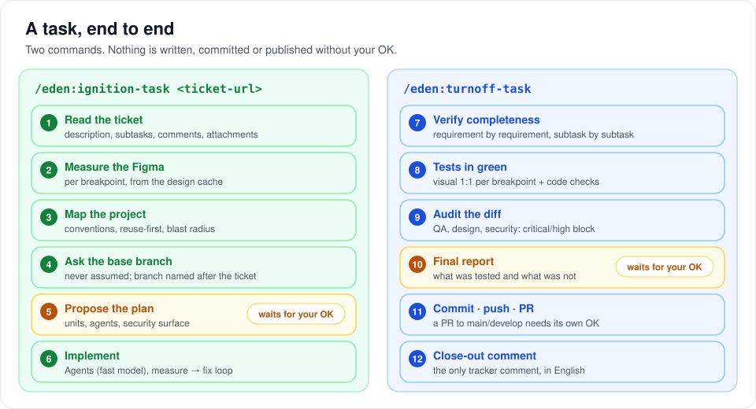
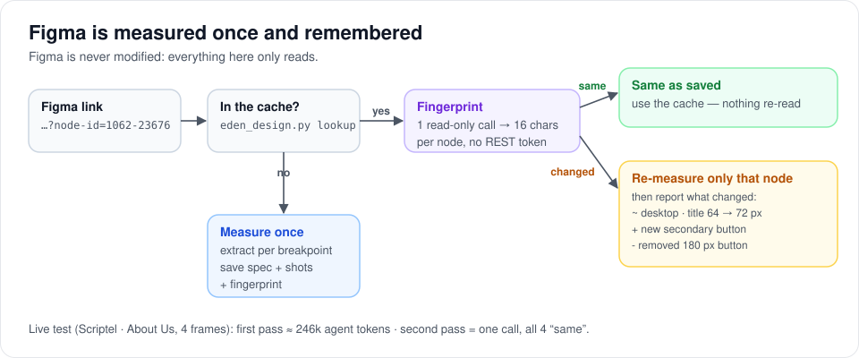
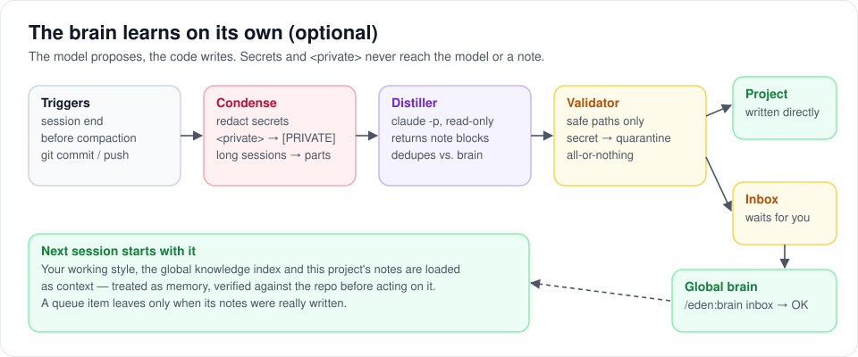

# Eden Guide

> 🇪🇸 [Versión en español](guide.es.md) · ⬅️ [Back to the README](../README.md)

The complete reference: what each command does, how each piece works and how it is configured. To get started quickly, see the [README](../README.md).

## Contents

1. [The task cycle and design commands](#the-task-cycle-and-design-commands)
2. [Design cache and read-only Figma](#design-cache-and-read-only-figma)
3. [QA and tests](#qa-and-tests)
4. [Security and anti-slop](#security-and-anti-slop)
5. [WordPress](#wordpress)
6. [Brain, memory and context](#brain-memory-and-context)
7. [Daily operations: visual QA, reports and time](#daily-operations-visual-qa-reports-and-time)
8. [Teams, models, profiles and tracker](#teams-models-profiles-and-tracker)
9. [Configuration and migration](#configuration-and-migration)
10. [React · Next.js](#react--nextjs)
11. [PHP · Laravel](#php--laravel)
12. [Node · Express · NestJS](#node--express--nestjs)
13. [Mobile · React Native · Ionic](#mobile--react-native--ionic)
14. [Shopify apps](#shopify-apps)
15. [Version history](#version-history)

---

## The task cycle and design commands



> **Division of labor:** `ignition-task` understands the task, prepares the base and **implements**. `turnoff-task` verifies,
> **commits, pushes, opens the PR** and posts the **only** comment on the task in the tracker.

### 🚀 `ignition-task`

1. **Reads the full task** from the tracker via MCP: description, requirements, custom fields,
   comments, attachments and **all subtasks**.
2. **Extracts the design from Figma** with Figma Console — node by node, on **mobile and desktop** (and tablet if
   the design specifies it): layout, spacing, typography, tokens, states. The output is a **Design Spec**
   with numbers, not impressions.
3. **Maps the project** to understand its conventions before proposing anything.
4. **Validates the project artifacts**: the design foundations (if missing, `create-fundaments`
   builds them from Figma before planning) and the sitemap (if it exists, places the task in it and cites the
   NODE-SECTION it touches; if missing, proposes `create-sitemap`).
5. **Asks where the branch comes from** — always, never assumes it — and creates it with the correct name and the
   ticket URL stored.
6. **Orchestrates**: classifies the work into units (S/M/L/XL) and decides what is done directly and what is
   delegated to subagents.
7. **Proposes the plan** and waits for approval. No code is written without approval.
8. **Starts the task**: moves it to "in progress" and starts time tracking. **It does not post
   comments.**
9. **Implements** the approved units, in parallel when they do not overlap, with the
   implement → audit design → fix loop. The work stays on the branch **uncommitted**.

### 🔌 `turnoff-task`

1. **Verifies completeness** requirement by requirement and subtask by subtask.
2. **Audits the entire branch diff**: functionality, regressions, bleed, team rules, cleanliness,
   stack validation, console.
3. **Verifies the design 1:1 against Figma** at each breakpoint.
4. **Records the QA** — what was tested and what was not, explicitly.
5. **Presents the report and waits for confirmation.** Nothing is pushed before that.
6. **Commits, pushes and opens the PR.** A PR against `main` or `develop` requires **separate authorization**.
7. **Closes in the tracker**: the **only** comment on the task, in English, which **describes what was done**
   — including what was left out, the PR and the preview of the exact page of the change. The technical detail goes in
   the PR, not in the ticket. Status and assignment are decided by the dev.

### 🧱 `create-fundaments`

Builds the project's **design foundations**: goes into Figma, extracts the design system that already
exists there (color, typography, spacing, breakpoints, grid, radii, shadows, iconography, states) and
**integrates it into the project** in four synchronized artifacts:

| Artifact | Who it is for |
|---|---|
| Tokens in code (wherever the project already puts them) | The browser — the runtime truth |
| `docs/design-system.md` | The team — the queryable truth |
| `.claude/project-config.json` | The skills and `eden:design-auditor` |
| Block in `CLAUDE.md` | Claude, every session |

It runs on its own (`/eden:create-fundaments`) or automatically from `ignition-task` when the project
does not have them yet. It is **additive**: installing the foundations must not change anything visually. Conflicts
with existing tokens and gaps in the Figma are reported and decided by the dev — values are never
overwritten silently and anything the design system does not define is never invented.

### 🗺️ `create-sitemap`

Determines the **store architecture** by cross-referencing three sources:

| Source | What it provides |
|---|---|
| **Figma** | The pages and their sections, each anchored to its `node-id` per breakpoint (**NODE-SECTION**), plus the annotation and comment specs |
| **The theme** | Which templates and sections already exist, and on how many pages each one is used (real blast radius) |
| **Tracker** | Which tasks exist for each section and in what state |

The result is `docs/sitemap.md`: page by page, each section with its Figma node, the theme section that
corresponds to it, its **status** (✅ built · 🔧 needs-work · ♻️ reusable · 🆕 to-build ·
👻 orphan · ❓ undefined), the reuse-first decision and its ticket.

The two loose ends nobody usually checks come out on their own: theme sections that are **not** in the design
(👻, reported, not deleted) and requested sections that the design does **not** define (❓, gaps for the
designer).

When it exists, `ignition-task` places each task in it — the plan cites the NODE-SECTION it touches — and
`turnoff-task` updates its status on close.

### 🧩 `create-new-section` · 🔧 `section-mod`

For when **only a section is needed** and not the full task cycle. They are autonomous: they ask for the
ticket URL and the Figma URL if they exist, **plus whatever the dev wants to provide** — expected behavior,
edge cases, constraints, what NOT to touch — and with that they plan, build and verify.

| | `create-new-section` | `section-mod` |
|---|---|---|
| **For** | A section that does not exist | A section that already exists and needs to change |
| **First** | Walks the reuse-first ladder — the command being called "create" does not mean something has to be created | Inventories what is there and measures the **blast radius**: who else uses it |
| **The risk** | Building too much | Breaking what already works |
| **The rule** | The cheapest rung that solves it | Neutral default: existing instances look **the same as before** |

Neither commits or pushes: when done, the work stays on the branch for `turnoff-task`.

### 🎨 `figma-expert`

Translates a Figma design into code with the **full pixel-perfect protocol**, end to end, and validates
itself. It is the command for when the task's criterion **is fidelity**.

The cycle is always the same and no step is skipped: extract the node with **Figma Console** (measurements,
typography, spacing, colors, shadows, images, states and the behavior per breakpoint) →
freeze a **Design Spec** that becomes the contract → download the real assets → implement with
the project's tokens and patterns, walking the reuse-first ladder first → **measure the render
with Playwright** (bounding boxes and computed styles, not just screenshots) → classify each difference,
find its root cause and fix **one property at a time** → measure again.

The three rules that set it apart from "it looks close":

- **Nothing is estimated.** Every value has its source: Figma or the browser. What could not be measured is
  reported as not measured, never filled in.
- **Typography is resolved first.** A badly loaded font changes widths, line breaks and the entire vertical
  rhythm — adjusting spacing on top of that is chasing a symptom.
- **It closes in two ways, not three:** 1:1 at all measured breakpoints, or an exact list of what
  does not match and why.

> The split with the others: `figma-expert` **implements and validates** a design, `attention-detail`
> **measures** a section, `qa-pixel-perfect` measures **and fixes** an entire page, and `create-new-section`
> / `section-mod` build within the kit's cycle. It does not commit or push either.

### 🔎 `attention-detail`

**In-depth** fidelity QA on a section. It measures the real render in the browser with
**Playwright** and the node in **Figma Console**, and compares element by element and breakpoint by
breakpoint: width, height, typography, spacing, padding, margins, colors, borders and **images**.

- It measures **what is computed**, not what the CSS says — and waits for fonts and images to load, because
  measuring earlier gives false numbers.
- It reports the **exact delta** and the responsible `file:line`. Differences under 1px are ignored; the
  rest are reported.
- It flags a case the eye does not see: a correct color **that is hardcoded** instead of coming from the token.
- **If the section is missing images from the design, it exports them from Figma** and leaves them in the project. The
  ones it cannot place on its own — because the merchant uploads them from the admin — it leaves downloaded and says
  exactly where they are and what to do with them.

It is used in a loop: measure → fix → measure again. Nothing is considered good without having been measured; what could not be
measured is reported as not measured.

> Requires the **Playwright MCP** to be connected. Without it, the skill stops instead of replacing
> real measurement with a reading of the code.

### 🖼️ `download-figma-img`

Downloads **all** the assets of a Figma — photos, illustrations, logos and icons — and leaves them ready to use:

- **Names that say where they came from**: `hero-banner--background@2x.jpg`,
  `value-props--icon-shipping.svg`. The prefix is the NODE-SECTION, so the name connects design,
  code and asset. If the node was called `Rectangle 7`, it proposes a name and **records the rename**.
- **Format by type**: SVG for everything vector (scales, light, recolorable via CSS), JPG for
  photos, PNG only with real transparency. `@2x` density when appropriate — first checking the
  frame width, because a design already made at 2x exports at 1x.
- **Organized folder** (`design-assets/{page}/{section}/` by default, with `icons/` separate) and a
  **`manifest.md`** that links each file to its node-id, size and where it is used.
- **It counts before downloading**, deduplicates repeats (the same icon in five sections is downloaded once) and
  **never overwrites** without warning.

It complements `attention-detail`, which exports individual images during QA: this one downloads the
full batch, before building.

---

## Design cache and read-only Figma

### 🗂️ Design cache — Figma is measured once and remembered



The first time a task measures a Figma section, its **Design Spec** (JSON + readable `.md`) and its
screenshots are saved in the project's memory. The next time the same link appears:

1. `eden_design.py lookup "{url}"` says whether it is stored (a link to a container — a SECTION with the
   mobile and desktop frames — finds all of its frames).
2. **A single read-only call** (`figma-fingerprint.js` via `figma_execute`) returns a short
   fingerprint per node: it walks the whole subtree inside Figma — sizes, auto-layout, paddings, typography,
   fills, variables — and the tree never reaches the context. **No REST token needed.**
3. Depending on the result:
   - **same** → the cache is used and nothing is read from Figma again;
   - **changed** → only **that node** is measured again and what changed is reported, point by point
     (`desktop · title 64 → 72 px`, `new: secondary button`…). The cache updates itself and the
     previous spec is kept in `.prev.json`.

| If the project… | The cache lives in |
|---|---|
| has a vault (`/eden:brain init`) | `{project}/.claude/brain/design/` — versioned; `shots/` is not |
| has no vault, but there is a global brain | `~/.claude/eden-brain/projects/{project}/design/` |
| has no brain at all | `~/.claude/eden-cache/design/{project}/` |

Files are never created in a client's repo without a vault. It is disabled per project with
`"design_cache": {"enabled": false}`. **Measured live** (Scriptel · About Us, 4 frames): the first
pass cost ~246k agent tokens; the second, one call that returned 4 × `same`.

Full contract: `plugins/eden/rules/on-demand/eden-design-cache-rules.md`.

### 🔒 Figma is read-only

It is read, measured, captured and fingerprinted; **never** is anything created, edited, renamed, moved or deleted
in a Figma file. A hook (`hooks/eden_figma_guard.py`) guarantees it:

- Only tools **known to be read-only** pass; any other is blocked, including
  those that future server versions bring (fails closed).
- Every `figma_execute` is reviewed: if the code creates, deletes, assigns properties (including `+=` or by
  index `obj[k] = v`), calls methods by computed name, uses `Object.assign` / `eval` / `new Function`,
  loads fonts or groups, it is blocked.
- Only a project can lift it, on purpose: `"figma": {"allow_writes": true}` in its
  `project-config.json`.

---

## QA and tests

### 🧪 `test-visual` · `test-code` — nothing ships without a test

**Test-first.** The acceptance criterion is written before the code, and must **fail first**: a
test that passes before implementing is not measuring anything.

**`test-visual`** derives a **versioned baseline** from Figma and verifies it against the real render with
Playwright, node by node and breakpoint by breakpoint:

| | What it asserts |
|---|---|
| 🎨 Color | Text, background, borders — **and that it comes from the token**. A correct but hardcoded `#1a1a1a` **fails**: it breaks when the scheme changes |
| 🔤 Typography | Family, size, weight, line-height, letter-spacing, transform |
| 📐 Spacing | Padding ×4, margin ×4, gap — measuring the real separation, because Figma does not collapse margins and the browser does |
| 📏 Dimensions | Width, height, container, aspect-ratio |
| 🎬 Animation | Property, duration, easing — **and that `prefers-reduced-motion` disables it** |
| 📱 Responsive | All of the above at each breakpoint, plus reflow and zero horizontal scroll |

**`test-code`** writes the behavior tests first (states, events, edge cases, and cleanup in
`disconnectedCallback` — the leak you do not see when testing by hand), runs linter/type-check/
Theme Check, and verifies with **context7** that the APIs and libraries used are **the current ones**, never from
memory: a deprecated API passes the linter and fails months later.

`turnoff-task` has a **blocking gate**: on red it does not close. And whatever could not be tested is
declared — never marked as passed.

> `test-visual` is the traffic light (repeatable, red/green); `attention-detail` is the microscope (exhaustive
> report when something does not add up). They do not replace each other.

### 🎯 `qa-pixel-perfect`

The **full-page** pass against its Figma — and the **only command in the kit that fixes**, not just
measures.

It walks all sections at all breakpoints and compares typography (family, size, **weight and
thickness**, line-height, letter-spacing), spacing (padding, margin, gap), **dimensions**,
**alignments**, colors of every kind and **animations**. Plus what is only visible at page level: the
**order** of the sections, the **spacing between** them, that they all align to the same container, header
and footer, token consistency across sections, and that there is **no horizontal scroll** at any width.

**There is no middle ground:** either the page ends up 1:1, or there is an exact list of what is missing and why.

Each discrepancy is classified before anything is touched:

| | What it is | What it does |
|---|---|---|
| 🟢 | The value lives only in that section | **Fixes it** |
| 🟡 | It would touch a token, a shared component or a default | **Stops and asks**, with the blast radius measured and the options |
| 🔴 | It cannot be matched (font not available, the platform does not allow it) | **Declares it** — does not approximate it |

And after each fix it **measures again**, including the sections above and below and all
breakpoints: fixing a padding moves what is below, and fixing on desktop without verifying 375 is
how one thing gets fixed and two get broken.

> The four do not overlap: `test-visual` is the repeatable **traffic light** for a section,
> `attention-detail` the **microscope** for a section, `qa-pixel-perfect` the **full-page pass
> that fixes**, and `eden:design-auditor` the agent that measures for all of them.

---

## Security and anti-slop

### 🛡️ Security

Security is a build requirement, not a final pass. Full contract in
`rules/eden-security-rules.md`.

| Command | What it does |
|---|---|
| `/eden:security-check diff` · `section` · `project` · `secrets` · `deps` | Audits with the `security-auditor` role (read-only) and reports by severity with `file:line` |

- **Plan:** every plan declares its `🛡️ Superficie` block, its attack surface: in · out · who · secrets · third parties.
- **What blocks:** in `turnoff-task` and `launch-check`, **Critical and High** findings block the
  commit, the push, the PR and the launch. Medium and Low are reported and remain in the PR. Only the dev
  can accept an exception, explicitly, and it is written in the *Security exceptions* section of the PR.
- **Commit hook:** `eden-commit-guard` (`eden_guard.py`) reviews what is about to go into each Claude `git commit` (and the
  commits about to leave on `git push`) and blocks it if it contains a secret or an AI signature
  (`Co-Authored-By: Claude …`, "Generated with Claude Code"). The dev is the author; a human co-author passes.
  The signature is also switched off at the source with `attribution` in `~/.claude/settings.json`.
- **Scanners:** `gitleaks` (secrets), `semgrep` (static analysis) and `osv-scanner` (dependencies). They are
  used if installed; **the kit works without them** (the reviewer reads the code and the report declares
  what could not be verified).

### 🧹 Anti-slop

So that nothing looks like it was made by an AI on autopilot. An adaptation to the Eden workflow of
[anti-slop](https://github.com/miqdadbadjuber/anti-slop) (MIT, © Miqdad Badjuber); the original
ruleset stays in `skills/antislop/references/upstream/` as reference material. Contract in
`rules/on-demand/eden-antislop-rules.md`, which is **on demand**: it is not loaded in every session.

| Layer | When it applies | What it does |
|---|---|---|
| **Functional** | Whenever the task touches UI or user-facing text | Nothing invented (figures, testimonials), nothing dead (links, buttons), empty/loading/error states, keyboard, measured contrast, usable mobile. **The hard stuff blocks `turnoff-task`** |
| **Aesthetics and voice** | Only with no defined design and with your yes | Avoids AI defaults (blue-violet gradients, *bento grid*, "Get Started", em dash…) and each decision carries its why. Report only |

- **Figma rules.** If there is a design, the design is implemented: the aesthetic layer is never applied over what
  the design defines. If Figma clashes with the functional layer, it is reported to you; it is not resolved silently.
- **Design source question:** with no Figma, screenshot or image, `ignition-task`, `create-new-section`
  and `section-mod` ask you whether to apply the aesthetic layer.
- **`antislop.mode`** (`.claude/project-config.json` or `~/.claude/eden-config.json`): `ask` (default),
  `on` or `off`. These are explicit exceptions of yours; the functional layer is not disabled.
- **Exceptions:** only you can accept a block, and it is written in the *Anti-slop exceptions* section of the PR.

| Command | What it does |
|---|---|
| `/eden:antislop section <name>` · `page <route>` | Audits a section or a page (real render) |
| `/eden:antislop copy <files>` · `code <files>` | Only the user-facing text / only the code comments |
| `/eden:antislop contrast <hex> <hex>` | WCAG ratio of a pair with `scripts/contrast_check.py` |

---

## WordPress

### 🟦 WordPress — `wp-setup` · `wp-local` · `wp-import` · `wp-feature`

WordPress **is not one platform: it is four ways of building**, with rules, tokens and "sections" that
do not resemble each other. The kit supports all of them and **does not guess which one it is**: it is decided once, per
project, and written where the rest of the kit reads it.

| Flavor | The token system is | A "section" is |
|---|---|---|
| **Block theme (FSE)** | `theme.json` | A pattern, a block or a template part |
| **Classic theme** | Own custom properties | A PHP template part |
| **Page builder** | The builder's globals (in the **DB**) | A widget or a saved template |
| **Headless** | The front end's tokens | A framework component |

- **`wp-setup`** is the **first command of every WordPress project**. It inventories what is there, asks the
  flavor and the local environment **with a reasoned recommendation about this site** (not in the abstract),
  builds whatever is missing — child theme, mu-plugin, PHPCS, `.gitignore`, environment config — and writes the
  decision in `project-config.json`, in `CLAUDE.md` (`eden-wp` marker) and in `docs/`. With no flavor
  declared, the other commands ask instead of writing code.
- **`wp-local`** operates the day-to-day environment in LocalWP, DDEV, wp-env or Docker: brings it up, leaves the site
  in development mode (debug, Query Monitor, caches off, **emails and payments off**), runs WP-CLI
  and **diagnoses by reading the log before touching anything**.
- **`wp-import`** moves sites in its four forms: production→local, demo content/WXR, migration
  from another platform, and the way back to staging. Backup before writing, `--dry-run` before
  executing, and `search-replace` **only** with WP-CLI and `--precise --recurse-objects` — any other route
  corrupts serialized data **without giving any error**.
- **`wp-feature`** builds functionality: CPTs, taxonomies, fields, REST endpoints, WooCommerce. In the
  **site's mu-plugin**, not in the theme, and with names proposed and agreed on before writing
  — a slug is not changed afterwards without migrating content.

Sections go through `create-new-section` / `section-mod`, routed to the project's flavor.

**The three WordPress things the kit treats as non-negotiable:**

1. **The blast radius includes the database.** Part of the site is not in the repo: renaming a
   block, a shortcode or a class that is already in published content **breaks pages nobody is going to
   review**. It is measured with `wp db search`, in addition to `grep`. It is *the* difference from Shopify.
2. **Functionality goes in the mu-plugin, presentation in the child theme.** If the design changes and the
   theme is swapped, the client cannot lose their data.
3. **Security is part of building**: escape on output, sanitize on input, **nonce AND
   capability** on every action, a real `permission_callback` on every REST route. `eden:wp-qa-reviewer`
   treats it as critical, not as an observation.

And two never: the core, a third-party plugin or the parent theme is never edited; and **a
plugin is never installed without asking the dev**.

---

## Brain, memory and context

### 🧠 `/eden:brain` — the project brain

The four-layer memory solved **what we remember**. The brain solves the next thing: **how it is
queried without reading all of it**, and how it connects to the real code instead of staying as loose notes.

It is **three layers that answer each other**:

| Layer | What it is | Who writes it | Versioned? |
|---|---|---|---|
| **Code graph** | `graphify-out/graph.json` — real nodes and relationships of the repo | **Graphify, automatic** | No — it is regenerated |
| **Semantic vault** | Obsidian: 4-layer memory, decisions, design, episodes, with `[[wikilinks]]` | **Us, by hand** | **Yes** |
| **Working memory** | `.claude/checkpoint.md` and `.claude/context/` | The workflow, during the task | No |

The top one says **what there is**; the middle one, **what it means and why**; the bottom one, **what we are
doing now**. A brain without the middle one is an expensive linter; one without the top one is a blog.

**Scopes** — they mirror the kit's memory: `~/.claude/eden-brain/` (global, all projects) and
`{project}/.claude/brain/` (local). Local is written on its own; **global waits for your approval**, because
with 40+ stores a particular case promoted to a general rule spreads to all of them.

**It learns on its own.** The plugin ships Claude Code hooks that make the brain grow without you
asking:

| When | What happens |
|---|---|
| **When a session starts** | Your way of working, the index of global knowledge and the project's, and how many proposals are waiting for approval are loaded |
| **Before each `git commit` / `git push`** that Claude runs | What has been worked on so far is distilled and the branch note is updated (what was done, decisions, pending items) |
| **When the session closes or before compacting** | The rest of the session is distilled: corrections, preferences, decisions, gotchas, procedures |

The distiller runs in the background (`claude -p` with Sonnet in `--safe-mode` by default, or whatever provider `/eden:setup ai` set) and never blocks
anything. What belongs to the project is written directly; what is general (your way of working, facts about a platform)
waits in `~/.claude/eden-brain/inbox/` until you approve it with `/eden:brain inbox`. Status and control:
`/eden:brain learn` (`on`, `off`, `now`, `model`). Requires the `claude` CLI with an active session
(`claude auth login`). Details in `rules/eden-brain-rules.md` § Aprendizaje automático.



**How it writes.** The distiller **only reads**: it returns each note in an `=== EDEN NOTE ===` block and the
script validates them (only the project brain or the inbox, no `..` or absolute paths), quarantines any
that carries a secret and writes the rest. **A session only leaves the queue when its notes
were actually written.** Long sessions are split into chunks, and a session opened in a worktree
learns in the main repo. If something was lost, `eden_brain.py requeue {transcript}` queues it again.

**What changes day to day:**

- **Blast radius with one more source.** `graphify affected "X" --depth 2` finds real relationships
  — who calls, who imports, what depends — that a grep does not see. **It adds to grep, never replaces it**, and
  in WordPress `wp db search` is still needed: **all three, or the blast radius is incomplete**.
- **Ask before reading.** `graphify query "..." --budget 2000` answers within a token budget instead of
  sending an agent to read half the repo. It is exactly what `eden-context-rules` aims for.
- **`docs/` and memory can also enter the graph**, to be queried in the same question as the
  code — but that requires the semantic pass (see the warning below).

⚠️ **What it really delivers, measured — not assumed** (`graphifyy 0.8.30`, 2026-09-09):

| | `affected` | Why |
|---|---|---|
| **WordPress** | **Yes** | `.php` is supported by the AST extractor |
| **Shopify** | **Limited** | **`.liquid` is NOT supported**: only its `.js`, `.json` and `.css` are extracted. There **grep remains the primary source** |
| **docs/ and memory (`.md`)** | Only with LLM | The cheap `update` is pure AST; markdown needs the semantic pass (`/graphify`, or `GEMINI_API_KEY`) |

In Shopify — the main platform — **the brain contributes mostly in the memory and decisions layer,
not so much in the code graph.** It is stated this way, because promising otherwise would lead someone to trust
a blast radius that did not see what it claimed to see.

**The two rules that keep it alive:**

1. **Generated and curated do not mix.** `brain/code/` and `graphify-out/` are regenerated with one command and
   **are never edited by hand** — the next build wipes out that work. They go in
   `.gitignore`. What is curated is versioned and reviewed in the PR.
2. **An outdated graph does not look outdated.** An old note looks old; an old graph
   answers confidently about code that no longer exists. That is why `status` compares the graph's date with
   the latest commit, and every query declares its age. **If graph and reality contradict each other, reality
   wins.**

> ⚠️ **Graphify ships its own skill and its `description` auto-activates** on any question about the
> code. The kit rewrites it to explicit invocation — but **`graphify install` reverts it** on every
> reinstall or package upgrade. `/eden:brain doctor` checks it and reapplies it.

**Requirements:** `pip install graphifyy` and Obsidian (optional — the vault is markdown files and Claude
reads them just the same; the app is so that **you** can see the graph).

### 🧠 `/eden:memory` — four-layer memory

The kit remembers between sessions **and between projects**:

| Layer | Answers | Lives in |
|---|---|---|
| **Working** | What am I doing now? | `.claude/checkpoint.md` |
| **Episodic** | What happened and how did it end? | `memory/episodic/` |
| **Semantic** | What is true? | `memory/semantic/` |
| **Procedural** | How is this done? | `memory/procedural/` |

In two scopes: **global** (`~/.claude/eden-memory/`, applies to all 40+ clients) and **local** (the
project's). It is queried **when a task starts** and consolidated **when it closes** — the checkpoint is
distilled into the other three layers before being deleted.

Three design decisions that keep it useful:

- **Local is written on its own; global waits for your approval.** With 40+ stores, a particular case
  promoted to a general rule spreads to all of them — it is the failure that makes an automatic memory useless.
- **What is already in the code, in `docs/` or in git is not memorized.** It is cited; duplicating it
  desynchronizes it. What is memorized is what cannot be derived: gotchas, non-obvious decisions and **the dev's
  corrections**.
- **It is files, not a black box.** It is read, reviewed in a PR and corrected. A wrong fact is
  worse than none.

And an explicit goal: procedural knowledge used three times **stops being memory and becomes a
skill or rule**. Memory is the antechamber of the kit, not a parallel drawer.

### 📉 `/eden:context` — long tasks without compressing

An eight-hour task should not force you to compact the context or open a new session.

**What the kit cannot do, plainly stated:** control the context window. Compaction belongs to the
Claude Code harness, not to the kit. **What it does** is make filling up stop mattering:

| Lever | How |
|---|---|
| **No junk gets in** | Every large read — scan, Figma tree, long diff, inventory — **is mandatorily delegated** to an agent on the fast tier, which returns conclusions |
| **Pointers, not content** | What is distilled is written to `.claude/context/`; one line stays in the session |
| **Offload at milestones** | When each unit closes, after extracting Figma, after auditing — automatic within the workflow |

The requirement, the plan, the decisions and what is pending are never released: that is what gives coherence.
Everything else is recoverable from disk, piece by piece, thanks to an `INDEX.md` that says **when** to
reload each file — and that marks when an artifact became obsolete because the code changed afterwards.

**The golden rule:** nothing is released without having been written. "I no longer need it" only holds if it was saved to
disk.

---

## Daily operations: visual QA, reports and time

### 🎨 `pastel-sync` · 📅 `mydaily` · 🚀 `launch-check`

All three rely on the project's active profile (`profiles/{name}/`) for their formats and thresholds.

- **`pastel-sync`** — works through visual QA comments: orders them by severity, fixes them one
  by one verifying each fix, and **does not let the task be handed back while any remain Open**. Ambiguous
  ones are not guessed: the question for the reviewer is drafted.
- **`mydaily`** — the daily report, cross-referencing the tracker, git and the checkpoint. It delivers the four blocks
  (*Accomplished Today · Carried Over to Tomorrow · Tomorrow's Priority · Unresolved Blockers*) **in
  Spanish and English**, ready to paste. Resolved blockers go **with the how** — that is what
  turns the daily into team knowledge and not a formality. "Yesterday" is the last working day: on
  Monday it looks at Friday. The dev publishes it.
- **`launch-check`** — P9 and P10: pre-deploy, production spot-check, analytics verified **in
  production**, 24–48h monitoring and the 30-day warranty. Without the client's written sign-off, it does not continue.

### ⏱️ `estimate-time`

Estimates the time of a tracker task and loads the estimates — **breaking down by subtask, and if it is
a page, section by section**.

What makes it different from estimating by eye:

- **It relies on the real time of similar tasks already closed** (the tracker's time entries and the time
  in each status). Looking at how long something spent bouncing between Review and In Progress is what explains
  the deviations nobody sees coming.
- **It breaks each unit down into six phases:** analysis · development · **kit tests** (with the fix
  loop until green) · **dev QA** · close · **margin in its own column**. That way it is visible
  that development is less than half of the work, and that manual QA is project time even if the kit
  does not run it.
- **It declares the confidence per unit** — HIGH if there is direct history, LOW if we have never done something like it — and
  low-confidence items **are delivered as a range, not a number**.
- **Every number carries its basis:** "4:50 because CU-86ab took 4:15 on something equivalent". Without a basis, the
  confidence is low by definition.
- **It does not write to the tracker without your approval**, and if a task already had an estimate it does not overwrite it silently.

When the task closes, estimated is compared against actual and the deviation **is saved to memory**. Without that
step, the kit would estimate just as badly a year from now.

### ⏱️ `time-report`

Logs the worked time in the time tracker. What makes it reliable is **where it gets the duration from** and what it
does before writing:

- **It always asks before loading.** No exceptions, not even when the duration seems obvious. It shows the
  task, the date, the duration, **where it came from** and how much is already logged that day — and waits for the yes.
  Time goes into the client's billing and is badly corrected.
- **It reconstructs with evidence:** the active timer, the checkpoint's start time, the day's commits
  and the tracker's time in status. Commits **bound the window, they do not measure it** — between the
  first and the last there were meals and meetings, and the dev knows that, not the kit.
- **It detects gaps**: a day with commits and zero hours logged is reported. Each gap is
  confirmed **separately** — loading three days at once with a single "yes" is how time gets logged wrong.
- If the dev corrects the duration, **theirs wins without argument**: they were there.

The split with the rest is: `ignition-task` starts the timer, `turnoff-task` logs on closing
a complete task, `mydaily` **warns** about what is left to log, and `time-report` is the one that
**loads it** — mid-task, on forgotten days, or splitting a workday across several tickets.

---

## Teams, models, profiles and tracker

### Teams by stack — a lead and their specialists

Each stack brings its **team**. The **lead** is a skill in the main session (`/eden:shopify`) because
it has to agree on the plan with you; the **specialists** are subagents with a closed subtask.

The kit's skills **no longer name agents**: they ask for a **role** (`explorer`, `implementer`, `reviewer`,
`quality-auditor`…) and the stack's roster (`teams/{stack}/roster.md`) says who fills it. A skill
written once works for Shopify, WordPress or any stack that gets added; without a roster, the generic
team is used.

| Stack | Lead | Specialists |
|---|---|---|
| Shopify | `/eden:shopify` | architect · devops · design-system · theme-dev · js-dev · data · qa-reviewer · perf-seo-a11y |
| WordPress | — (the `wp-*` commands act as lead) | eden:wp-explorer · eden:wp-implementer · eden:wp-qa-reviewer · eden:wp-migrator |
| React, web and mobile apps | pending | — |

**With the store, the Shopify team never runs `shopify theme push`** and does not touch the published theme without your
authorization. `theme pull` and `theme dev` only if you authorize them. Details in `rules/eden-team-rules.md` and
`teams/shopify/roster.md`.

### Models — the strong model plans, the fast one executes

The kit runs on two **model tiers**, and each has a different job. They are named `strong` and `fast`,
not after a vendor: each AI tool fills them with its own models (in Claude Code, Opus and Sonnet).

| | **`strong`** — the session | **`fast`** — the agents |
|---|---|---|
| **Is** | The orchestrator: talks to you and holds the thread | The executors: they receive a closed assignment |
| **Does** | Understand, decide scope, plan, distribute, **verify** | Scan, measure, extract, write, audit |
| **Decides** | Everything that is a decision | Nothing — if a decision is needed, it stops and reports |

**Why:** a theme scan, a Figma dump or a long diff are thousands of tokens of raw data.
If they enter the main session they displace what has to be remembered — the requirement, the plan,
what was decided. By delegating them, the session receives **the conclusion, not the dump**. And scope and
risk decisions are made with the full picture, not inside an isolated task.

The agents declare `model: sonnet` (= the `fast` tier); that ships with the kit, and for other tools it is
translated to their own field (`fast` in Qwen Code, `inherit` in Cursor) or left out so the agent inherits
the session's model — `scripts/eden_ai.py` → `TIERS`, overridable in `ai.tiers` of `eden-config.json`.
**Putting the session on the strong tier is up to you**: `/model opus` in Claude Code (or
`ANTHROPIC_MODEL` when it points at another vendor), `/model` in Qwen Code, Codex or Gemini, the model
picker in Cursor or OpenCode. If a command starts and the session is clearly on a small or fast model, it
tells you in one line and carries on — it does not block you.

Details in `rules/eden-model-strategy-rules.md`.

### Operation profiles

The kit has two layers that do not mix:

| Layer | What it is |
|---|---|
| **Core** | How we work with any client. Agnostic. When it does not know something, it **asks**. |
| **Profile** | The truths of a specific operation: real statuses, branches, roles, thresholds, business rules |

A profile does not change how the kit thinks: **it gives it the data it would otherwise have to ask for**. It is activated
per project with `<!-- eden-profile: acme-retail -->` in its `CLAUDE.md`.

**Precedence:** the dev in the moment → the project → the profile → the core default.

**And if something falls outside the profile, it does not block**: the default is applied and declared in one line. If the
profile contradicts the repo's reality, reality wins and it is reported. An outdated profile is not
an order.

The kit ships `profiles/_template/`; each company creates its own from there (it is internal, never
published). A profile declares tracker, statuses, suggested base branch, roles, QA widths and thresholds,
severities with deadlines, phases, warranty, daily report format and, optionally, a
business rules file (`business_rules`).

### Tracker

The kit is not tied to one task manager. The skills ask for **operations** (`task.read`, `task.move`,
`task.comment`, `time.add`…) and the tracker's **adapter** says which tool fulfills them. Today there are
three: **Asana** (the default), **SMG Hub** (also as a time tracker with tickets in Asana) and
**ClickUp**; and `none` for work without a ticket.

- **Tickets and time are two axes:** `tracker.provider` and `tracker.time_provider` (empty = the same).
- **Resolution:** the dev in the moment → the reference (the ticket link rules) → `project-config.json`
  → the profile → `~/.claude/eden-config.json` → default `asana`.
- If the tracker's server is not connected, you are told; the tracker is never switched silently.

The adapter table, the vocabulary of operations and the logical statuses live in
`rules/eden-tracker-rules.md`.

---

## AI provider (headless calls)

Eden's own calls to a model — today, the brain's background distiller — go through
`scripts/eden_ai.py`, which talks to **any provider**: a CLI you have installed, or any API that speaks
the Anthropic Messages or the OpenAI Chat Completions format (which almost every vendor offers).
Pick it **automatically** or **by hand**:

- **Automatic** — `/eden:setup ai` detects, without writing anything, the AI CLIs on your PATH (and whether
  `claude` is logged in), API keys in your environment or in the `env` block of `~/.claude/settings.json`,
  whether Claude Code is already pointed at a vendor (`ANTHROPIC_BASE_URL` for Kimi, GLM, MiniMax, DeepSeek
  or Qwen, model included) and a local ollama. For keyed APIs it asks the vendor for its model list and
  picks the fastest-looking one. It ranks them and recommends one; `ai auto` writes it after your yes
  (`--pick N` for another), and `ai test` makes one short real call to confirm. It never shows a key.
- **Manual** — `/eden:setup ai set <provider> [--model M] [--key-env VAR] [--base-url URL] [--api anthropic|openai]`,
  or edit the `ai` block of `~/.claude/eden-config.json` yourself:

```json
"ai": {
  "provider": "deepseek",
  "model": "<your provider's fast model>",
  "providers": {
    "my-cli": { "cmd": ["my-cli", "run", "--model", "{model}", "-"], "add_dir_flag": "--add-dir" },
    "my-api": { "api": "openai", "base_url": "https://llm.example.com/v1", "api_key_env": "MY_API_KEY", "model": "my-model" }
  }
}
```

| Kind | Built-in | How it runs |
|---|---|---|
| **CLI** | `claude` (default), `codex`, `gemini`, `qwen` | Prompt on stdin, answer on stdout; `{model}` substituted. Read-only where the CLI allows it (`claude`: `--safe-mode` + `Read,Glob,Grep`; `codex`: `--sandbox read-only`) |
| **API (Anthropic format)** | `anthropic`, `moonshot` (Kimi), `zai` (GLM), `minimax`, `deepseek`, `dashscope` (Qwen) | `POST {base_url}/v1/messages` |
| **API (OpenAI format)** | `openai`, `openrouter`, `google` (Gemini), `xai` (Grok), `ollama` (local) | `POST {base_url}/chat/completions` |

Aliases: `kimi`→`moonshot`, `glm`→`zai`, `grok`→`xai`, `chatgpt`→`openai`, `qwen-api`→`dashscope`.
Any other vendor or a self-hosted server (vLLM, LM Studio…) is one entry in `providers` with
`api`, `base_url`, `api_key_env` and `model`.

- **Model:** `ai.model` › `providers[p].model` › the preset's default. `learning.model` (`sonnet`) only
  feeds the `claude` CLI, so a non-Claude provider never receives a Claude model name. Except
  `anthropic`, API presets ship **no** model — vendors rename them too often — so set `ai.model`.
- **Keys:** read from the environment variable named in `api_key_env` (e.g. `DEEPSEEK_API_KEY`),
  **never** from the config file and never logged. In Claude Code you can set it in the `env` block of
  `~/.claude/settings.json`. Only `https` is accepted, except `http` to localhost.
- **What travels:** an API has no tools, so the condensed session (already redacted) and the project's
  notes go **inside the prompt** — i.e. they are sent to that provider. A CLI reads them itself.
- **Errors:** missing CLI, missing key, bad config or a rejected key (401/403) leave the session in the
  queue and are reported at the next session start; `/eden:brain learn now` still distils in-session.
- `/eden:setup status` shows the configured provider, which CLIs are on the PATH and which API keys are
  set (never their value).

### Using these models in the session itself

That setting only covers Eden's headless calls. To **work** with Kimi, GLM, MiniMax, DeepSeek or Qwen
inside Claude Code, point Claude Code at the vendor's Anthropic-compatible endpoint (`ANTHROPIC_BASE_URL`,
`ANTHROPIC_AUTH_TOKEN`, `ANTHROPIC_MODEL`, as each vendor documents); Eden runs unchanged on top.
Other hosts (Codex, Gemini/Antigravity, OpenCode, Kimi Code, Cursor, Grok Build) are the next phases
of the multi-host work.

### Installing Eden in other AI tools

Claude Code, Qwen Code, Grok Build and **Codex** load the plugin as it is (Codex from the `eden-kit`
marketplace: `codex plugin marketplace add https://github.com/bandann/eden-dev-system.git`, then
`codex plugin add eden@eden-kit`). For the rest, `/eden:setup hosts` detects
which tools you have and `hosts install <tool…>` (or `--detected`) packages Eden for them — dry run first,
`--apply` after your yes:

| Layer | Where | What |
|---|---|---|
| Shared kit | `~/.eden/kit/` | The plugin, adapted once: paths point here, `/eden:x` becomes `/eden-x`, `eden:agent` becomes `eden-agent`. Hooks and scripts run from it |
| Shared skills | `~/.agents/skills/eden-*/` | The Agent Skills standard folder Codex, Gemini/Antigravity, Cursor, Kimi Code and OpenCode all read — written once, so no tool sees them twice |
| Codex | `~/.codex/agents/eden-*.toml` | Only the agents: Codex plugins cannot carry them. Skills and hooks come from the native plugin; **trust its hooks with `/hooks`** or they never run |
| Cursor | `~/.cursor/plugins/local/eden/` | Plugin manifest, agents (`readonly`, `model: inherit`), hooks (`beforeShellExecution`, `beforeMCPExecution`…) |
| Gemini / Antigravity | `~/.gemini/extensions/eden/` | Extension with `EDEN.md` as context, agents, `/eden:x` commands, hooks (`BeforeTool`…). Antigravity: `agy plugin import gemini` |
| OpenCode | `~/.config/opencode/agents/`, `plugins/eden.js` | Agents (`mode: subagent`) and a v2 plugin (`export default { id, setup }`): the rules digest through the session `context` hook, the two guards through `tool.hook("execute.before")` |
| Kimi Code | `~/.eden/hosts/kimi/` | Built, not installed: a plugin folder and a `hooks.toml` to add to `~/.kimi-code/config.toml` |
| Anything else (Crush…) | `~/.eden/EDEN.md` | Rules digest and how to call the skills: link it from your `AGENTS.md`; use `githooks` for the guard |

Agents get each tool's model field from the tiers (`eden_ai.agent_model`). Every file is recorded in
`~/.eden/installed.json`; `hosts uninstall <tool…>` removes exactly that (and the shared kit once no tool
uses it). After updating the plugin, run `install` again to regenerate.

**What has been verified in the real tool** (Windows, November 2026):

| Tool | Version | Verified | Not yet |
|---|---|---|---|
| Codex | 0.167 | Loads the plugin natively from the marketplace and lists its skills; one real `codex exec` as the brain's AI provider (read-only); its CLI is found inside the desktop app; `codex login status` detects the session | Hooks inside a Codex session — they need your trust (`/hooks`). Codex clamps `SessionEnd` hooks to 3 s |
| OpenCode | 2.2.6 | Loads the 55 agents and the v2 plugin without errors; the plugin's hooks, driven with OpenCode's v2 context shape, inject the rules, allow `ls` and Figma reads, and block a commit carrying a secret and a Figma write | A model-driven run (needs an agent with auto-approved tools) |
| Qwen Code | 0.26.5 | Loads the plugin (`qwen extensions`); updated to 3.16 by reinstalling from the local folder (`update` does not see local changes) | Hooks after 3.13 in a live session. Qwen also reads `rules/` as its own conditional rules and prints one warning per rule without `paths:` (harmless: Eden loads its rules through the hook) |
| Cursor, Gemini/Antigravity, Kimi, Grok, Crush | — | Packages built and checked by tests; generated hooks run from the kit | Not installed on the test machine |


### Eden's hooks

Each hook carries a short name — shown while it runs (`statusMessage`) and used everywhere in these docs:

| Name | When | What it does |
|---|---|---|
| `eden-load-rules` | Session start | Injects the kit's rule digest and points to the full rules |
| `eden-brain-recall` | Session start | Loads what the brain knows about you and this project |
| `eden-context-resume` | After `/clear` or `/compact` | Brings back the checkpoint and what was just learned |
| `eden-context-watch` | Each prompt | Measures the context; saves at `save_at`, warns at `warn_at` |
| `eden-brain-learn-on-exit` | Session end | Queues the session for the brain to distil |
| `eden-brain-learn-before-compact` | Before compacting | Same, before the context is compressed |
| `eden-brain-learn-on-commit` | A `git commit` / `push` | Records what is being delivered |
| `eden-commit-guard` | A `git commit` / `push` | Blocks it if it carries a secret or an AI signature, and a push whose content changed after `turnoff-task` reviewed it (also as git hooks: `/eden:setup githooks`) |
| `eden-secrets-readonly` | A file read or a shell command | Blocks reading `.env`, private keys, `~/.ssh` and credential files (templates and public keys pass; `security.allow_read` for the dev's exceptions) |
| `eden-figma-readonly` | Any Figma tool call | Blocks anything that would write to Figma |

### Running on other AI tools (hooks)

Every Eden hook reads its input and writes its answer through `hooks/eden_host.py`, the one place that
knows each tool's hook contract. It detects the calling tool (`--host`, `$EDEN_HOST`, or the payload's
shape) and translates: event names (`BeforeTool`, `preToolUse`, `beforeShellExecution`, `PreCompress`…
→ Claude's), shell tool names (`run_shell_command`, `Shell`, `bash`… → `Bash`), camelCase or Cursor
payloads, and the way to block a call (Claude's `hookSpecificOutput`, `{"decision": "deny"}`,
`{"permission": "deny"}`, or exit code 2 for any tool it does not know). Claude Code, Qwen Code,
Codex and Kimi Code get exactly the JSON Claude Code always got. The brain also reads Codex rollout
transcripts and any generic `{role, content}` JSONL, and the Figma guard recognises MCP tool names in
each tool's style. Packaging Eden for each tool comes in a later version.

**The guard as git hooks.** A tool without hooks, or one whose hooks cannot block, still cannot commit a
secret or an AI signature: `/eden:setup githooks` installs the same guard as the repo's `pre-commit`,
`commit-msg` and `pre-push` hooks, so it runs on every commit and push — whoever makes it. An existing
hook is kept and still runs first; `core.hooksPath` setups (husky) get the line to add instead; plugin
updates never break it; `githooks --remove` restores what was there. The AI-signature check now also
covers Codex, Gemini, Qwen, Kimi, Grok and other assistants, not only Claude.

---

## Configuration and migration

### Global and per-project configuration

| File | What it sets | Who writes it |
|---|---|---|
| `~/.claude/eden-config.json` | Your company and your default tracker, for all your projects | The installer seeds it; you adjust it |
| `.claude/project-config.json` | Company, `project.prefix` and `namespace`, stack, tracker, Figma, breakpoints | You, from `team/project-config.example.json` |
| Profile (`profiles/{name}/`) | Statuses, branches, roles and thresholds of a specific operation | The kit, activated per project |

**Precedence:** the dev in the moment → `project-config.json` → profile → `eden-config.json` → core
default.

**`project.prefix`** (short, lowercase, the client's) is the prefix of the project's own code:
`--{prefix}-*` tokens, `{prefix}-design-tokens` snippet, `{prefix}_*` PHP functions, `{prefix}/v1` REST.
The kit's name **never** enters a client's code. Empty = it asks before writing
code with a prefix.

### Setting up a project

1. Copy `CLAUDE.base.md` into the project's `CLAUDE.md`.
2. Copy `team/project-config.example.json` to `.claude/project-config.json` and set at least the Figma
   URL, the `project.prefix` and, if it is not the default, the `tracker`.
3. Copy `docs/_TEMPLATE.md` to the project's `docs/` folder.
4. Run `/eden:create-fundaments` — it fills in the rest: tokens, exact breakpoints, the design
   system doc and the design block of `CLAUDE.md`.
5. Run `/eden:create-sitemap` if the project is an entire store or several pages — it leaves the map of
   pages and sections with their NODE-SECTION.

(If you skip 4 and 5, the first `ignition-task` proposes them to you.)

### Migrating from a previous installation

**From Eden ≤ 2.1.0 (installed by file copy):** install the plugin and run
`/eden:setup migrate`. It shows you the exact list, and with your yes backs up to
`~/.claude/backups/eden-file-install-{date}/` and removes the copied skills and agents, `~/.claude/eden/`
and Eden's hooks in `settings.json`. It keeps your rules, the brain, the memory and the config. Commands
go from `/ignition-task` to `/eden:ignition-task`, from `/eden` to `/eden:go`, and from `/eden-brain`,
`/eden-memory`, `/eden-context` and `/eden-shopify` to `/eden:brain`, `/eden:memory`, `/eden:context` and
`/eden:shopify`.

**From dev-system-FL (`fl-` prefix):**

1. Back up and manually remove what was installed with `fl-*` in `~/.claude` (`/fl*` commands, `fl-*` agents,
   `fl-*-rules.md` rules). Eden version 2.x did this with its installer.
2. **Brain and memory:** move `~/.claude/fl-brain` to `eden-brain` and `fl-memory` to `eden-memory`.
3. **The old markers keep working.** `<!-- fl-profile -->`, `<!-- fl-stack -->`,
   `fl-fundaments` and `fl-sitemap` in an existing project are read as their `eden-*` equivalents, and the
   kit proposes migrating them. An old `clickup` block in `project-config.json` is read as
   `tracker.provider: clickup`.
4. **Projects with `--fl-*` code** (tokens, `fl-design-tokens` snippet, `fl_*` functions): declare
   `"prefix": "fl"` in their `.claude/project-config.json` and the existing code stays valid without renaming
   anything.
5. Restart the Claude Code session. The commands become `/eden:go`, `/eden:shopify`, `/eden:brain`,
   `/eden:memory` and `/eden:context`.

---

## React · Next.js

The React team covers two flavours: **SPA** (React with Vite and React Router) and **Next.js** (App
Router, Server Components, Server Actions, route handlers). Rules in `plugins/eden/rules/react/` and its
flavour; team in `plugins/eden/teams/react/roster.md`.

| Command | What it does |
|---|---|
| `/eden:react` | The lead: classifies (new, onboarding or task), plans with the team, delegates and verifies. Never deploys |
| `/eden:react-setup` | Sets up the environment: current official scaffold (Vite or `create-next-app`), Node and package manager, strict TypeScript, ESLint, Vitest + Testing Library, Playwright, `.env.example`; in an existing project, only what is missing |
| `/eden:react-component` | One component, reuse-first: blast radius, Figma (cache first), test first, tokens, accessibility and every state |
| `/eden:next-route` | One Next route: page, layout, route handler or Server Action, with the server/client boundary, caching for the installed version, metadata and server-side security |
| `/eden:react-data` | The data layer: the project's tool, server state vs UI state, forms with shared validation, loading/empty/error, invalidation |

**The team:** `react-architect` (explores and audits, read-only) · `react-ui-dev` (components and styles)
· `react-data-dev` (state, fetching, Server Actions, route handlers) · `react-tester` (tests first:
Vitest/Jest + Testing Library, Playwright) · `react-devops` (environment, scripts, config, CI) ·
`react-qa-reviewer` (diff, lint, type-check, tests, build, quality).

**What it never does:** deploy, add or upgrade dependencies without your OK, put secrets in
`NEXT_PUBLIC_`/`VITE_` variables, disable lint or tests, or change the major version of React, Next,
Vite or React Router as part of another task.

**Next changes fast:** the caching APIs (`'use cache'`, Cache Components), the async request APIs and
`proxy.ts` (formerly `middleware.ts`) are checked with context7 against the installed version. Server
Actions and route handlers are public endpoints: each one checks who is asking and whether they may,
validates its input and returns a DTO.

**Stack detection:** `python -I plugins/eden/scripts/eden_stack.py detect [path]` reports a repo's stack
and flavour using a fixed order (a Shopify app is also React; Laravel is also PHP) and flags a monorepo
with two stacks as ambiguous.

---

## PHP · Laravel

The PHP team covers two flavours: **plain PHP** (loose libraries or a micro-framework) and **Laravel**.
WordPress is PHP too, but it has its own module and team. Rules in `plugins/eden/rules/php/` and its
flavour; team in `plugins/eden/teams/php/roster.md`.

| Command | What it does |
|---|---|
| `/eden:php` | The lead: checks that PHP and Laravel are supported, classifies (new, onboarding or task), plans with the team, delegates and verifies. Never deploys or touches real databases |
| `/eden:php-setup` | Sets up the environment: a supported PHP, Composer, Laravel with the chosen installer and starter kit (or a PSR-4 base without a framework), local environment (Herd, Sail, Docker), a disposable test database, Pest or PHPUnit, Pint, PHPStan/Larastan, `composer audit`, `.env.example` |
| `/eden:laravel-feature` | One feature end to end: reversible migration with indexes, model with mass assignment and casts, Form Request, Policy, routes, controller or action, views, jobs and events, test first |
| `/eden:laravel-api` | Endpoints with a stable contract: versioned routes, Sanctum, Policies, Form Requests, API Resources, pagination, consistent errors, rate limiting; a shape change in an existing endpoint is a breaking change |

**The team:** `php-architect` (explores and audits, read-only) · `php-dev` (routes, controllers,
validation, authorization and views) · `php-data-dev` (models, migrations, queues, Resources,
integrations) · `php-tester` (Pest or PHPUnit, always with the security cases) · `php-devops`
(environment, Composer, config, Pint, PHPStan, CI) · `php-qa-reviewer` (diff, tests, Pint, PHPStan,
`composer audit`). If the front end is Inertia with React, the React team builds that part.

**What it never does:** deploy; migrate, seed or delete data outside the local or test database; run
write SQL against a real database; add or upgrade packages without your OK; leave secrets in code or
`.env.example`; disable PHPStan, tests or CSRF.

**Supported versions:** PHP and Laravel ship a major a year and drop support on fixed dates. A project
on a version without security support is reported at onboarding, and `composer audit` runs at every
close-out (there are serious recent advisories, such as the Livewire 3 RCE below 3.6.4).

---

## Node · Express · NestJS

The Node team covers **Node back-ends** in three flavours: **plain Node** (services, workers, CLIs),
**Express** and **NestJS**. Next.js runs on Node but belongs to the React team, and a Shopify app to the
`shopify-app` stack. Rules in `plugins/eden/rules/node/` and its flavour; team in
`plugins/eden/teams/node/roster.md`.

| Command | What it does |
|---|---|
| `/eden:node` | The lead: checks that Node, the framework and the ORM are supported, classifies (new, onboarding or task), plans with the team, delegates and verifies. Never deploys or touches real databases |
| `/eden:node-setup` | Sets up the environment: Node LTS, package manager, ESM or CommonJS, the current scaffold (`nest new`, or an Express or framework-less base with the app separate from `listen`), strict TypeScript, ESLint, the ORM, the runner with supertest, a local and a test database in Docker, `.env.example` |
| `/eden:node-api` | Endpoints with a stable contract: every input validated (Zod or DTOs with `whitelist`), auth and per-resource authorization, DTO output, errors without stack traces, pagination and rate limiting; a shape change in an existing endpoint is a breaking change |
| `/eden:node-data` | The data layer: schema and migration with the project's ORM, reviewing the generated SQL, indexes and constraints, repositories without N+1, transactions, idempotent jobs |

**The team:** `node-architect` (explores and audits, read-only) · `node-dev` (routes, controllers,
modules, middleware, guards, validation) · `node-data-dev` (schema, migrations, repositories, queues,
external clients) · `node-tester` (HTTP integration with supertest, always with the security cases) ·
`node-devops` (environment, scripts, config, Docker, CI) · `node-qa-reviewer` (diff, lint, typecheck,
tests, build, `npm audit`).

**What it never does:** deploy; migrate, seed or reset outside the local or test database; add or upgrade
dependencies without your OK; leave secrets in code, `.env.example` or logs; disable lint, types or tests.

**Versions and advisories:** Node 26 is LTS from 2026-10-28 and Node 24 is in maintenance; Express 5
changed routing and async errors; NestJS 12 is ESM and defaults to Vitest in ESM projects; Prisma 7
changed its configuration. NestJS published several high-severity middleware-bypass advisories: route
protection goes in guards, and the version is kept current.

---

## Mobile · React Native · Ionic

The mobile team covers two flavours: **React Native** (with Expo, the recommended path, or without a
framework) and **Ionic with Capacitor** (a web app in Angular, React or Vue inside a WebView). Rules in
`plugins/eden/rules/mobile/` and its flavour; team in `plugins/eden/teams/mobile/roster.md`.

| Command | What it does |
|---|---|
| `/eden:mobile` | The lead: checks versions and store requirements, what can be verified in this environment (no macOS, no local iOS), classifies, plans with the team, delegates and verifies. Never publishes or sends OTA to production |
| `/eden:mobile-setup` | Sets up the environment: the current scaffold (`create-expo-app`, or Ionic + Capacitor with its framework), navigation, theme, TypeScript, tests with Testing Library and e2e, separate build profiles and OTA channels; the app running in the emulator |
| `/eden:mobile-screen` | One screen: blast radius, Figma (cache first), navigation and deep link, data with loading/empty/error/offline, test first, safe areas and accessibility |
| `/eden:mobile-native` | One device capability (camera, push, location, biometrics…): Expo module or official plugin first, minimal permissions with their text, privacy declarations, the "no" handled; it warns that a new binary is required |
| `/eden:mobile-release` | Prepares the release: binary or OTA, version and build, current Google Play and App Store requirements, notes and the exact commands. **The dev publishes** |

**The team:** `mobile-architect` (explores and audits, read-only) · `mobile-ui-dev` (screens,
navigation, styles) · `mobile-native-dev` (modules, config plugins, Capacitor plugins, permissions) ·
`mobile-data-dev` (state, secure storage, offline) · `mobile-tester` (Jest/Vitest + Testing Library,
Maestro, Detox, Playwright) · `mobile-devops` (environment, builds, CI, release preparation) ·
`mobile-qa-reviewer` (diff, lint, typecheck, tests, doctor, accessibility).

**What it never does:** publish to a store; send an OTA to production; run cloud builds or sign without
your OK; touch signing credentials or change a published app's identifier; add dependencies or native
plugins without your OK; put secrets in the app (everything in the bundle can be extracted).

**Store requirements (verified 2026-10-22):** Google Play requires Android 16 (API 36) from 2026-08-31 and
16 KB pages from 2027-02-01; the App Store requires Xcode 26 and the iOS 26 SDK, plus the privacy
manifest. In October 2026 Capacitor published a critical advisory on WebView navigation
(GHSA-rvm3-566m-v7fv): an affected version is reported as Critical.

---

## Shopify apps

The Shopify apps team builds **apps**: the embedded admin, its extensions (theme app extensions,
checkout, customer account, admin) and its Shopify Functions. **Themes belong to the Shopify team.**
Rules in `plugins/eden/rules/shopify-app/`; team in `plugins/eden/teams/shopify-app/roster.md`. If you
have the `smg-shopify-app` plugin, its `shopify-app-rules` skill and `webhook-builder` agent are used as
extra reference.

| Command | What it does |
|---|---|
| `/eden:shopify-app` | The lead: checks the template, the CLI and that the Admin API version is supported, classifies, plans with the team (scopes, whether a version release is needed, compliance), delegates and verifies. Never runs `shopify app deploy` or touches real stores |
| `/eden:shopify-app-setup` | Sets up the environment: Shopify CLI, `shopify app init` with the React Router template, session storage, dev store, `shopify.app.{env}.toml` with minimal scopes and the current API; you do the partner login |
| `/eden:shopify-app-admin` | One admin screen: authenticated loader and action, GraphQL validated against the schema, Polaris and App Bridge, every state |
| `/eden:shopify-app-extension` | One extension or function with its surface's current API and limits, generated with the CLI; it warns that a version release is needed |
| `/eden:shopify-app-webhook` | One webhook: TOML subscription, HMAC on the raw body, fast response with a queue, idempotency, and the compliance topics |
| `/eden:shopify-app-deploy` | Prepares the version: what changes, the safe order (tolerant server first, then release), the App Store checklist and the exact commands with `--no-release`. **You release** |

**The team:** `shopify-app-architect` (explores and audits, read-only) · `shopify-app-admin-dev` (UI
with Polaris and App Bridge) · `shopify-app-backend-dev` (loaders, GraphQL, sessions, webhooks, billing,
database) · `shopify-app-extension-dev` (extensions and Functions) · `shopify-app-tester` (routes,
webhooks with HMAC and idempotency, functions) · `shopify-app-devops` (CLI, environments, CI, version
preparation) · `shopify-app-qa-reviewer` (diff, validation and requirements).

**What it never does:** `shopify app deploy` or `release` (they release to **every** store with the app);
deploy the server; install the app or mutate data on real stores; add scopes without your OK; leave the
app secret or tokens in the repo, the UI or logs.

**Verified 2026-10-22:** Admin API 2026-10; new public apps are GraphQL-only; public apps must use
expiring offline tokens by 2027-01-01; Polaris as web components 2.x; managed pricing by default; Shopify
Scripts retired (their use cases move to Functions).

---

## Version history

| Version | What it brought |
|---|---|
| **4.0.0** | **Stable release of the 4.0 line** (beta.1–beta.7, tested): any AI tool, model and provider; hooks on every tool; secret reads blocked; proportional delegation; one host table; review seal on push; optional dual blind review; safe installs (`hosts doctor`/`sync`); opt-in AI pre-commit review; brain keyed by git remote with topic dedupe and shared by Claude Code, Codex and OpenCode; UI/UX Pro Max (asked first); `w2shopify`; `/eden:go` as orchestrator (Fable plans, Opus/Sonnet build) with `--auto`; SMG Hub through the claude.ai connector, no SMG plugin needed |
| **4.0.0-beta.7** | **`/eden:go` orchestrates**: three model tiers — `plan` (Fable in Claude: the `/eden:go` session understands, chains the skills, plans, delegates and verifies), `strong` (Opus, complex units) and `fast` (Sonnet, bounded units), the model picked per delegation by complexity. **Autonomous mode `/eden:go --auto`** (opt-in per task, or `go.auto_default`): runs the skill chain, takes the most reversible assumption for non-blocking questions and logs them in `.claude/context/questions-{task}.md` without stopping, stops only for blocking ones (commit/push/PR, tracker, deleting, dependencies, store, security, scope contradictions, design rights, UI/UX Pro Max); `/eden:go answers` applies the dev's answers and reworks only what depended on them; the close always stops at `turnoff-task`'s confirmation with the open assumptions listed |
| **4.0.0-beta.6** | **One brain in OpenCode too**: the OpenCode plugin now adds what the brain knows at session start (the same `eden_brain.py start` as every other tool) and, when a session goes idle, saves its dialogue as `{role, content}` JSONL — tool calls kept — and queues it with `eden_brain.py learn`, so OpenCode sessions are distilled into the shared brain with the provider in `eden-config.json` (e.g. a local LM Studio model) |
| **4.0.0-beta.5** | **`/eden:w2shopify`**: reproduce in a Shopify (Horizon) theme the design of a live page built with any technology. Asks first whether the dev has the right to reproduce it (`clone`) or only wants structure and patterns (`inspiration`); the new read-only agent `eden:web-extractor` measures the render with Playwright at each breakpoint (`skills/w2shopify/references/extract.js`: sections, container, typography, buttons, media, repeated grids, palette, type and spacing scales, fonts and their origin, technology) and that measurement becomes the task's Design Spec; then the mapping to Horizon (reuse-first), fundamentals (`create-fundaments` gains the "measured site" source), building and a visual-parity loop against the original — each phase with its own approval. Never copies the site's HTML, CSS, JS or texts, never downloads assets without permission, never migrates data or publishes. New role `web-extractor` |
| **4.0.0-beta.4** | **UI/UX Pro Max when there is no design, always asked first**: new `/eden:uiux-pro` and `scripts/eden_uiux.py` use [UI/UX Pro Max](https://github.com/nextlevelbuilder/ui-ux-pro-max-skill) (MIT) as an external dependency — never bundled. `ignition-task`, `create-new-section`, `section-mod`, `create-fundaments` and the anti-slop aesthetic layer *propose* it when a UI task has no Figma, capture or direction document, and wait; it runs only with `--approved` after the dev's yes, never with `--persist`/`--force`/`--output-dir`, and its proposal is mapped to the project's tokens with Figma, the fundamentals, WCAG AA, reuse-first and anti-slop taking precedence. `uiux.mode: off` turns the proposal off; there is no automatic mode |
| **4.0.0-beta.3** | **Opt-in AI pre-commit review** (`hooks/eden_ai_review.py`): with `review.precommit.enabled`, the git pre-commit hook sends the staged diff and the project's instructions file to the provider from `/eden:setup ai` and blocks only findings at or above `block_on`; fails open with a reason, skips a tree that already passed, never sees a diff the secret scan blocked. **Brain:** the project's folder is keyed by its git remote (`owner-repo`, read from `.git/config`, no credentials), so clones share learnings and same-named folders do not collide — an existing folder-name brain keeps its folder; notes carry a `topic:` and a new note on an existing topic updates that note |
| **4.0.0-beta.2** | **The push carries what was reviewed**: `turnoff-task` seals the reviewed state (`hooks/eden_review.py stamp`, a temp-index tree in `.git/eden-review.json`, staging untouched) and the commit guard — tool hook and git pre-push — blocks a push whose tree changed after the review, naming the files; commits in between are free, a matching push consumes the seal. **Optional dual blind review** in `turnoff-task` (`--dual`, `review.dual`, or proposed for risky surfaces): two independent reviewers, crossed findings, at most two rounds. **Safe installs**: `hosts install` records each file's sha256, only replaces or removes Eden's untouched files, backs up anything foreign or edited (and restores pre-existing files on uninstall); `hosts doctor` and `hosts sync` |
| **4.0.0-beta.1** | **Secrets are not read either**: new hook `eden-secrets-readonly` blocks reading `.env`, private keys, `~/.ssh` and credential files on every tool (Read, Grep, shell, Cursor's `beforeReadFile`, OpenCode's plugin), ~1 ms over Python start-up on the common path. **Proportional delegation**: delegate only for a nameable reason (large read, parallel work, independent verifier, full context), small work is done by the session, and the plan scales with the work — approval does not. **One host table** (`hooks/eden_hosts.py`) drives the hook contract, the packager and the provider layer. Ideas from [gentle-ai](https://github.com/Gentleman-Programming/gentle-ai) (MIT), rewritten; no code copied |
| **3.17.0** | **Faster hooks, whole digest**: the two hooks on every shell call went from ~200 ms to ~90 ms (no-git fast path before anything loads; `eden_ai` and `urllib` load only when distilling), the prompt hook from 130 to 76 ms, session start from 128 to 66 ms; `SessionEnd` on a 5.5 MB transcript takes ~0.4 s, inside Codex's 3 s limit. The session-start rules index is compact, so the digest is no longer truncated (7 KB of 9.5 KB). `/eden:setup hosts` warns when Codex or Qwen run an older Eden, and when Codex has not trusted Eden's hooks |
| **3.16.0** | **Verified in real tools**: OpenCode 2.2.6 rejected the v1 plugin, so `eden.js` is now a v2 plugin that also injects the rules (no `opencode.json` edit); Codex 0.167 loads the Claude plugin natively, so `hosts install codex` only adds the agents (no hooks merge, no duplicate skills); the Codex CLI bundled in the desktop app is found off the PATH, its login is detected, and an empty model no longer passes an empty `-m`; verification table in the guide |
| **3.15.0** | **Eden in other AI tools**: `/eden:setup hosts` detects the AI tools on the machine and `hosts install` packages Eden for Codex, Cursor, Gemini/Antigravity, OpenCode, Kimi Code and any `AGENTS.md` tool — one shared kit (`~/.eden/kit`), shared skills (`~/.agents/skills/eden-*`), and per tool its agents, hooks and manifest (`scripts/eden_port.py`); recorded install, exact uninstall |
| **3.14.0** | **Model tiers, not names**: the kit's rules and skills speak of the `strong` (session) and `fast` (agents) tiers instead of Opus/Sonnet; `eden_ai.TIERS` maps them to each tool's agent model field, overridable in `ai.tiers`; "`CLAUDE.md`" now means the project's instructions file of whatever tool (`AGENTS.md`, `GEMINI.md`, `QWEN.md`), and the stack marker is read from any of them |
| **3.13.0** | **Hooks on any AI tool**: `hooks/eden_host.py` translates each tool's hook payload and blocking format (Claude Code, Qwen, Codex, Kimi, Gemini/Antigravity, Cursor, Grok, Crush; exit 2 for unknown ones); the brain reads Codex and generic JSONL transcripts; **`/eden:setup githooks`** installs the secret / AI-signature guard as git hooks so it protects every commit and push, with any AI or none; the signature check covers other assistants |
| **3.12.0** | **Any AI provider** for Eden's headless calls (the brain distiller): `ai.provider` in `eden-config.json` — a CLI (`claude` default and unchanged, `codex`, `gemini`, `qwen`) or any Anthropic- or OpenAI-format API (`anthropic`, `openai`, `openrouter`, `google`, `moonshot`/Kimi, `zai`/GLM, `minimax`, `deepseek`, `dashscope`/Qwen, `xai`/Grok, `ollama`, or your own); keys only from env vars; tool-less APIs get the session and notes inline; `/eden:setup ai` detects the machine's providers and configures one automatically (`ai auto`) or by hand (`ai set`), `ai test` confirms it |
| **3.11.0** | **No AI signature**: the guard blocks commits and pushes that carry `Co-Authored-By: Claude` or "Generated with Claude Code"; git rule and `attribution` setting |
| **3.10.0** | **Context watcher**: measures the real context, saves the session into the brain and the checkpoint at 60 %, warns at 80 % when it is safe to `/clear`, and injects the checkpoint and what was learned back after `/clear` or `/compact`; `/eden:context save` and `status` |
| **3.9.0** | **Shopify apps** stack: rules, roster, 7 agents and 6 skills (`shopify-app`, `shopify-app-setup`, `shopify-app-admin`, `shopify-app-extension`, `shopify-app-webhook`, `shopify-app-deploy`) |
| **3.8.0** | **Mobile** stack (React Native with Expo or bare, Ionic with Capacitor): rules with flavours, roster, 7 agents and 5 skills (`mobile`, `mobile-setup`, `mobile-screen`, `mobile-native`, `mobile-release`) |
| **3.7.0** | **Node · Express · NestJS** stack (back-end): rules with flavours (Node, Express, NestJS), roster, 6 agents and 4 skills (`node`, `node-setup`, `node-api`, `node-data`) |
| **3.6.0** | **PHP · Laravel** stack: rules with flavours (plain PHP and Laravel), roster, 6 agents and 4 skills (`php`, `php-setup`, `laravel-feature`, `laravel-api`) |
| **3.5.0** | **React · Next.js** stack: rules with flavours (SPA and Next), roster, 6 agents and 5 skills (`react`, `react-setup`, `react-component`, `next-route`, `react-data`) |
| **3.4.0** | Foundation for the new stacks: `tester` role, stack detection order and `scripts/eden_stack.py detect`, per-stack blocks in `project-config`, structure tests |
| **3.3.1** | The Figma cache compares using a **fingerprint via the bridge** (no REST token). **Read-only Figma** with a hook that blocks every write. The Figma agents now declare their Figma Console tools |
| **3.3.0** | **Figma design cache** per project: measured once and only what changed is measured again |
| **3.2.1** | The brain distiller returns notes and the script writes them (before, it lost notes); no windows on Windows; long sessions in chunks; worktrees to the main repo |
| **3.2.0** | Brain privacy: secret redaction, `<private>`, exclusions, cleanup; failure diagnostics and in-session distillation |
| **3.1.0** | On-demand **anti-slop** layer (adapted from anti-slop, MIT) |
| **3.0.0** | Eden becomes a **Claude Code plugin** (`eden@eden-kit`) that detects your global rules |
| 2.x | Renamed to Eden, company- and tracker-agnostic (Asana, SMG Hub, ClickUp), security layer, self-learning brain |
| 1.2.0 | Project brains: Graphify + Obsidian |
| 1.1.0 | WordPress module (four flavors) |
